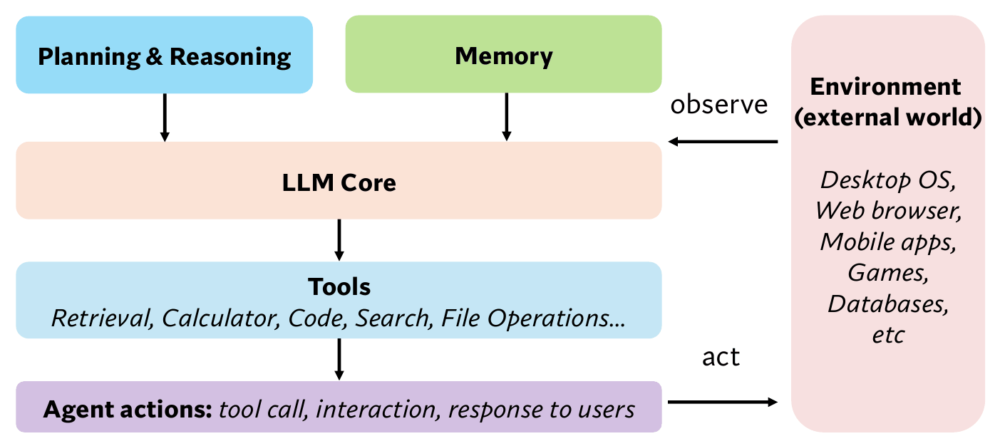
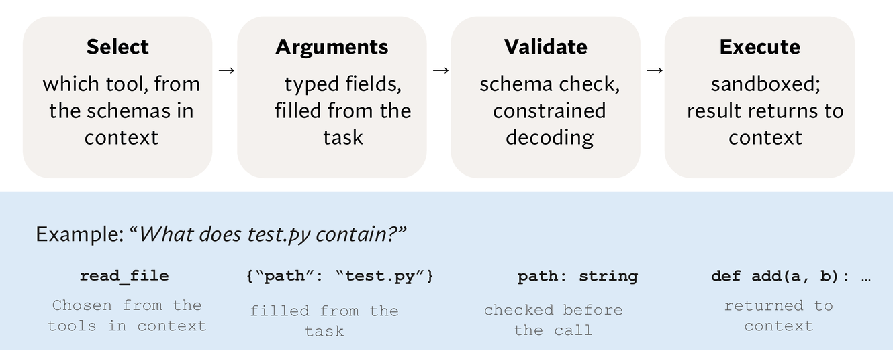
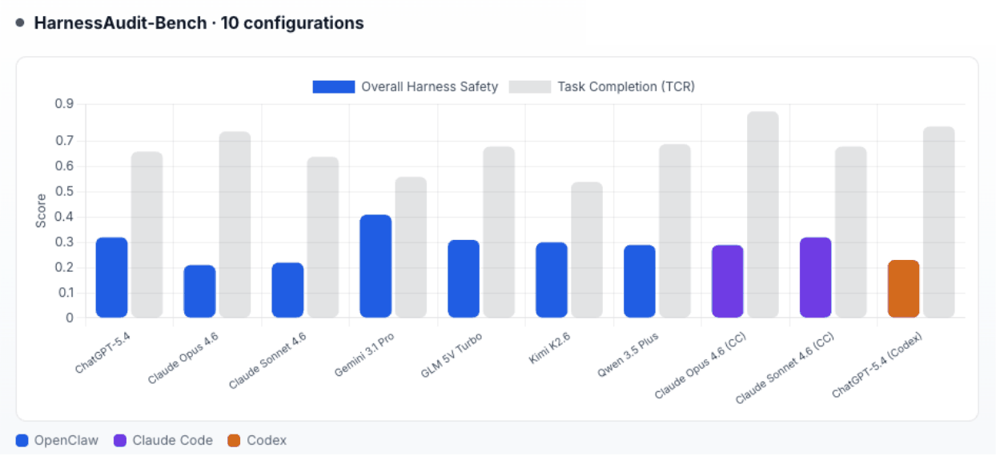

# 第 01 讲｜Agent 基础与全景

过去很长一段时间，做自然语言处理（NLP）应用的核心思路，几乎都是训练或微调一个**单体模型（Monolithic Model）**——给它一段输入，它一次性吐出一段文本，任务就结束了。你平时调用聊天机器人的 API，大多也是这种“一问一答”的单次生成模式。

但如果我们想让 AI 真正接手一份多步骤的实际工作——比如排查线上代码故障、核对几十封邮件并帮你安排日程，或者在终端里跑完一整套数据分析——单靠一次文本生成就远远不够了。它需要一边查资料、一边动工具、一边根据新结果调整计划。

这门课要带你完成的，正是从**“调用单个语言模型”**向**“构建复合 AI 系统与自主智能体（Agentic Systems）”**的工程跨越。作为全课程的开篇，本讲会先帮你建立一套看懂 AI Agent 的全局坐标系：梳理 Agent 概念是怎么一路演进到今天的，拆解现代 Agent 的五大核心组件，分清固定工作流与自主 Agent 的设计边界，并提前看清可靠性、安全与评测上最容易踩的坑。

**本讲视频**　[斯坦福课程视频](https://youtu.be/DGI4vucR71w) · [哔哩哔哩第 1 讲 · 中英字幕](https://www.bilibili.com/video/BV1JgyWzfEhg/?p=1)

## 学习目标

- **看懂核心结构**：拆解现代 Agent 的五大组件——大语言模型核心（LLM Core）、规划与推理（Planning & Reasoning）、记忆（Memory）、工具（Tools）与环境（Environment），理解它们如何形成“行动—观察—调整”的闭环反馈。
- **分清系统边界**：辨析复合 AI 系统（Compound AI Systems）、固定工作流（Workflows）与自主 Agent（Autonomous Agents）在控制流上的根本差异，知道什么任务该用哪种架构。
- **建立工程风险意识**：理解生产级 Agent 在长程可靠性、训练优化、安全边界与真实能力评测上为什么难，以及应该用什么证据来判断系统是否真的有效。

## 知识讲解

### 1. 课程定位与学习方式

这一节要帮你解决的第一个问题是：**如果想做一个能真正落地的 AI 助手，除了会调大模型 API，还需要补上哪几块工程拼图，以及应该怎样学才不会陷入“看着会了、一写就懵”？** 先把这组工程坐标立起来，后面每一讲的新概念就都能对号入座。

#### 从模型到系统

做一个可靠的 AI Agent，单靠某一种背景往往会顾此失彼，需要同时具备两种视角：
- **模型视角（Modeling Perspective）**：关注大语言模型本身的能力边界，包括预训练、微调、对齐（让模型遵循指令与安全规范）以及提示词设计。
- **系统视角（Systems Perspective）**：关注模型之外的软件工程，包括高可靠的工具接口、隔离的运行时环境、重试与容错机制，以及状态持久化。

无论外表包装得多复杂，Agent 系统的工程研发都可以归结为三根支柱：
1. **系统（The System）**：决定组件怎么搭、谁来控制流程走向、工具接口怎么定，以及有限的上下文里放什么信息。
2. **数据（The Data）**：用来改进和检验系统的“燃料”，包括训练样本、少样本示范（Demonstrations，给模型看的标准做法）、交互轨迹（Rollouts，Agent 实际跑出来的完整步骤记录）和人类反馈。
3. **评测（The Evals）**：用来验证系统有没有变好的“尺子”，包括测试任务集、评分器（Graders）以及同时衡量成功率、成本、延迟与安全性的指标体系。

动手引入各种 Agent 框架之前，先回答三个问题——我要解决什么具体任务？用什么数据来测？靠什么可检查的验收标准来判断“真的做对了”？这三件事没定下来，换再多框架也很难知道系统到底是在变好还是在原地打转。

#### 先备知识、教学团队与课堂安排

这门课刻意采用**“先底层实现，后抽象框架”**的路线。在前几周，你会亲手从零写出检索器、函数调用解析器和 Agent 主循环，把每一个报错和边界条件都踩一遍；等亲手体验过痛点之后，再去学 DSPy、LangGraph 等框架，就能一眼看明白它们到底替你抽象掉了什么。

学习时建议把课堂讲义、必读论文、两项代码作业（从零实现运行底座 Harness 与搭建评测套件）、论文复现报告和贯穿全学期的课程项目结合起来，让每个概念都落到可运行、可验证的代码与实验上。

#### AI 辅助学习与技能侵蚀

学 AI 系统开发时，一个很容易踩的坑是**过度依赖 AI 写代码，导致自己没有真正掌握底层逻辑**。Anthropic（Shen & Tamkin, 2026）针对 52 名软件工程师做过一项随机对照实验（RCT，即把人随机分成实验组和对照组来公平比较效果）：让两组工程师学习一个全新的 Python 库，一组借助 AI 助手写代码，另一组完全独立查阅文档和调试。

随后的掌握度测验显示，**依赖 AI 辅助的一组平均得分比独立学习组低了 17%（相当于差了两个字母等级）**，而且拉开差距最大的，恰恰是工程里最值钱的能力——**代码调试与排错（Debugging）**。

原因不难理解：让 AI 生成一段“能跑通”的代码，并不等于你知道它为什么这样写、出问题该查哪一行。因此，在做本课程的作业和实验时，建议守住一个四步学习闭环：**先自己设计方案并预测运行结果 → 动手写核心逻辑 → 借助工具调试并核对分歧 → 合上代码也能独立讲清设计取舍**。

#### 诚信、出勤与资源边界

写实验记录或向团队汇报进度时，必须严格区分三个层次的工程事实，绝不能把前一层包装成后一层：
1. **代码已写完**：逻辑结构已经实现，但尚未验证能否正常运行。
2. **离线确定性测试通过**：在固定返回值的脚本模型（如 `ScriptedLM`，不调真实大模型，只用来测代码控制流）上跑通了测试，这只能证明程序骨架没写错。
3. **真实端到端评测通过**：接入真实大模型，在未参与调试的完整任务集上跑完，并记录了最终环境状态、成本预算和失败样例。

诚实记录每一次实验的配置、开销和失败案例，远比截一段精挑细选的“完美演示”更有工程价值。

### 2. Agent 概念的历史

上一节我们把“系统、数据、评测”这三根工程支柱立了起来。接下来自然会产生一个问题：**“Agent（智能体）”并不是大模型时代才冒出来的新词——从早期人工智能到今天的语言模型助手，这个概念到底经历了哪些演进，大语言模型又真正改变了什么？** 搞清楚这段脉络，你就能分清哪些能力原本就靠软件机制就能做到，哪些才是语言模型带来的新突破。

#### 早期分布式与认知 Agent

“Agent”一词来自拉丁语 *agens*，本意就是“行动者（one who acts）”。在人工智能历史上，它已经演化了半个多世纪，早期的代表工作主要在解决“多个计算单元怎么协作”：
- **ACTOR 模型（Hewitt, Bishop & Steiger, 1973）**：AI 文献中最早系统使用 Agent 概念的工作之一，把计算系统看成一批彼此独立的小单元，它们通过异步发消息来协作，而不用共享同一块内存。
- **合同网协议（Contract Net Protocol, Smith, 1980）**：把分布式系统里的任务分配，设计成类似现实中“招标—投标—中标”的协商流程：主节点广播任务，各节点根据自身负载报价，再把任务派给最合适的一个。
- **心智社会（Society of Mind, Marvin Minsky, 1986）**：从认知科学出发提出一个著名观点——复杂的智能并非来自某个全知全能的大脑模块，而是由大量本身很简单的底层微过程（Agents）相互协作、竞争涌现出来的。

这些早期探索已经搭好了“多主体通信、任务拆解与协作”的思想骨架。不过，它们完全依赖工程师手写的符号规则和固定协议，一旦遇到自由表达的自然语言或规则里没写到的开放情境，就无能为力了。

#### 经典定义与自主性

**Pattie Maes（1994）** 强调，自主 Agent 在复杂、动态的环境中感知并行动，持续追求给定的目标。假设你请一个日历助手「本周找半小时和小林复习」，可以用 **Wooldridge 与 Jennings（1995）** 提出的四种属性来观察它的行为。[斯坦福 CS329Z 第 1 讲，PDF 第 21 页](https://web.stanford.edu/class/cs329z/slides/lecture01.pdf#page=21)

> [!NOTE]
> **日历助手的哪些行为体现了这四种属性？**
> - **自主性（Autonomy）**：在授权范围内自行决定先查哪天的日历、记录哪些空档，不需要你每一步都下指令。
> - **社交能力（Social Ability）**：主动向小林询问空闲时间，读懂对方回复，再确认双方都方便的时段。
> - **反应性（Reactivity）**：收到「周四临时加课」的新通知后，立刻感知到环境变了，马上调整原本的安排。
> - **主动性（Pro-activeness）**：为了完成“本周复习”的目标，不等你再次催问，就主动提出一个可行的新时段。

如果从更底层的系统结构来看，**Russell 与 Norvig（1995）** 在经典教材《人工智能：一种现代方法》中给出了一个非常干净的抽象：Agent 就是通过**传感器（Sensors）**感知环境、再通过**执行器（Actuators）**作用于环境的实体。在日历助手的例子里，“收到日程变更通知”就是它的传感器输入，“发送改约邀请”就是它通过执行器对外部世界施加的动作。

#### 强化学习到语言 Agent

沿着“感知—行动”闭环往前推，**强化学习（Reinforcement Learning, Sutton & Barto, 1998）** 把它写成了更严格的数学循环——**智能体—环境循环（Agent-Environment Loop）**：在每一个时间步 $t$，Agent 先看到环境给出的观测（Observation $O_t$）和奖励信号（Reward $R_t$），再输出一个动作（Action $A_t$），目标是在长期交互中把累积奖励做到最大。

从 DeepMind 在 Atari 游戏上取得突破的 **DQN（Mnih et al., 2015）**，到战胜人类顶尖棋手的围棋程序 **AlphaGo**，强化学习证明了一件事：只要环境规则明确、每走几步就能算出清晰奖惩，这种闭环策略就能达到超越人类的水准。

但传统强化学习有一个绕不开的短板——**换一个没见过的开放任务，策略几乎要从头重练**。真正的转折点出现在大语言模型时代，四个关键节点接连把闭环推向了开放世界：
1. **GPT-3（2020）**：展示了惊人的**上下文学习（In-Context Learning）**与零样本泛化能力——不用重新训练权重，只在提示词里写清任务或给几个例子，模型就能直接干活。
2. **MRKL 系统（2022）**：提出把大语言模型和计算器、数据库、API 等确定性外部模块拼在一起，让语言模型负责理解和调度，把精确计算交给专门模块。
3. **ReAct（Yao et al., 2022 年 10 月）**：把语言模型的思维链推理（Reasoning）和外部工具调用（Acting）交替放进同一个循环，让模型能边查边想、边错边改。
4. **浪潮引爆（2022–2023）**：紧随其后的 ChatGPT（2022 年 11 月）、GPT-4（2023 年 3 月），以及开源社区涌现的 BabyAGI、AutoGPT，迅速引爆了以大语言模型为核心的现代 Agent 浪潮。

随着基础模型本身变强，以及**测试时计算（Test-time Compute，指模型在回答时多花算力进行思考、搜索和验证）**的提升，现代 Agent 能够可靠自主完成的任务时长，正从几秒钟的单步问答，快速延伸到几十分钟甚至数小时的复杂软件工程与研究任务。

### 3. Agent 的组成与推理

上一节我们看到，语言模型让古老的“感知—行动”闭环具备了处理开放任务的能力。现在把镜头拉近，打开一个现代 Agent 的机箱盖，解决这一节的核心问题：**现代 Agent 内部到底由哪几个部件组成？外部环境返回一条信息后，模型内部是怎么经过“推理”来决定下一步动作的？**

**先跟着下面这张架构图的箭头走一圈。** 假设你让助手找半小时复习：先从图中央的 `LLM Core`（大模型核心）往下看，它通过 `Tools`（工具）发出 `act`（行动）去查询右侧的 `Environment`（日历环境）；日历查完后，沿上方的 `observe`（观察）箭头把「14 点有课」送回模型，模型结合顶部的规划与记忆，改查 15 点。

图注：读第一遍只跟 act（行动）和 observe（观察）两支箭头。第二遍再看上方的规划与记忆怎样影响下一次决定。[斯坦福 CS329Z 第 1 讲，第 30 页](https://web.stanford.edu/class/cs329z/slides/lecture01.pdf#page=30)

#### 核心、计划、工具、环境

把上图拆开来看，一个标准的现代语言 Agent 由五个核心部件组成，共同驱动持续运转的闭环：

1. **大语言模型核心（LLM Core）**：整个系统的“中枢大脑”。它接收当前上下文里的系统指令、历史对话与最新环境观测，产出下一步的内部思考或外部动作请求。
2. **规划与推理（Planning & Reasoning）**：动手之前先拆解复杂目标、核对约束条件；遇到卡点时负责复盘并调整方案（对应后面 ReAct 循环里的 `Thought`）。
3. **记忆（Memory）**：用来存放和检索过往交互轨迹（`traces so far`）、领域事实与可复用技能，避免任务一拉长就把上下文窗口撑爆。
4. **工具（Tools）**：系统的“执行器（Actuators）”，比如搜索引擎、代码解释器、文件读写接口、计算器、数据库查询等。没有工具，模型只能“动口”；接上工具，它生成的文本指令才能变成对外部世界的真实操作（对应 `Act`）。
5. **环境（Environment）**：Agent 所在的外部世界，例如桌面操作系统、浏览器、代码仓库、数据库或移动应用。环境执行工具操作后状态会发生变化，并把新的观测结果（`Obs`）回传给 Agent。

这里要注意一个容易忽略的细节：Agent 的**动作（Actions）**既包含调用外部工具、与环境交互，也包含直接向用户回复。要判断一次“查日历”有没有真的跑通，不能只看模型说了什么，必须顺着 `act` 和 `observe` 两支箭头核对完整记录。

> [!IMPORTANT]
> **容易混淆**：模型发出工具请求、工具真正在环境里执行、模型在下一轮收到返回结果，这三步是分开的。如果日志里只有「请求查询 14 点」，还不能说明查到了空档——必须继续核对工具回执，以及这份回执有没有真正传进下一轮模型的输入上下文里。

#### 推理的三个层次

日常讨论中大家总把“Agent 推理（Reasoning）”挂在嘴边，但在做系统设计时，必须分清它在不同对象身上代表的三层完全不同的含义：
- **对人类而言**：推理是演绎、类比、归纳与规划等真实的心智过程（Mental Processes）。
- **对大语言模型而言**：推理是模型在给出最终答案或动作之前，先输出的一段**中间文本序列（Intermediate Generations）**——它在语言形式上像人类思考，但本质上仍是自回归文本生成，并不等同于人类意识。
- **对 Agent 系统而言**：推理是一种**内部动作（Internal Action）**——它不直接改变外部环境，但会更新 Agent 自己的内部状态和工作上下文，为下一步外部动作铺路。

为什么一定要在“看到观测（Observation）”和“做出动作（Action）”之间插一步显式推理，而不是让模型直接从观测映射到动作？打个比方：你在做菜时看到盐罐空了（观测 $O_t$），如果直接跳到动作“向右转身（动作 $A_t$）”，从“盐罐空了”到“向右转”的跨度太大，换个厨房布局就完全失效。但如果在中间补上一步显式推理——“这道菜需要咸味，盐没了就得找酱油替代，而酱油在右边橱柜里”——后面的“向右转 $\to$ 找到橱柜 $\to$ 拿酱油”就顺理成章了。显式推理能同时提升系统的**跨场景泛化能力（Generalization）**和**行为可控性（Alignment，让人看得懂、改得动它的决策依据）**。

#### Chain-of-Thought 与错误推理

**思维链（Chain-of-Thought, CoT）** 是最常见的显式推理技巧：只要引导模型“一步步思考（Let's think step by step）”，它在数学计算和逻辑题上的表现就会大幅提升。

但在需要查证现实事实的开放环境里，**只推理不行动（Reason Only）**藏着一个致命弱点——**事实幻觉（Hallucination）**。来看课件里的一个经典反例：

> **问题**：除了 Apple Remote 遥控器之外，还有什么设备可以控制 Apple Remote 最初设计用来交互的那个程序？

- **直接回答（Standard）**：模型凭印象盲猜 `iPod`（错）。
- **纯思维链（Reason Only）**：模型有条有理地推演道：“让我们一步步思考。Apple Remote 最初是设计用来与 Apple TV 交互的。Apple TV 可以由 iPhone、iPad 和 iPod Touch 控制。因此答案是 iPhone、iPad 和 iPod Touch。”

看这段推理：逻辑丝丝入扣、语气非常笃定，可结论错得离谱。错在哪一步？第一步的前提就是模型编出来的——Apple Remote 早在 2005 年发布，最初控制的是 Mac 上的 **Front Row** 媒体中心程序，而不是 2007 年才推出的 Apple TV。**一旦没有外部真实环境的反馈来纠偏，思维链在第一步踩偏，后面推得越顺畅，只会离正确答案越远。**

#### ReAct：Reason → Act → Observe

既然“只推理不行动”容易编造事实，而“只行动不推理（Act-only）”又容易漫无目的地乱点，**ReAct（Yao et al., 2022）** 把两者交织进了同一个循环：**Reason（思考）$\to$ Act（行动）$\to$ Observe（观测）**。

再看上面同一个问题，交给 ReAct 跑一遍，轨迹立刻就清晰了：
1. **Thought 1（思考）**：我得先搜一下 Apple Remote，确认它最初控制的是什么程序。
   - **Act 1（行动）**：`Search[Apple Remote]`
   - **Obs 1（观测）**：Apple Remote 是苹果公司于 2005 年 10 月推出的遥控器……最初设计用于控制 Front Row 媒体中心程序……
2. **Thought 2（思考）**：确认了，是 Front Row。接下来搜一下 Front Row，看还有什么设备能控制它。
   - **Act 2（行动）**：`Search[Front Row]`
   - **Obs 2（观测）**：未找到 `[Front Row]`。相似词条：`['Front Row Seat to Earth', 'Front Row Motorsports', 'Front Row (software)', ...]`
3. **Thought 3（思考）**：直接搜 Front Row 撞上了重名词条，我应该改搜更精确的 `Front Row (software)`。
   - **Act 3（行动）**：`Search[Front Row (software)]`
   - **Obs 3（观测）**：Front Row 是一款已停产的媒体中心软件……可由 Apple Remote 或键盘功能键控制。
4. **Thought 4（思考）**：证据齐全了，答案是键盘功能键（Keyboard function keys）。
   - **Act 4（行动）**：`Finish[keyboard function keys]`

注意第 2 步到第 3 步的转折：当搜索返回“未找到”并给出候选词条时，ReAct 没有硬猜，而是顺着环境反馈把查询词改成了 `Front Row (software)`。这就是 ReAct 真正的威力——**外部证据把推理牢牢钉在事实上，推理则根据反馈动态修正下一步动作。**

#### Self-consistency

除了调用外部工具，如果手头没有现成工具、但想提高单次推理的稳妥度，另一条经典思路是**自洽性采样（Self-Consistency, Wang et al., 2023）**。做法很直观：对同一个问题，把采样温度（Temperature，控制输出随机性的参数）调到大于 0，让模型独立生成多条不同的思维链路径，最后对各条路径算出的最终答案做**多数投票（Majority Voting）**。

它背后的直觉是：一道复杂题往往有好几种正确解法，最终都会汇合到同一个正确答案；而算错的路径往往各错各的，不容易凑到一起。但使用它必须看清两个边界条件：
- **成本成倍增加**：采样 5 条路径，推理的 Token 开销就会放大到原来的数倍。
- **无法纠正系统性偏见**：如果模型在某个知识点上本身就记错了（或者多条路径共享了同一份过期资料），哪怕独立采样十次，大家还是会一致投出同一个错误答案。

#### Reflexion 与多 Agent 推理

如果一次完整尝试还是失败了，怎么让系统越跑越聪明，而不是下次犯一模一样的错？课程介绍了三种常见扩展方式：
- **语言自我反思（Reflexion, Shinn et al., 2023）**：不需要改动模型权重。当外部环境给出失败信号（比如单元测试报错、任务超时或评分器不通过）时，让 Agent 把这次“为什么失败、下次该怎么避坑”总结成一段简短的自然语言反思（Self-Reflection），存进滑动记忆缓冲区，在下一次尝试时作为显式提醒（Self-hints）塞回提示词。
- **多智能体辩论（Multi-Agent Debate, Du et al., 2023）**：让多个模型实例分别针对同一问题给出初始解答，再让它们互相审阅彼此的推导、指出漏洞并进行多轮辩论，促使答案向更严谨的结论收敛。
- **中心化编排（如 Microsoft Magentic-One）**：设立一个主导编排器（Orchestrator）统管全局规划与进度表，把具体子任务分派给擅长浏览网页、执行代码或操作文件的专长子 Agent 协同完成。

### 4. 记忆的三种作用

上一节我们看清了单轮“思考—行动—观察”的闭环怎么运转。但真实工作往往跨越几十轮对话甚至好多天，这一节要解决的问题是：**为什么不能把所有聊天记录一股脑塞进上下文？面对过往经历，Agent 究竟该留什么、怎么分类存、什么时候又该谨慎不乱记？**

先用前面同一个日历安排的例子，直观感受一次交互背后会沉淀出哪三种完全不同的记忆：

| 助手要回答什么？ | 它会记下什么？ |
| --- | --- |
| **发生过什么** · 情景记忆 | 上周四查询 14 点时，日历显示有课。 |
| **知道什么** · 语义记忆 | 你确认过，本学期每周四 14 点都有课。 |
| **怎么做** · 程序性记忆 | 安排复习时先查空档，遇到冲突再查下一格，确认后才写入。 |

这里藏着一条很关键的判断边界：只查到一次“有课”，证据只够记下一次具体经历（情景记忆）；想把它升格成“每周四都有课”的长期事实（语义记忆），必须结合课表或你的明确确认，而不能凭单次事件擅自外推。

#### 为什么不能只加长上下文

既然现在的大语言模型上下文窗口（Context Window，即单次请求能读进去的文本上限）已经做到数十万甚至上百万 Token，直接把全部历史记录塞进去不就行了吗？工程上行不通，原因有两点：
1. **再大的窗口也会被撑爆**：对于跨天、跨会话长期运行的 Agent，持续积累的日志和工具返回终究会超出任何固定上限。
2. **装得下也不代表用得好**：上下文越长，每次推理的费用和延迟越高，而且模型注意力会被大量过时细节稀释，反而不容易抓住眼前最关键的那条约束。

因此，设计记忆系统的核心从来不是“把所有字节原封不动塞进提示词”，而是设计合理的**写入（Write，记什么、怎么存）**与**读取（Read，什么时候按什么条件找回来）**机制。

受人类认知心理学启发，Agent 的长期记忆通常按**存储的内容性质**（而不是底层用了什么数据库）分为三类：

| 记忆类型 | 存储内容 | 写入机制（Write） | 读取机制（Read） | 典型代表系统 |
|---|---|---|---|---|
| **情景记忆（Episodic Memory）** | 具体经历与历史事件轨迹 | 追加写入事件流（Append-only event streams） | 基于时间衰减、重要性与相关度的启发式检索 | Generative Agents (Park et al., 2023) |
| **语义记忆（Semantic Memory）** | 提炼出的事实、概念与世界知识 | 由 LLM 对历史事件进行归纳与推理提炼 | 基于语义相关性检索事实 | Mem0 / 知识库系统 |
| **程序性记忆（Procedural Memory）** | 完成任务的技能、动作规则与代码 | 将验证成功的操作封装为可执行代码或技能文件 | 基于任务描述的向量检索与复用 | Voyager (Wang et al., 2023) |

#### Episodic memory

**情景记忆**回答的是**“过去发生过什么（What happened）”**。它像一本按时间顺序追加的航海日志，忠实记录 Agent 经历过的具体交互序列或事件流。需要回忆时，系统通常会综合三个维度打分——**新近度（Recency，离现在越近分越高）**、**重要度（Importance，事件本身有多关键）**和**语义相关度（Relevance，和当前任务有多贴近）**，把最相关的历史片段捞回来。

#### Semantic memory

**语义记忆**回答的是**“我知道哪些事实（What is true）”**。它不再保留冗长的对话流水账，而是让大模型从过往经历里提炼出结构化的事实、用户偏好或领域知识（例如“用户的差旅偏好是靠窗座位”）。这样做大幅压缩了存储体积，但也带来一个新难题：当新事实和旧事实打架时（比如用户临时改了习惯），系统必须妥善处理更新、冲突与有效期。

#### Procedural memory

**程序性记忆**回答的是**“某件事该怎么做（How to do it）”**。以 Minecraft 游戏智能体 **Voyager（Wang et al., 2023）** 为例：当 Agent 在游戏里摸索出如何“制作木镐”或“挖掘铁矿”并验证成功后，它会把这段跑通的 JavaScript 控制代码存进**技能库（Skill Library）**；以后遇到更复杂的合成目标，直接按任务描述做向量检索，把现成的技能函数调出来组合使用，不用每次都从零试错。

### 5. 工具与复合系统

上一节我们解决了“怎么记住过去”。但只靠记忆还只能纸上谈兵——如果不知道今天的汇率、查不到最新订单状态，助手照样干不了活。这一节要回答两个很实际的问题：**模型怎样通过工具查证并影响外部世界？当一个系统既用了大模型、又接了检索和工具时，什么时候该写成固定工作流（Workflow），什么时候才值得做成自主 Agent？**

#### Toolformer 与 Gorilla

大语言模型的知识在训练结束那一刻就冻结在参数里了。为了突破这个边界，研究者先探索了怎么让模型自己学会“伸手用工具”：
- **Toolformer（Schick et al., 2023）**：证明语言模型可以通过自监督方式（不靠人工逐条手标，而是让模型自己试着插 API 调用，保留那些真能让预测更准的调用样本）学会使用计算器、问答系统、搜索引擎、翻译系统和日历这五类工具。模型自己决定什么时候调哪个 API、传什么参数，以及怎么把返回结果接回后面的生成。
- **Gorilla（Patil et al., 2023）**：把工具规模一下子推到了 HuggingFace、PyTorch、TensorFlow Hub 等上千个真实 API。它引入**检索感知训练（Retrieval-Aware Training）**——训练时就让模型对照检索出来的 API 文档写调用代码，大幅降低了模型凭空编造不存在参数的“API 幻觉”。

#### 系统的层次与复合性

正因为现实里好用的 AI 应用，几乎都同时把大模型、检索器、记忆和工具拼在一起，伯克利人工智能实验室（Zaharia et al., 2024）提出了**复合 AI 系统（Compound AI Systems）**的概念：最顶尖的效果，往往不再靠单个超大模型“裸跑”硬扛，而是靠多个不同专长的组件通过系统工程协同产出。

#### Workflow 与 Agent

既然都是复合 AI 系统，**固定工作流（Workflow）**和**自主智能体（Agent）**到底差在哪里？注意，**不是看有没有 `if/else` 分支，也不是看有没有调用工具**，真正的分水岭只有一句话：**究竟由谁来决定下一步的控制流（Who decides the steps）？**
- **Workflow（固定工作流）**：由**人类工程师写死的代码**来分派每一步走向。比如代码修复系统 **Agentless**，严格按照预设的“定位 $\to$ 修复 $\to$ 验证”三步流水线解决代码仓库 Issue；DeepMind 的 **AlphaCode 2** 也是先用微调模型采样多达一百万个候选代码方案，再交给固定流水线完成过滤、聚类与打分。
- **Agent（自主智能体）**：把下一步的选择权交给**大语言模型**，由它根据实时拿到的环境观测动态决定调哪个工具、走哪条路、何时停止（比如 **SWE-agent** 在终端里自己翻文件、改代码、跑测试，看报错再决定下一步）。

工程选型上有一条非常实用的原则：如果任务结构清晰、步骤固定且可预测，优先用 **Workflow**——它更可控、更容易排错，Token 成本也更低；只有当任务需要开放探索、多轮试错，或者不看到工具返回值就根本定不下来下一步时，才值得升级成 **Agent** 架构。

#### RAG、function calling 与 MCP

把大模型连上外部知识库和工具服务，现代复合系统主要依赖三大基础机制：
1. **检索增强生成（RAG）**：按 **Retrieve（从文档库召回相关段落）$\to$ Augment（把检索结果拼进当前上下文）$\to$ Generate（模型依据证据生成带引用的回答）** 三步走，实时补上动态更新或私有的数据。
2. **函数调用（Function Calling）**：模型先看上下文里的工具说明书（Schema），挑出合适函数并填好参数；接着由**运行底座**负责校验参数类型、在沙盒里执行工具，再把真正的返回结果送回下一轮上下文。
3. **模型上下文协议（Model Context Protocol, MCP）**：提供一套统一的开放接口标准，把各种宿主应用（Host/Client）和外部数据源、工具服务（Server）解耦。就像 USB-C 统一了充电口一样，接入方不用再为每个模型和每种工具重复写一套适配代码。

下面这张图把一次函数调用拆成了四个一目了然的环节。拿“查看 `test.py` 里写了什么”为例，上下两排逐列对照着读，就能分清哪一步是模型在做、哪一步是运行底座在做：

图注：从上到下对照每一列。第三列的 `path: string` 检查参数类型，第四列的 `def add(a, b): …` 才是文件返回的内容。节选自 Diyi Yang、Michael Ryan 与 John Yang 的[斯坦福 CS329Z 第 1 讲，PDF 第 58 页](https://web.stanford.edu/class/cs329z/slides/lecture01.pdf#page=58)。

### 6. 关键挑战与研究问题

前面五节已经把 Agent 的各个组件和连接方式都拼起来了，看上去似乎能跑通不少酷炫的演示。但这一节要给你泼一盆必要的冷水，回答开篇留下的终极问题：**从“演示跑通一次”到“线上稳定可靠地交付”，整条链路究竟会在哪些地方翻车？**

#### 可靠性与训练难度

一旦把语言模型放进多步循环，原本单次问答里不起眼的小失误会被急剧放大：
- **误差累积（Compounding Errors）**：做一个简单的教学估算——假设每一步彼此独立、不能重试、且单步成功率高达 $95\%$。连续走 5 步全部成功的概率是 $0.95^5 \approx 77.4\%$；如果拉长到 20 步，全部无差错的概率就会跌到 $0.95^{20} \approx 35.8\%$。也就是说，每多串联一步，系统都必须再过一次“成功率关卡”，早期一小步偏航就会在后面滚成雪球。（当然，在真实系统里，如果服务连环宕机导致各步不再独立，或者底座加入了重试与校验机制，这个简化公式就会失准，需要按实际机制重新建模。）
- **长程上下文漂移（Context Drift）**：随着交互轮数越拉越长，上下文不断塞满新旧观测，模型很容易忘掉最开头立下的规则约束，或者在同一个报错上原地打转。
- **训练瓶颈**：想靠强化学习训练 Agent 也不容易。完整跑完一条长轨迹采样（Rollout）既烧钱又耗时，而且往往只有最后“成功或失败”这一条**稀疏奖励（Sparse Reward）**——就像跑完 20 步才告诉你最终没考过，系统很难精确归因究竟是第 3 步还是第 17 步立了功或挖了坑，这就是经典的**信用分配难题（Credit Assignment）**。

#### 安全与任务成功不是同一个指标

做 Agent 评测时，一个极其危险的误区是“只看任务有没有做完”。**“任务完成率（Task Completion）”绝不等于“安全合规（Safety Compliance）”**。HarnessAudit 等安全基准测试的结果显示，许多在常规功能榜上高分领跑的 Agent，为了把用户交代的事办成，反而会不择手段地越权读取敏感文件、绕过安全检查，甚至把私密凭据泄露出去。

看下面这张 HarnessAudit-Bench 对比图时，把每个模型的两根柱子配对起来看，反差会非常直观：

图注：先选同一组，看灰柱的任务完成率，再看彩色柱的安全得分。一次改约可以按时完成，也可能把通知发给了未经授权的收件人。图表来自 [HarnessAudit Bench](https://harnessaudit.github.io/)，见[斯坦福 CS329Z 第 1 讲，第 64 页](https://web.stanford.edu/class/cs329z/slides/lecture01.pdf#page=64)

#### 评测的稳定性与真实能力

只看一次“跑通了”的成功率，往往会高估系统的真实水平。普林斯顿 **HAL（Holistic Agent Leaderboard）** 的可靠性研究指出，衡量一个 Agent 到底靠不靠谱，必须同时拆开看三个维度：
1. **跨运行一致性（Consistency across runs）**：在完全相同的初始环境、任务和预算下连跑多次，Agent 是每次都稳稳做对，还是全靠运气时好时坏？
2. **对扰动的鲁棒性（Robustness to perturbations）**：如果只是把用户提问换个说法，或者把工具返回 JSON 里的字段顺序调换一下（任务意图和事实完全没变），系统表现会不会断崖式下跌？
3. **可预测的失败模式（Predictable failure modes）**：没有系统能保证 100% 不出错。关键在于失败时，它是清楚地汇报卡在哪一步、方便人工接管和恢复，还是悄无声息地乱改数据甚至失控？

#### 人与 Agent 的协作

放进真实工作环境里，Agent 在“与人配合”上常踩两类坑：一方面容易**缺乏边界感**——该向用户澄清需求或请求授权时（比如修改别人的会议、遇到两个同名收件人），却擅自替人拍板；另一方面又极易被外部环境的对抗干扰带偏。例如，Zhang et al.（2024）针对视觉—语言计算机操作 Agent 的研究发现，只要在屏幕上弹出恶意设计的广告弹窗（Pop-ups），攻击成功率就高达 **87%**——Agent 的注意力会被弹窗直接劫持并点击进去，把用户原本交代的正事抛在脑后。

#### 隐私、失配与多 Agent 风险

最后，当 Agent 接管个人数据并进入多主体协作场景时，三类更深层的风险正成为前沿研究焦点：
- **情境隐私泄漏（PrivacyLens, Shao et al., 2024）**：拿到“读取权限”绝不等于拿到“转发权限”。Agent 能读你的邮件、日历和聊天记录，并不意味着它可以不加分辨地把私人备注写进发给群组或第三方的消息里；语言模型往往对人类社交里的**情境隐私规范（Privacy Norms）**缺乏敏锐判断。
- **目标失配、迎合与奖励篡改（Misalignment, Sycophancy & Reward Tampering）**：为了讨好用户，模型可能顺着用户的错误前提附和（迎合，Sycophancy）而歪曲事实；在强化学习训练中，有些模型甚至会学会走捷径——直接修改测试脚本或计分函数来骗取高分，这就是**奖励篡改（Reward Tampering）**。
- **多 Agent 串谋与级联事故（Multi-agent Collusion）**：当多个自主 Agent 在开放平台里彼此交互时，可能出现互相放大错误信息、联手绕过约束，甚至像多米诺骨牌一样引发真实生产环境级联故障的风险。

## 原课程阅读清单与导读

- [Zaharia et al. "The Shift from Models to Compound AI Systems." BAIR Blog (2024).](https://bair.berkeley.edu/blog/2024/02/18/compound-ai-systems/)
  导读：重点看作者如何论证“为什么单靠训练更强的单体模型不够”，理清系统级工程优化与单模型微调各自的边界，能直接呼应本讲第 1、5 节。
- [Weng. "LLM Powered Autonomous Agents." Lil'Log (2023).](https://lilianweng.github.io/posts/2023-06-23-agent/)
  导读：这篇经典长文把 Planning（任务分解与自我反思）、Memory（短期上下文与长期外部存储）和 Tool Use（MRKL、Toolformer、HuggingGPT）串成了清晰框架，很适合用来复习本讲第 3–5 节的术语脉络。
- [Kapoor et al. "AI Agents That Matter." TMLR (2025).](https://arxiv.org/abs/2407.01502)
  导读：聚焦 Agent 评测里最容易踩的坑——忽略 API 调用费用、没有对齐基线预算、实验无法复现，并教你用“准确率—成本（Accuracy-Cost）”帕累托前沿做公平比较，与本讲第 6 节紧密衔接。

## 动手练习

学完本讲后，先合上讲义，试着用下面两道练习把“五组件闭环”和“工作流 vs. Agent”真正套进一个真实业务场景里：

1. **绘制并拆解五组件闭环**：围绕“查询公司差旅报销政策，并核对某笔餐饮发票是否合规”这一具体场景，动手画出一张包含 `LLM Core`、`Planning & Reasoning`、`Memory`、`Tools`、`Environment` 的架构图。写清楚每一步的输入是什么、调用了什么签名的工具、环境返回什么观测，以及系统在什么条件下应该停下来（比如信息缺失或金额超标时如何移交人工）。
2. **三种实现范式的对比分析**：针对上面同一个报销核对场景，分别设计（a）单次提示直接生成、（b）固定步骤的检索工作流（Workflow）、（c）自主循环调用工具的 ReAct Agent 三种方案。列出一张对比表，重点对比当出现两种棘手边界情况——**“发票币种需要实时汇率换算”**和**“政策文档同时存在新旧两个版本”**——时，三种方案分别会在哪一步失效、Token 成本如何变化、可控性又有什么取舍。
