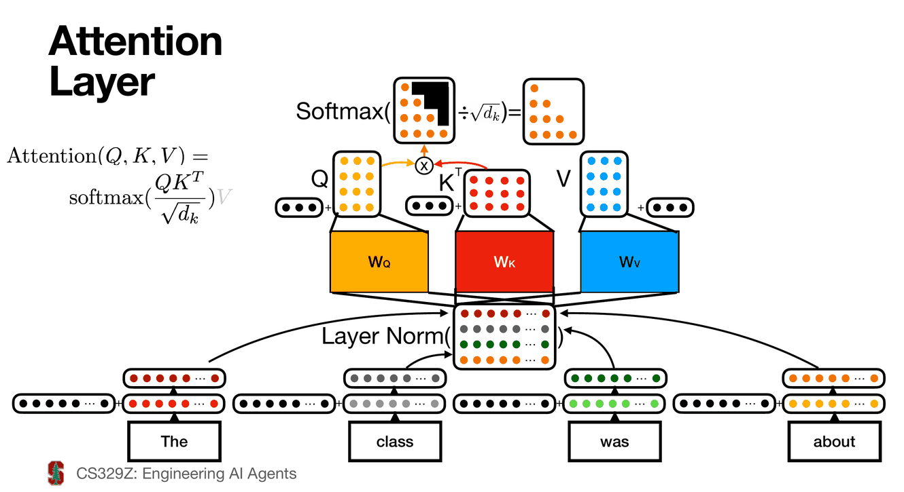
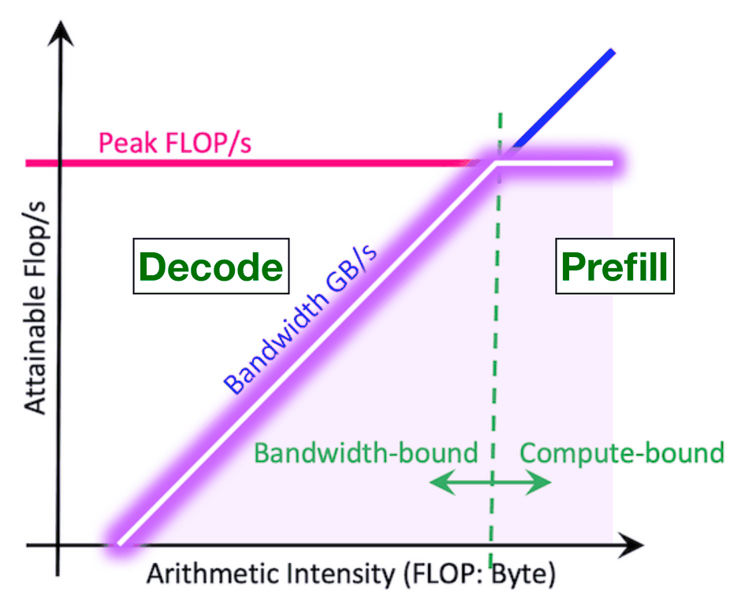
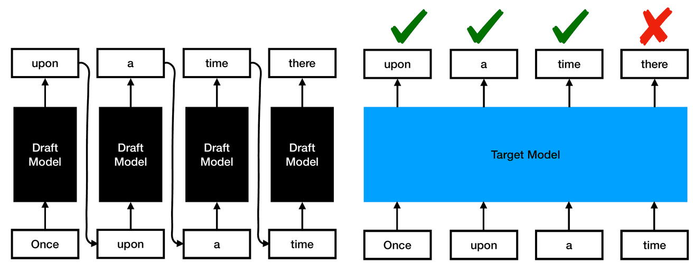

# 第 02 讲｜面向构建者的大语言模型

写 AI Agent 的工程师站在整个大模型技术栈的最顶层，但这绝不意味着可以把底层的语言模型当成一个黑盒“魔法”。只要真正上手做系统，你很快就会撞上一连串具体问题：为什么对话一长，助手就忘了最开头立下的规矩？为什么工具调用的 JSON 参数偶尔会少一个右括号？为什么等第一个字蹦出来要两秒，后面却刷刷地飞快吐字？为什么有的模型擅长在十万字长文里大海捞针，有的模型却更适合短上下文多步调工具？

这些问题光靠猜提示词是解决不了的，必须打开引擎盖看清大语言模型（LLMs）到底怎么工作。本讲站在“构建者”而非纯算法研究者的视角，带你沿一条完整链路走下来：从逐词预测与解码策略出发，拆解 Decoder-only Transformer 的内部数据流、注意力复杂度瓶颈与线性化变体，理清从预训练到强化学习的训练管线，最后落到推理加速、结构化输出约束与上下文工程（Context Engineering）的实战原则。

**本讲视频**　[斯坦福课程视频](https://youtu.be/Vr1NzH8bT44) · [哔哩哔哩第 2 讲 · UP 主「不做挖掘姬」整理上传](https://www.bilibili.com/video/BV1ARxc61Er2/?p=2)

## 学习目标

- **看懂文本是怎么一个词一个词生成的**：从条件概率链式法则理解自回归语言模型，掌握贪心（Greedy）、Top-$k$、Top-$p$、温度（Temperature）缩放与束搜索（Beam Search）的机制差异与任务取舍。
- **看清 Transformer 内部与长上下文瓶颈**：走通 Decoder-only Transformer 的核心数据流，对比标准全注意力（Full Attention）、线性注意力（Linear Attention）与混合注意力（Hybrid Attention）在并行训练、显存状态和精确回溯上的利弊。
- **理清模型能力是怎么“炼”出来的**：串联预训练（Pretraining）、中期训练（Mid-training）、监督微调（SFT）、偏好对齐（RLHF / DPO）与可验证奖励强化学习（RLVR）各自解决什么问题。
- **掌握落地最常用的系统优化与控制手段**：理解 GPU 算力与显存带宽瓶颈、KV Cache 复用、投机解码（Speculative Decoding）、测试时计算扩展（Test-time Scaling）、受限解码（Constrained Decoding）以及长上下文工程的实战原则。

## 知识讲解

### 1. 语言模型与解码

第 1 讲我们把 `LLM Core` 当成 Agent 的“中枢大脑”放进了架构图里。从这一节开始，我们正式打开这个大脑，先解决最基础的问题：**同一个提示发给大模型，为什么每次吐出来的回答可能不一样？“温度（Temperature）”“Top-$p$”“贪心解码”这些调 API 时常见的参数，背后到底在操控什么？**

#### 构建者的三层视角

现代大模型技术栈从下到上分成三层，先看清我们站在哪一层、和下面两层是什么关系：
1. **模型工程层（LLM Engineering）**：负责造引擎——分布式算力调度、Transformer 架构改进、底层 GPU 算子（Kernels）、缩放定律（Scaling Laws）、分词器（Tokenizer，把文本切成词元 ID 的组件）以及预训练和后训练基础设施（如斯坦福 CS336 涵盖的内容）。
2. **模型适配层（LLM Adaptation）**：负责调校引擎——指令微调（Finetuning）、知识蒸馏（Distillation，让小模型向大模型学习）、上下文学习（In-Context Learning）、低秩适配（LoRA，只微调少量新增参数的省显存方法）以及人类偏好对齐（如 RLHF、DPO）。
3. **系统应用层（LLM Applications）**：负责造整车——把模型组装成可靠的检索增强系统（RAG）、工具调用流水线、多智能体系统与主动式 Agent（正是本课程 CS329Z 的主场）。

虽然我们工作在最顶层，但下面两层的架构与训练决定，会直接转化为上层系统的能力上限、账单成本和各种奇怪的故障。

#### 序列概率与自回归

剥开所有包装，语言模型干的核心事情非常纯粹：把一段文本先切成一个个**词元（Token，可以是单词、子词或汉字片段）**序列 $x_1, x_2, \dots, x_n$，然后给整条序列算一个联合概率。根据概率链式法则，整句话出现的概率，等于“在已经看到前面所有词元的前提下，猜中下一个词元的条件概率”一路连乘起来：

$$P(x_1, x_2, \dots, x_n) = \prod_{t=1}^{n} P(x_t \mid x_1, \dots, x_{t-1})$$

拿句子 `"The class was about agents ."` 举例：模型依次算出 $P(\text{The}) = 0.0377$、$P(\text{class} \mid \text{The}) = 0.0001$、$P(\text{was} \mid \text{The, class}) = 0.0344 \dots$，再把它们乘到一起。写程序时你会立刻发现一个工程问题：几百个小于 $1$ 的小数连乘，很快就会小到超出浮点数精度变成 0（即**数值下溢 Underflow**）。因此，训练和推理代码里从来不直接连乘，而是先取对数，把连乘变成**对数概率之和（Sum of Log-Probabilities）**。

顺便分清机器学习里常提的一对概念：
- **判别式模型（Discriminative Models，如逻辑回归、SVM）**：只学“怎么给输入分类”，即条件边界 $P(y \mid x)$。
- **生成式模型（Generative Models）**：像语言模型这样直接建模整个序列的概率分布。正因为如此，它才能通过**逐个采样下一词元（Next-token Sampling）**，像滚雪球一样**自回归（Autoregressively）**地续写新文本——每吐出一个新 Token，就把它拼回输入末尾，再接着预测下一个。

#### Greedy、sampling、top-k、top-p

模型在时刻 $t$ 算完之后，给出来的并不是唯一一个词，而是整张词表上每个词元的概率分布。**解码策略（Decoding Strategy）**决定了究竟从这份概率表里挑哪一个词元输出。

用一个只有四个候选词（A、B、C、D）的小词表来直观对比，假设它们的概率依次为 55%、25%、15%、5%。保持这份分布完全不变，看四种策略各允许谁上场：

> [!NOTE]
> **同一份预测，哪些词元有机会被选中？**
> - **贪心解码（Greedy Decoding）**：每步死选第一名 A。虽然局部最稳，但一步只顾眼前最高分，可能会错过整句累计概率更高的路径。
> - **随机采样（Pure Sampling）**：按原始概率直接抽签，四个候选都有机会，连 D 都有 5% 的可能被抽中。真实词表有几万个词，长尾低概率词加起来的总概率往往很可观，容易突然冒出离谱的词。
> - **Top-$k$ 采样**：先截断只保留前 $k$ 名。设 $k=2$ 时，只留 A（55%）和 B（25%），把它们的概率重新归一化（变成 $55/80$ 和 $25/80$）后再抽签。
> - **核采样（Nucleus / Top-$p$ Sampling）**：按累计概率阈值截断。设 $p=0.9$ 时，A+B 合计 80% 还不够 90%，加上 C 达到 95% 才过线，于是在 A、B、C 中重新归一化后抽签。

注意 **Top-$k$ 与 Top-$p$ 在不同情境下的关键区别**：如果换到下一步，模型非常确定，A 一项就占了 95%，同样的 `top_p=0.9` 只会留下 A 自己（自动收窄候选）；而 `top_k=2` 还是会硬把只占 3% 的第二名塞进候选池里。

#### Temperature 的作用与概率缩放

调 API 时最常调的参数就是**温度（Temperature, $T$）**。它干的活是在抽签之前，先把概率分布“变尖”（更自信、更确定）或者“变平”（更发散、更有创意）。

**用一个小算例看清温度怎么改概率。** 假设下一步只有 A、B 两个候选词，温度 $T=1$ 时的原始概率是 $0.8$ 和 $0.2$（概率比 $4:1$）。固定模型和提示词，只调温度 $T$，两者的概率比会从 $4:1$ 变成 $4^{1/T}:1$：

| 温度 $T$ | A 与 B 的概率比（$4^{1/T}:1$） | 抽中 A 的概率 |
| --- | --- | --- |
| 0.5 | $4^2:1 = 16:1$ | $16/17$，约 94.1% |
| 1 | $4^1:1 = 4:1$ | $4/5$，即 80.0% |
| 2 | $4^{0.5}:1 = 2:1$ | $2/3$，约 66.7% |

> [!TIP]
> **容易混淆**：把温度从 2 降到 0.5，确实让 A 在**随机采样**时更容易被抽中；但注意，在这三个温度下 A 始终排第一名。所以如果你开的是**贪心解码**，不管温度设多少，三次选出来的都是 A。

背后的公式很干净：模型内部先算出未归一化的打分向量 **logits** $z_i$，除以温度 $T>0$ 后再做 Softmax 变成概率。如果手头只有 $T=1$ 时的原概率 $p_i$，等价操作是给每项取 $1/T$ 次幂再重新归一化：

$$P_i(T) = \frac{\exp(z_i/T)}{\sum_j \exp(z_j/T)} = \frac{p_i^{1/T}}{\sum_j p_j^{1/T}}$$

这里有个常见计算误区：千万不能把原概率 $p_i$ 直接除以 $T$ 再归一化——因为分子分母同除以常数 $T$ 会直接约掉，分布纹丝不动。另外，当最高分词元唯一时，$T \to 0$ 的极限会把几乎全部概率都压到第一名身上，效果等价于贪心解码。

#### Beam search 与任务权衡

贪心解码只看眼下这一步，可能捡了芝麻丢了西瓜。如果想找整句话累计概率更高的输出，可以用**束搜索（Beam Search）**：每一步同时保留 $B$ 条（称为束宽 Beam Width）累计对数概率最高的候选前缀，下一步把这 $B$ 条各自展开，再剪枝只留前 $B$ 条。

Beam Search 在机器翻译这类强约束任务里很常见，但代价是显存和计算开销直接乘以 $B$。而在 Agent 任务里还要警惕一件事：**语言模型给某条序列打出的概率最高，并不等于它调用的工具参数合法或真正完成了任务**。因此现代 Agent 很少用 Beam Search，更常见的做法是低温单路解码，或者干脆调高温度多采样几条候选，再交给外部验证器（Verifier，比如编译器或单元测试）来挑出真正对的那一条。

#### 架构演变

在进入下一节拆解 Transformer 之前，快速回看序列模型是怎么一步步演化过来的——每一次换代，都在解决上一代的记忆短板或算力瓶颈：
1. **N-gram 语言模型（2010 年以前）**：基于马尔可夫假设，只统计前 $N-1$ 个词一起出现的次数。视野极短，完全抓不住长距离依赖（比如开头的人名隔了十个词就忘了），遇到没见过的词组也没法泛化。
2. **前馈神经语言模型（Bengio et al., 2003）**：引入分布式**词向量（Word Embeddings）**，让意思相近的词在向量空间里离得近，开始具备跨词泛化能力。
3. **循环神经网络与长短期记忆网络（RNN, 2010 / LSTM, 1997 提出、2014 普及）**：靠一个不断滚雪球的隐藏状态 $h_t = f(h_{t-1}, x_t)$ 传递任意长度的历史信息。但致命痛点在于“必须算完第 $t-1$ 步才能算第 $t$ 步”——训练时没法让 GPU 并行处理整段话，序列一长还容易梯度消失、忘掉早先的关键信息。
4. **Transformer（Vaswani et al., 2017）**：干脆扔掉循环结构，完全靠**注意力机制（Attention）**让序列里任意两个位置直接对话，既打破了串行训练瓶颈，又奠定了现代大语言模型的基石。

### 2. Transformer 的内部数据流

上一节我们从外部看清了模型怎样拿着下一词元的概率分布做解码。现在往里走一层，回答一个核心问题：**这些概率到底是怎么算出来的？为什么 Transformer 能把整篇文档一次并行送进 GPU 训练，生成时却要一个词一个词往外吐？**

#### Encoder–decoder 与 decoder-only

2017 年原始的《Attention Is All You Need》论文面向机器翻译，采用了**编码器—解码器（Encoder-Decoder）**两段式架构：编码器双向通读整句原文，解码器再逐词生成译文。而如今绝大多数主流大语言模型（如 GPT 系列、Claude、LLaMA、Qwen）都采用更简洁统一的 **Decoder-only（纯解码器）** 架构——你写的提示词（Prompt）和模型接着生成的回答，被串在同一条自回归序列里处理。

一段文本送进 Decoder-only Transformer 后，会按四步流水线走完：
1. **分词与词嵌入**：先经分词器切成一串整数 Token ID，再通过**词嵌入矩阵（Embedding Layer）**查表变成稠密向量。
2. **注入位置信息**：因为注意力本身分不清词的先后顺序，需要叠加**位置编码（Positional Embedding，现代模型常用 RoPE 旋转位置编码）**。
3. **多层特征提炼**：向量依次穿过 $L$ 层结构完全相同的 Transformer Block。
4. **映射回词表**：最后一层输出经过线性投影层（LM Head）映射到整张词表的维度得到 logits，再做 Softmax 产出下一词元的概率分布。

#### Q、K、V 与 scaled dot-product attention

打开任意一层 Transformer Block，输入向量先做一次**层归一化（Pre-LayerNorm）**稳住数值尺度，接着乘以三个独立的可学习权重矩阵 $W_Q, W_K, W_V$，把每个词元都投影成三个角色（可以用“查字典/查数据库”来类比）：
- **查询向量（Query, $Q$）**：代表“当前位置正在找什么信息”；
- **键向量（Key, $K$）**：代表“每个历史位置身上贴着什么索引标签”；
- **值向量（Value, $V$）**：代表“如果这个位置被匹配上了，它实际交出来的内容是什么”。

有了这三个向量，**缩放点积注意力（Scaled Dot-Product Attention）**只需三步就能算出结果：

$$\text{Attention}(Q, K, V) = \text{softmax}\left(\frac{QK^\top + M}{\sqrt{d_k}}\right) V$$

逐步拆解这个公式，绝不跳步：
1. **算相似度（$QK^\top$）**：把当前词元的 $Q$ 和所有位置的 $K$ 做点积，得到两两之间的匹配得分。
2. **缩放防饱和（除以 $\sqrt{d_k}$）**：$d_k$ 是 Key 向量的维度。维度越大，点积结果的方差就越大；如果不除以 $\sqrt{d_k}$，极大极小的数值送进 Softmax 后会把概率压成近乎 0 和 1，导致梯度几乎消失（模型学不动）。
3. **加权取内容（乘以 $V$）**：加上掩码 $M$、做完 Softmax 得到加起来等于 1 的注意力权重后，用这组权重对所有位置的 $V$ 做加权求和——**权重决定“看谁多、看谁少”，$V$ 决定“真正取回什么信息”**——最后再乘输出投影矩阵 $W_O$ 映射回隐藏层维度。

#### Causal mask

前面说 Transformer 训练时能把一整篇几千字的文档一次并行喂给 GPU，可问题来了：既然一次把整句话都算了，第 2 个词怎么不会“作弊”偷看第 3、第 4 个词的答案？答案就在上面公式里的**因果掩码（Causal Attention Mask, $M$）**。

$M$ 是一个上三角部分全为 $-\infty$、主对角线和下三角全为 $0$ 的方阵。算第 $t$ 个位置的注意力得分时，所有排在它后面的未来位置（$j > t$）都会被加上 $-\infty$，经过 Softmax（$\exp(-\infty) = 0$）后权重严格归零。这样一来，**每个位置只能看到自己和之前的历史**，既守住了自回归的因果律，又让整段已知序列能在训练阶段靠一次大矩阵乘法并行算出所有位置的损失。

看下面这张图，对照底部的四个词元和右侧矩阵的每一行，就能一眼看懂因果掩码怎么遮住未来：

图注：找到底部第二个词元 `class`，再看上方等号右侧矩阵的第二行。只有前两列有权重，对应 `The` 和 `class`，右边两个词元在这一步不可见。节选自 Diyi Yang、Michael Ryan 与 John Yang 的[斯坦福 CS329Z 第 2 讲，PDF 第 39 页](https://web.stanford.edu/class/cs329z/slides/lecture02.pdf#page=39)。

#### 多头、残差、归一化和前馈层

只有一组注意力权重时，模型在某一步很难同时盯住多种关系。**多头注意力（Multi-Head Attention）**的做法是同时开多组独立的投影矩阵 $(W_Q^{(h)}, W_K^{(h)}, W_V^{(h)})$，让不同的“头”在各自的子空间里并行各看各的——比如有的头专门追踪“他/它”指代前面哪个人，有的头专门盯着代码里的括号配对——最后把所有头的输出按列拼接（Concatenate），再乘一个大的输出矩阵 $W_O$ 融合成统一向量。

算完注意力之后，这一层还会做两件关键的事：
- **残差连接（Residual Connection）**：把子层的输出直接加回原始输入上（$x + \text{SubLayer}(\text{LN}(x))$）。你可以把它想象成一条直通高速公路，既防止深层网络把原始信息丢光，又让训练时的梯度能顺畅传回底层。
- **逐位置前馈神经网络（Feed-Forward Network, FFN / MLP）**：再经过一次 LayerNorm 后，对每个位置的向量独立做一次非线性特征变换。

把几十层这样的 Block 叠在一起，本质上就是反复交替执行**“跨位置全局信息路由（注意力） + 单个位置深度特征加工（MLP）”**。

#### 并行性与二次复杂度

Transformer 解决了 RNN 无法并行训练的痛点，却也撞上了另一堵硬墙：**标准自注意力对序列长度 $n$ 的计算和显存开销是二次方 $O(n^2)$**。原因很直白：每个词元都要和前面所有词元两两算点积，形成一张 $n \times n$ 的得分表。上下文长度从 4K 涨到 128K（扩大 32 倍）时，这张表的格子数会暴涨 $32^2 = 1,024$ 倍——这就是长上下文 Agent 越来越慢、越来越贵的底层原因。

### 3. 线性、混合注意力与上下文

上一节我们看到，标准全注意力虽然精确，但 $O(n^2)$ 的算力墙让超长上下文代价高昂。这一节要解决的问题是：**能不能把注意力的复杂度从 $O(n^2)$ 降到线性 $O(n)$？降下来之后会牺牲什么能力？我们看模型宣传的“百万上下文窗口”时，又该怎么分辨纸面上限和真实可用长度？**

#### Linear attention 的直觉

**线性注意力（Linear Attention，Katharopoulos et al., 2020）** 用了一个极其巧妙的矩阵乘法规律，打破了 $O(n^2)$ 的魔咒。

回顾标准注意力 $\text{softmax}(QK^\top)V$：我们之所以被迫先算出庞大的 $n \times n$ 矩阵 $QK^\top$，是因为外层套了非线性的 $\text{softmax}(\cdot)$，没法拆括号。如果我们先拿掉 Softmax（或改用可分解的核特征映射 $\phi(Q)\phi(K)^\top$ 替代），就能立刻动用**矩阵乘法结合律**，改变相乘的先后顺序：

$$(QK^\top)V = Q(K^\top V)$$

只换了一对括号，计算量就天差地别：先算 $K^\top \in \mathbb{R}^{d \times n}$ 乘以 $V \in \mathbb{R}^{n \times d}$，结果是一个只有 $d \times d$ 大小的紧凑方阵！不管序列长度 $n$ 是 1 万还是 100 万，特征维度 $d$ 是固定的常数，整体复杂度瞬间从 $O(n^2 d)$ 降到了随长度线性增长的 **$O(n d^2)$**。

再往深看一步，在自回归逐词生成时，前缀累加出来的 $d \times d$ 矩阵 $S_t = \sum_{i=1}^t k_i^\top v_i$ 可以写成极简的递推更新：

$$S_t = S_{t-1} + k_t^\top v_t, \quad o_t = q_t S_t$$

这个等式揭示了一个惊人的统一性：**线性注意力下的 Transformer，本质上就是一个以矩阵 $S_t$ 为隐藏状态的循环神经网络（论文标题正是“Transformers are RNNs”）**。它兼得了两头的好处——训练时依然可以按块并行，推理时却只需要维护一个固定大小的状态矩阵 $S_t$，不再需要随长度无限膨胀的 KV Cache。

#### 线性化的边界

但工程上没有免费的午餐。把无限增长的历史硬塞进一个固定尺寸的状态矩阵 $S_t \in \mathbb{R}^{d \times d}$，本质上是一种**有损压缩**。

当输入非常长时，成千上万条历史键值全叠在同一张固定大小的矩阵里，互相之间难免干扰。因此，在需要**精确“大海捞针”**的任务里——比如从十万字日志里原封不动捞出一串 32 位哈希值或早先某个精确订单编号——线性注意力的召回表现往往明显弱于为每个历史词元保留独立向量的标准全注意力（Full Attention）。另外，真正落地的线性注意力家族（如 RetNet、Mamba、Gated DeltaNet 等）通常还要加上核特征映射、归一化分母或门控遗忘机制，才能稳住数值和表达力。

#### Full、linear、hybrid 的比较

既然全注意力准但贵、线性注意力省但容易忘细节，现代前沿模型（如课件中展示的 Kimi 线性/混合架构等探索）越来越多地采用折中方案——**混合注意力架构（Hybrid Attention）**：

| 注意力架构 | 每步推理存储状态 | 序列长度复杂度 | 核心优势 | 典型短板 |
|---|---|---|---|---|
| **Full Attention（标准全注意力）** | 随长度 $n$ 线性增长的 KV Cache | $O(n^2)$ | 任意距离精确召回（Exact Recall）与细粒度关联最强 | 超长上下文下显存占用与解码延迟高昂 |
| **Linear Attention / SSM（线性注意力）** | 固定大小的状态矩阵 $S_t$ | $O(n)$ | 推理显存恒定，超长序列吞吐量极高 | 固定状态容量有损压缩，精确字面回溯较弱 |
| **Hybrid Attention（混合注意力）** | 少量全注意力层 KV + 大量线性层状态 | 介于两者之间 | 每隔若干层线性注意力穿插一层全注意力（如 3:1 或 7:1），兼顾长程吞吐与精确检索 | 架构与推理引擎调度更为复杂 |

#### 上下文长度的多个限制

作为 Agent 开发者，看到模型宣传支持“1M 上下文窗口”千万别直接当成“塞进 100 万字都能准确答对”。你必须把四个层面的限制拆开核对：
1. **位置编码上限**：数学结构上允许输入的最大位置索引有多远；
2. **训练序列分布**：模型在预训练和后训练时，到底有没有真正学过这么长的连贯高质量文档；
3. **硬件显存上限**：你当前部署的 GPU 显存，实际能装下多长的输入加输出 KV Cache；
4. **有效利用长度（Effective Context Length）**：就算装得下，把关键条款放到长文开头、正中间和末尾时，模型是不是都能准确找出来并用对，而不发生性能塌陷。

#### 模型与 harness 匹配

底层注意力和训练配比不同，决定了不同模型的“脾气”不同：有的模型擅长把大段材料直接塞进上下文一次读完，有的模型则更适合配合精简的**运行底座（Harness）**，靠搜索和分页读取工具按需取回相关片段。搭 Agent 系统时，上下文管理策略必须和所选模型的注意力特性配套设计。

### 4. 从预训练到对齐与 Agent 训练

前面三节我们看清了 Transformer 怎么算注意力、怎么处理长上下文。现在换一个角度，解决这一节的核心问题：**一个刚搭好的空白神经网络，究竟是怎么一步步从“只会乱续写文本”成长为“能听懂指令、敢承认不确定、还会多步用工具”的 Agent 大脑的？**

#### 交叉熵目标

大语言模型的知识底座来自第一阶段——**大规模预训练（Pretraining）**。模型在数万亿 Token 的海量文本上反复做同一道填空题：看到前文 $x_{<t}$，预测下一个真实词元 $x_t$。训练目标非常直接，就是最小化**交叉熵损失（Cross-Entropy Loss）**，也就是把正确答案的预测概率取负对数：$-\log P(x_t \mid x_{<t})$。预测得越准（概率越接近 1），损失就越接近 0；猜得越离谱（概率越小），惩罚就越大。

举个具体数字感受一下：假设真实下一词是 `"how"`，模型给它的预测概率只有 $P(\text{how}) = 0.0124$。这一步的负对数损失，如果用常用对数（以 $10$ 为底）算是 $-\log_{10}(0.0124) \approx 1.907$；如果用深度学习里更标准的自然对数（以 $e$ 为底）算则是 $-\ln(0.0124) \approx 4.390$。所以对比不同论文的 Loss 或困惑度（Perplexity）时，一定要先核对两件事：**对数底数是否一致、分词器切词粒度是否一致**。

#### 预训练数据清洗

预训练阶段有一条铁律：垃圾进、垃圾出。从互联网原始网页抓取（如 CommonCrawl）到真正能喂给模型的语料，必须闯过四道清洗关卡：**网页正文提取（HTML 解析与去噪）$\to$ 语言识别与过滤 $\to$ 启发式规则与模型质量打分过滤 $\to$ 模糊去重（Deduplication）**。像 **The Pile**、**DCLM** 以及专攻数学推理清洗的 **Nemotron-CC-Math** 都用实验证明：同等参数规模下，精心筛洗过的高质量语料能练出远超粗糙海量数据的推理底座。

#### 数据配比与 mid-training

在通用预训练和末端指令微调之间，现代大模型普遍多加了一个承上启下的阶段——**中期训练（Mid-training）**，并高度重视**数据配比（Data Mixing，如 Olmix 等研究）**。

为什么不能拿通用预训练模型直接做几万条样本的微调完事？《The Fine-Tuning Fallacy》与《Midtraining Bridges Pretraining and Posttraining》等研究给出了清醒的答案：如果模型在预训练主干里没充分吸收代码、长链条数学推导、结构化轨迹和长上下文语料，光靠最后几万条微调样本，只能教会它“模仿助手的说话腔调和格式”，根本注不进深层的领域推理能力。**Mid-training** 正是在这个关口大幅调高高质量代码、数学、合成推理轨迹与长文本的比例，提前把 Agent 所需的底层能力打牢。

#### Instruction tuning / SFT

刚做完预训练和中期训练的模型，本质上还是个“续写机器”——你输入“帮我查一下明天的天气”，它很可能接着往下写“，顺便再帮我订一张去上海的机票”。为了让它真正听懂指令、进入“助手”角色，就需要**监督微调（Supervised Fine-Tuning, SFT / Instruction Tuning）**：准备成千上万条高质量的（指令，期望回复）或（用户请求，思考过程，工具调用，环境观察，最终回答）多轮示范轨迹，继续用交叉熵损失微调，让模型把对话格式和工具使用规范练成肌肉记忆。

#### RLHF 与偏好数据

SFT 教会了模型“按示范做”，但很多时候回答没有唯一标准，我们需要告诉模型“哪种回复更诚实、更可靠”。这就轮到**基于人类反馈的强化学习（RLHF）与偏好对齐**登场。

**同一个提示，两个回答，一次偏好比较。** 假设用户问“会议室已经订好了吗？”，而日历工具刚才超时了。回答 A 说“暂时无法确认，我会先查预约记录”，回答 B 说“已经订好了”。标注者挑出尊重证据的 A，就得到了一对偏好样本 $(y_{\text{win}}, y_{\text{lose}})$：

| 训练方法 | 怎样使用这对样本？ |
| --- | --- |
| 经典 RLHF（以 PPO 为例） | 先用成对偏好训练一个独立的奖励模型（Reward Model）学会打分，再用它给策略新采样的回复打分，通过强化学习更新策略。 |
| 直接偏好优化（DPO） | 跳过独立奖励模型，直接用偏好对更新策略，拉大优选回复相对落选回复的对数概率差（并与参考策略对比防跑偏）。标准 DPO 无需单独训练奖励模型。 |

两条路线都依赖偏好标签的质量。如果标注者习惯给自信的措辞高分，B 即使没有预约凭据也可能被选中。[DPO 原论文，Rafailov 等](https://arxiv.org/abs/2305.18290)

#### RLVR 与可验证奖励

人工标偏好既贵又容易受主观语气干扰。好在写代码、解数学题和跑 Agent 任务时，我们手里有比主观打分硬核得多的信号——**基于可验证奖励的强化学习（Reinforcement Learning with Verifiable Rewards, RLVR）**：
- 在数学题里，最终算出的数值和单位是否吻合标准答案，程序一查便知；
- 在形式化定理证明（如 Lean）里，编译器能不能通过证明检查是 100% 确定的；
- 在软件工程 Agent（如 **SWE-smith** 生成的代码仓库修复任务）里，改完的代码能不能跑通单元测试套件（Unit Tests）是客观可判定的。

RLVR 放手让模型在真实或合成环境里自己多步试错、调用工具，只要最终结果过了验证器就给正奖励，从而逼出自我纠错、回溯和长链推理能力。但切记一条反面教训：只要存在自动评分器，模型就可能钻评分逻辑的空子（**奖励劫持 Reward Hacking**，比如只校验数字不校验单位时把 5 克和 5 毫克混为一谈），所以验证器本身必须足够严密。

### 5. 推理系统与测试时扩展

上一节我们把模型训练好了。现在把它部署上线当 Agent 的大脑，立刻会撞上一连串性能和账单问题。这一节要帮你弄清：**为什么有时等第一个字蹦出来特别慢，有时则是后面吐字卡顿？KV 缓存、投机解码和“多想一会儿（Test-time Scaling）”各自在解决什么瓶颈？**

#### GPU roofline 与瓶颈

把模型放到 GPU 上跑推理，速度天花板由两道物理上限共同决定，工程上用 **Roofline 模型**（屋顶线模型）来刻画：
- **算力上限（FLOP/s，计算瓶颈 Compute-bound）**：GPU 的计算核心每秒最多能算多少次浮点运算。
- **显存带宽上限（Bytes/s，访存瓶颈 Memory-bandwidth-bound）**：数据从显存搬到计算核心的“高速公路”每秒最多能运多少字节。

假设 Agent 刚读进几千个历史词元，只需吐出一小段工具调用。在“看到第一个字之前”和“后面逐字往外蹦”这两个阶段，GPU 卡住的地方完全不同：

> [!NOTE]
> **一次请求的两个阶段，GPU 分别忙什么？**
> - **预填充（Prefill）**：一次性并行处理全部输入词元，算好前缀的键（Key）和值（Value），并预测第一个输出词元。输入较长时矩阵计算极密集，通常卡在**计算吞吐上限**，耗时直接算进**首词元延迟（TTFT）**。
> - **解码（Decode）**：每次只为这条请求生成 1 个新词元，却要把庞大的模型权重和全部历史键值从显存里搬出来读一遍。小批量请求时计算量小、搬运量大，通常卡在**显存带宽上限**，体现在**后续每词元耗时（TPOT）**上。

图注：沿横轴向右，每搬运一字节就能完成更多运算。斜线上可达吞吐受显存带宽限制，进入平台后受峰值算力限制。图中标出了两种阶段的典型位置。课件据 [NERSC 的 Roofline 模型](https://docs.nersc.gov/tools/performance/roofline/) 标注，见[斯坦福 CS329Z 第 2 讲，PDF 第 134 页](https://web.stanford.edu/class/cs329z/slides/lecture02.pdf#page=134)。

#### KV cache

在解码第 $t$ 个词元算注意力时，必须用到前面第 $1$ 到 $t-1$ 个位置的所有 $K$ 和 $V$ 向量。如果每新吐一个字，就把前面几千字的 $K$ 和 $V$ 全重算一遍，算力会瞬间爆炸。因此，现代推理引擎会把算过的前缀 $K$、$V$ 向量存进显存反复复用，这就是 **KV Cache（键值缓存）**。

KV Cache 省掉了海量重复计算，但它的显存占用会随着层数、注意力头数、隐藏维度和序列长度线性膨胀，成了长上下文部署里的头号“吃显存大户”。对 Agent 开发者而言，它还有一个立竿见影的省钱加速杠杆：在多轮交互中，如果推理服务支持 **Prompt Caching（前缀缓存复用）**，而且本轮请求命中了已缓存的**相同消息前缀（Prefix）**，服务就可以跳过这部分前缀的 Prefill 计算。首词元延迟和输入 Token 费用都有可能下降，部分情形下的降幅可达 50%–90%。实际节省多少，要看命中的词元数、实测延迟和服务的计费规则。

#### 性能指标

线上排查“助手变慢了”时，千万别只看总耗时——必须把“等第一个字”和“后面逐字输出”拆开看。用一次教学假设请求来算：请求发出后一共返回 4 个词元，到达时刻分别是第 800、850、900、950 毫秒：

| 指标 | 这次如何计算 |
| --- | --- |
| **首词元延迟（TTFT）** | 第 1 个词元在第 800 毫秒到达。排队等待、网络往返和输入前缀的 Prefill 计算都算在这里。 |
| **后续每词元耗时（TPOT）** | 第 1 个词元之后又到了 3 个词元，经历 3 个相邻间隔共 150 毫秒，平均每个 50 毫秒（约 20 个词元/秒）。 |
| **端到端生成延迟** | 从发出请求到最后一个词元到齐，共 950 毫秒。 |

一般地，若输出共 $N\ge2$ 个词元，按上述口径有 $\text{总耗时} = \mathrm{TTFT} + (N-1)\times\mathrm{TPOT}$。如果是高并发多请求服务，还必须单独统计整个系统每秒产出的总词元吞吐量（Throughput）。

#### Speculative decoding

既然解码阶段卡在“每吐 1 个字都要把大模型权重搬一遍”，能不能一次搬运顺手推进好几个字？**投机解码（Speculative Decoding）** 就是这个思路：先派一个又小又快的**草稿模型（Draft Model）**一口气连猜后面 $k$ 个词元，再让真正的大**目标模型（Target Model）**用一次类似 Prefill 的并行前向传播，把这 $k$ 个位置同时验算一遍。按顺序核对时，一旦遇到第一个没通过校验的词元，就保留前面已经通过的前缀，在被拒的位置生成一个替代词元，并丢弃后面依赖错误前缀的草稿。

图注：左侧的回折箭头表示上一步的猜测进入下一步输入。右侧只有一个目标模型框，验证后保留的草稿前缀是 `upon a time`。改绘灵感来自 [GenAI Works 的投机解码示例](https://medium.com/@genai.works/speed-up-llm-inference-with-speculative-decoding-1fc79701e9d6)，见[斯坦福 CS329Z 第 2 讲，PDF 第 136 页](https://web.stanford.edu/class/cs329z/slides/lecture02.pdf#page=136)。

在随机采样场景下，这套接受/拒绝规则非常讲究：按目标分布与草稿分布之比决定接受概率，在拒绝处从校正后的分布里采样替代词元，**数学上能严格保证最终输出分布与目标模型逐词采样一模一样，不损半点质量**。写代码或生成格式固定的工具参数时，只要连续有好几个草稿词元通过校验，一次目标模型前向计算就能向前推进多个位置，解码速度成倍提升。

#### 推理长度与 reasoning budget

进入推理模型（Reasoning Models）时代，提升效果不再只有“把模型训得更大（Pretraining Scaling）”这一条路，还可以在回答时让模型多花算力生成更长的内部思考链，也就是 **测试时计算扩展（Test-time Scaling）**。

看一道经典的直觉陷阱题：“一件 80 美元的商品先涨价 25%，再降价 25%，最终价格是多少？”脱口而出很容易猜“80 美元”；但只要把中间两步写出来——$80 \times 1.25 = 100$，$100 \times (1 - 0.25) = 75$ 美元——就不会掉坑。

不过，思考链越长，延迟和 Token 账单也越贵；简单问题想半天纯属浪费。因此现代模型与工程体系引入了显式的**推理预算控制（Reasoning Budget）**：比如 GPT-OSS 等模型提供的推理强度档位（`low` / `medium` / `high` reasoning effort）、在强化学习目标里加入长度惩罚（如 Inkling 的预算控制训练），以及通过多教师蒸馏（如 Kimi 的长度感知训练），让模型学会“简单题干脆答，难题再深想”。

#### 多次采样与 verifier

Test-time Scaling 还有一条横向扩展的路——**并行多次采样（Repeated Sampling / Best-of-$N$）**：同一道题并发生成 $N$ 条候选轨迹，再挑出最好的一条。
- **有可靠外部验证器（Verifier，如编译器、单元测试或形式化检查器）时**：随着 $N$ 增加，至少撞对一次的概率（$\text{pass}@k$）会大幅上升，验证器能精准把对的那条捞出来。
- **缺乏外部验证器时**：只能退而求其次靠多数投票（Majority Voting / Self-Consistency）或奖励模型重排（Reward Model Reranking），一旦遇到模型自身的盲区，多采几条也很快触顶饱和。

做工程方案对比时，一定要**锁死总计算预算（Total Token Budget 或总耗时）**，在同预算下公平比较“小模型采样 10 次 + 验证器”和“超大模型单次推理”谁更划算。

### 6. 结构化输入输出

上一节我们让模型跑得又快又稳了。但跑完之后马上会遇到下一个实际问题：**在 Agent 系统里，模型吐出来的文字不是只给人看的，而是要直接喂给下游 Python 函数、数据库或 API——怎样保证程序每次都能稳定读懂，不会因为少个引号就解析崩溃？**

#### 结构作为共享契约

普通聊天里自然语言就够用了，但在 Agent 里，**结构化格式（如 JSON Schema）就是语言模型与宿主程序之间的共享契约（Shared Contract）**。

但这里必须把三道关卡分清楚，任何一道都不能替代另一道：
1. **长得像 JSON** $\neq$ **合法 JSON 且符合 Schema 类型**（比如把布尔值 `false` 写成字符串 `"false"`）；
2. **通过语法与类型校验** $\neq$ **业务语义正确**（比如原文是 `12.50 元`，Schema 要求非负整数分 `amount_fen`，模型输出 `{"amount_fen": 125}` 照样能过类型检查，但金额缩水了十倍）。

#### Constrained decoding 与 FSM

要想从根子上消灭缺引号、少括号或瞎编字段名这类格式报错，靠在提示词里反复叮嘱“请务必输出合法 JSON”并不保险。更彻底的工程解法是**受限解码（Constrained Decoding，如 SGLang、Outlines 等推理引擎采用的技术）**：把目标 JSON Schema 或正则表达式编译成一个**有限状态机（Finite State Machine, FSM）**，在解码的每一步直接做硬约束：
1. **判断当前语法状态**：状态机看目前已生成的字符串前缀，确定接下来合法的语法走向（比如刚生成了 `"urgent": `，下一个值只能是布尔量）；
2. **屏蔽非法词元**：推理引擎直接在词表 logits 上套掩码，把所有不符合当前状态转移的 Token 概率强行压成 $-\infty$（此时只允许 `true` 或 `false` 对应的 Token 过关，连双引号开头都会被直接屏蔽）；
3. **确定片段跳跃填充**：如果后面一段固定字符根本没悬念（比如固定键名 `","reason":"`），状态机可以直接一次性跳过模型计算直接填上去（Jump-forward decoding），既保证 **100% 语法合法**，又省下算力加快速度。

#### Signatures、分类头与 tool calling

落到工程框架里，结构化输入输出通常有三种各有所长的实现形态：
- **声明式签名（如 DSPy Signatures）**：用强类型类把输入输出契约写清楚（例如 `name: str`、`email: Optional[str]`、`intent: Literal["booking", "cancel", "inquiry"]`），把“要什么结构”和底层提示词解耦。
- **专用分类头（Classification Heads）**：面对高频、极低延迟、类别固定的路由或安全判别任务（如 System One 类设计），直接在小模型顶部接分类头输出各枚举类别的概率，不用费劲逐词生成 JSON。
- **原生函数调用（Function Calling）**：把工具名称、用途说明和参数 JSON Schema 注册进上下文，让模型在“直接答复用户”和“发起结构化工具调用”之间自主选择。

### 7. Context engineering

上一节我们把模型的“输出契约”锁稳了。最后一节反过来看“输入”——这是决定长程 Agent 能不能稳住的命门：**在有限的上下文窗口里，到底哪些信息值得放进去、应该按什么顺序摆、快装满或彻底装不下时又该怎么拆解？**

#### 上下文的组成

把大语言模型的上下文窗口当成计算机的内存（RAM），**上下文工程（Context Engineering）**干的就是内存分配与垃圾回收。在 Agent 运行过程中，有五类内容在抢同一块窗口空间：
1. **系统指令（System Instructions）**：角色设定、全局规则和不可逾越的边界；
2. **工具定义（Tool Definitions）**：所有可用函数的名称、说明与参数 Schema；
3. **跨会话记忆与知识库检索片段（Memory & Retrieved Docs）**；
4. **对话与动作历史（Conversation & Action History）**；
5. **工具返回的观测输出（Tool Observations，如文件内容、终端日志）**。

记住上下文工程的第一原则：**绝不要因为窗口还装得下，就把所有东西一股脑倒进去。** 每一段放进上下文的文字，都应该有明确的用途和退出时机。

#### Context rot 与 OOLONG

为什么要这么克制？因为历史对话和冗长日志越堆越多时，哪怕离模型的物理窗口上限还差很远，模型的推理准确率和指令遵循度也会明显下滑——这就是**上下文腐化（Context Rot）**。诸如 **OOLONG** 等长上下文推理与聚合基准已经证明：关键证据一旦被淹没在几万 Token 的噪声里，模型不仅检索召回率掉下来，跨段落计数、比较和多步逻辑聚合的错误率更会陡增。

#### 精简工具和按需读取

对抗 Context Rot 的两个核心工程习惯，是**最小化暴露**和**按需加载（Just-in-time Loading）**：
- **精简核心工具集**：以极简编码底座 **Pi** 为例，它只暴露 4 个彼此正交的基础工具（`read`、`write`、`edit`、`bash`），整段系统提示还不到 1,000 Token。比起一口气往上下文里塞上百个功能重叠、说明冗长的专用 API，精简工具集既大幅减少模型选错工具的概率，又把宝贵的窗口留给了真正的任务证据。
- **渐进式读取**：别把整本手册或全部记忆提前全贴进系统提示里，而是先给一份精简目录或索引，让 Agent 用 `search_docs`、`read_doc` 或 `recall` 工具在需要时按需分页读取；读到“例外见附录”时，再顺藤摸瓜补读对应附录。

#### 前缀稳定与缓存

排布上下文顺序时，还得时刻想着前面第 5 节学过的 **KV Cache 前缀复用**。如果你在每一轮请求的系统提示最开头塞一个每秒都在变的当前时间戳，或者每轮随机打乱工具列表的顺序，后面那几千上万个原本一模一样的 Token 就会因为开头一个字变了而**整段缓存失效**，每轮都得白白重做全量 Prefill。

正确的布局姿势非常简单：**让 `[System Prompt + Tool Schemas + 早期历史]` 保持字节级稳定不变**，把每轮新来的用户消息、当前时间、动作和工具观测一律**追加（Append-only）**到末尾，只在触发压缩阈值时才集中重组一次。

#### Compaction

当长任务的累计 Token 逼近预算红线时，就必须启动**上下文压缩（Compaction）**：让辅助模型或压缩模块把早先多轮的“思考—行动—巨型观测”浓缩成一份精炼的结构化进度交接单。一份合格的压缩摘要绝不能只写“进展顺利”，必须保住四类核心线索：
1. **用户的原始目标与硬性约束**（如预算上限、截止时间）；
2. **已经核实的关键事实、参数与原始出处**（如查到的报销限额、具体文件路径或票据行号，方便必要时回查）；
3. **已经完成的动作**；
4. **尚未解决的待办事项与信息缺口**。

同时，把那些已经被消费完毕的冗长中间日志果断丢弃。

#### Recursive Language Models

如果手头的材料大到连单次窗口都远远装不下（比如要核查 600 封邮件或整个大型代码仓库），光靠被动压缩还不够，可以采用**递归语言模型（Recursive Language Models, RLM）**的思路：把超长资料当成外部可编程环境，主模型不硬塞全文，而是通过写循环脚本或递归派发子模型调用（Sub-calls）分批扫描数据、收回可合并的结构化证据（例如命中条件的订单编号与邮件位置，方便主程序去重合并，避免只交回计数导致跨批重复统计），最后再汇总得出全局结论。

## 原课程阅读清单与导读

- [Vaswani et al. "Attention Is All You Need." NeurIPS (2017).](https://arxiv.org/abs/1706.03762)
  导读：对照本讲第 2 节的数据流拆解来读原文，重点重温 Scaled Dot-Product Attention、Multi-Head Attention 以及 Decoder 中的 Masked Self-Attention 为什么能兼顾并行与因果性。
- [Katharopoulos et al. "Transformers are RNNs: Fast Autoregressive Transformers with Linear Attention." ICML (2020).](https://arxiv.org/abs/2006.16236)
  导读：跟着论文一步步验证核特征映射下矩阵乘法结合律如何把复杂度从 $O(N^2)$ 降到 $O(N)$，并看懂递推公式 $S_t = S_{t-1} + \phi(k_t)^\top v_t$ 为什么把 Transformer 和 RNN 统一起来。
- [Rajasekaran et al. "Effective Context Engineering for AI Agents." Anthropic (2025).](https://www.anthropic.com/engineering/effective-context-engineering-for-ai-agents)
  导读：结合系统提示设计、工具定义精简、按需检索、上下文压缩（Compaction）与子 Agent 隔离等一线实战经验，对照本讲第 7 节思考如何守住长任务的上下文信噪比。

## 动手练习

合上讲义，试着用下面三道动手算例和设计题检验自己是否真正打通了“解码—架构—显存—上下文”这条链路：

1. **温度缩放与解码计算**：假设某一步词表只有三个候选 Token，模型在 $T=1$ 时输出的原始概率分布为 $p = [0.6, 0.3, 0.1]$（对应 logits $z = \ln p$）。请分别手算在 $T = 0.5$ 和 $T = 2.0$ 下经 $\text{softmax}(z / T)$ 归一化后的新概率分布，并用代数式验证为什么“直接把概率 $p_i$ 除以 $T$ 再归一化”完全不会改变分布。
2. **KV Cache 与显存估算**：凭记忆画出一个标准 Decoder-only Transformer 层的完整数据流图（标出 LayerNorm、$W_Q/W_K/W_V$、Causal Mask、Softmax、$W_O$、残差连接与 FFN）。接着算一笔硬件账：假设模型有 32 层、隐藏维度 $d = 4096$、采用 FP16（每浮点数占 2 字节，每层同时存 K 和 V 两个向量），计算当上下文长度从 4,096 增长到 65,536 时，单条请求的 KV Cache 显存占用从多少 MB 涨到了多少 GB。
3. **前缀缓存与上下文压缩设计**：针对一个需要连续调用 15 次工具的多步查询任务，设计一套追加式消息布局与触发式压缩（Compaction）策略。明确写出：（a）哪些部分在每轮调用间保持字节级不变以命中 Prompt Cache，哪些动态信息（如当前时间）必须放到末尾；（b）当 Token 计数逼近预算红线时，压缩提示词应要求辅助模型保留哪四类核心信息，确保下一轮能无缝接手并可回查出处。
