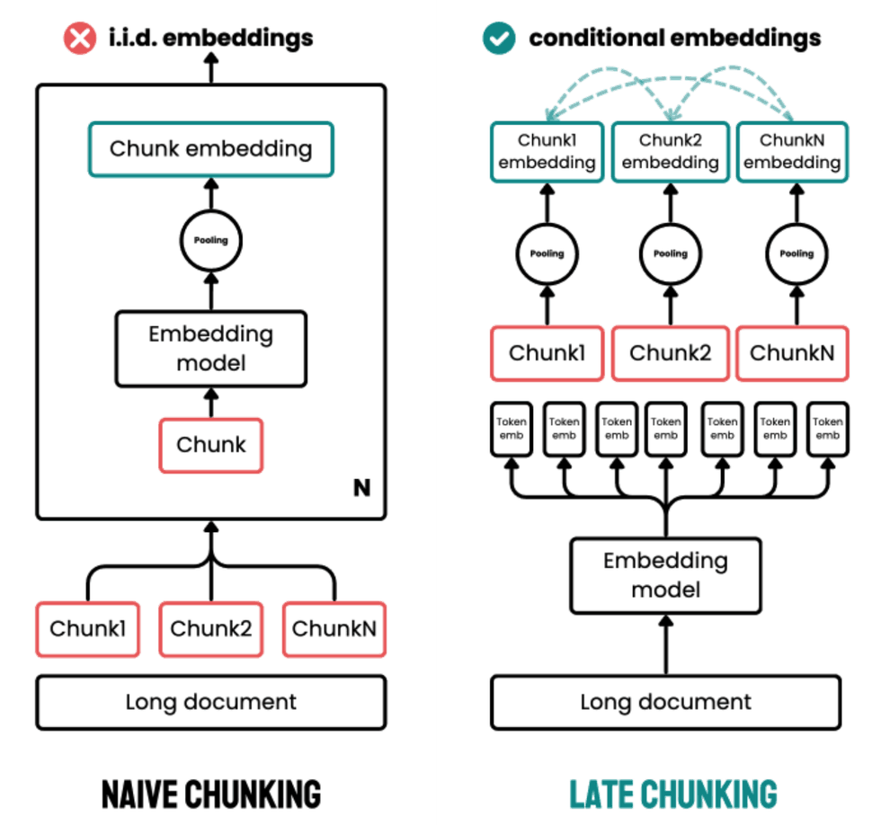
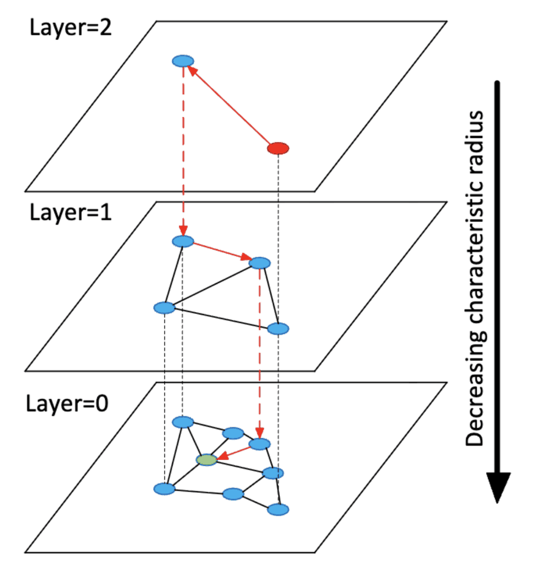
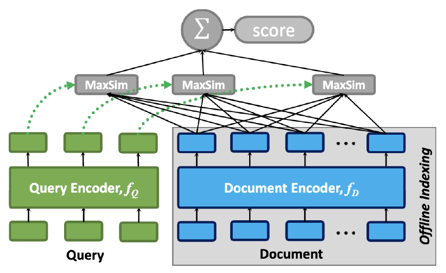

# 第 03 讲｜检索增强生成（RAG）

直接问一个大语言模型：“本周哪一节助教答疑（Office Hour）排队的人最少？”没有任何外部资料可查的模型，只能凭训练语料里的统计常识硬猜一句听起来很合理的建议：“试试周三下午吧，通常周中人最少。”但如果系统先去翻一下课程过去三周的排队日志，查出“周二下午 4 点平均排队 14 人，周四上午 9 点平均排队 3 人”，模型就能给出精准、可核查的回答：“周四上午 9 点——前面大约只有 3 名同学。”

大语言模型写在权重参数里的记忆是静态且不透明的：它既不知道训练截止日期之后的新动态，也读不到企业的私有文档，更没法为随口说出的数字附上原始出处。**检索增强生成（Retrieval-Augmented Generation, RAG）** 做的事情很直白——把推理时的“闭卷死记硬背”变成“开卷按需查阅”。本讲带你沿整条端到端 RAG 流水线走一遍：从潜变量概率建模、文档切块与上下文增强索引，到稀疏检索（BM25）、稠密检索（DPR）、混合排序（RRF）、晚期交互重排（ColBERT），最后走到让模型自己决定何时查、怎么查的 Agentic RAG 与三层故障排查。

**本讲视频**　[斯坦福课程视频](https://youtu.be/psLc-46GqY0) · [哔哩哔哩第 3 讲 · 中英字幕](https://www.bilibili.com/video/BV1JgyWzfEhg/?p=3)

## 学习目标

- **看懂 RAG 的概率骨架与演进脉络**：理解原始 RAG（RAG-Sequence 与 RAG-Token）把文档当作潜变量的建模思路，理清从 DrQA、REALM、DPR 到现代 RAG 的演进。
- **掌握文档切块与索引组织取舍**：理解固定/语义切块（Chunking）、上下文增强检索（Contextual Retrieval）、晚期切块（Late Chunking）、层次化树索引（RAPTOR）与图索引（GraphRAG）各自解决什么信息割裂问题。
- **吃透主流检索、融合与重排算法**：掌握 HNSW 近似最近邻搜索、BM25 词频饱和与长度归一化公式、DPR 双编码器对比学习、RRF 混合检索及 ColBERT 晚期交互（MaxSim）重排，能用 Hit@$k$、Recall@$k$、MRR 与 nDCG 客观评测检索器。
- **会搭也会修 Agentic RAG**：理解 Self-RAG、CRAG、Search-R1 如何把检索决策交还给模型，并能沿检索端、阅读端、循环端三层精准定位一次错答的根因。

## 知识讲解

### 1. 项目与检索动机

上一讲我们把大模型内部的解码、注意力和上下文工程摸透了。从这一讲开始，我们给大脑接上第一类核心外部能力——**知识检索**。先解决这一节的起步问题：**为什么不能指望模型把所有知识都背进参数里？在动手搭检索系统或做课程项目之前，先立好哪些评测条件，以后才分得清到底是“没查到”还是“没读懂”？**

#### 项目要从可评测问题开始

这门课在这个节点正式启动学期项目（Course Project），先把一条贯穿全学期的工程底线说透：**任何有价值的 Agent 系统或研究项目，都必须从一个能被严格评测的问题出发。**

不管你想研究成本、延迟与安全的平衡，测试提示注入和工具报错下的鲁棒性，做一个懂特定代码库的编程助手，还是做一个读课程大纲自动写日历的个人助理，只靠一次跑通的演示（Demo）都算不上工程证据。动手堆复杂架构之前，尽早定死四件事：
1. **任务定义**：具体要解决什么问题、适用边界在哪；
2. **测试数据来源**：用哪批独立问题和文档来测；
3. **成功标准**：什么结果才算真正做对；
4. **评分与基线**：用确定性代码评分器（Code Graders）、LLM 裁判（LLM-as-Judge）还是人工评估来量化基线（Baselines）与失败模式。

#### 检索为什么帮助生成

与其指望模型把全世界的新闻、公司制度和你的私有笔记全背进几百亿个权重参数里，不如在回答问题的那一刻，按需（Just-in-time）把最相关的几段资料递到它手边。检索给生成模型带来了两项不可替代的优势：
1. **动态可更新（Dynamic）**：公司报销标准改了、代码库合了新提交、或者刚收到一封新邮件，只需更新外部检索索引就能立刻生效，不必花大价钱重训或微调模型权重。
2. **可解释与可核查（Interpretable & Verifiable）**：模型可以标出每句结论来自哪一段原文引用（Citations），人或下游程序一眼就能回查出处，大幅压低凭空编造的事实幻觉。

#### DrQA、REALM 与 DPR 的脉络

现代 RAG 并不是凭空冒出来的，而是从开放域问答（Open-Domain QA）的经典 **“检索器—阅读器（Retriever-Reader）”** 两段式框架一路演进来的：
- **DrQA（Chen et al., 2017）**：面对“1933 年华沙有多少居民讲波兰语？”这类事实题，先用传统稀疏词频检索（TF-IDF）从整部维基百科里快速捞出前 $K$ 篇候选文档（$f(\mathcal{D}, Q) \to P_1, \dots, P_K$），再用 SQuAD 阅读理解数据集上训出的双向 RNN 阅读器从原文里精准抠出答案片段（$833{,}500$）。
- **REALM（Guu et al., 2020）与 DPR（Karpukhin et al., 2020）**：把靠字面词频匹配的 TF-IDF 升级成基于 BERT 的可学习**稠密向量检索（Dense Passage Retrieval）**，让系统第一次具备了跨同义词的语义匹配能力。
- **RAG（Lewis et al., 2020）**：把稠密检索器 DPR 和序列到序列生成模型 BART 端到端连成一个联合概率模型，正式确立了“检索增强生成”这一范式。

### 2. 原始 RAG 模型

上一节明确了“为什么一定要先查再答”。接下来把检索器和生成器真正串起来，解决这一节的核心问题：**检索出来的多段候选材料，在概率模型里到底是怎么参与生成最终答案的？不人工标注“每道题该查哪一段”，系统又怎么端到端学会检索？**

#### 把文档当作潜变量

在 Lewis et al.（2020）的原始 RAG 数学框架里，面对用户输入 $x$，系统并不知道“哪一段文档才是唯一标准证据”，于是把检索到的相关段落 $z$ 建模为一个**潜变量（Latent Variable，可以理解为藏在输入和输出之间的中间隐含状态）**。整套系统由两个概率部件协作：
1. **检索器（Retriever）$p_\eta(z \mid x)$**：给定查询 $x$，给出最相关的前 $K$ 个文档段落以及它们的归一化概率权重；
2. **生成器（Generator）$p_\theta(y_i \mid x, z, y_{1:i-1})$**：同时看着查询 $x$、拿到的段落 $z$ 和前面已经生成的词元，逐个预测下一个词元，拼出答案 $y$。

**用一个心算例子看懂“边际化（Marginalization）”。** 所谓边际化，就是把“可能参考了哪段文档”的所有情况按权重加权平均起来。假设检索器只返回两段公告，权重分别是 $0.75$ 和 $0.25$。想评估候选回答“16 点闭馆”有多合理，先分别问生成器：只给第一段时生成整句话的概率是多少（假设 $0.8$）？只给第二段时又是多少（假设 $0.2$）？按权重加权求和，就得到混合概率 $0.75 \times 0.8 + 0.25 \times 0.2 = 0.65$。（注意：这里数字仅作教学演算，实际回答闭馆时间前必须核对公告是否仍在生效。）

#### RAG-Sequence 与 RAG-Token

继续用上面这两段公告，给「16 点闭馆」算概率时，Lewis 等人提出了两种在**不同时机**汇总多段证据的方式：

> [!NOTE]
> **两段公告的预测，在哪一步合起来？**
> - **RAG-Sequence（序列级边际化）**：先锁死同一篇公告，一路连乘算出整条回答的概率；再换另一篇公告算一遍整条回答的概率；最后在最外层按检索权重把两者的整句概率加起来。
> - **RAG-Token（词元级边际化）**：每预测单个词元，就把两篇公告各自给出的下一词元概率按检索权重加权求和，得到该位置的混合概率；再把所有位置的混合概率一路连乘起来。

对照下面两个公式里**求和号 $\sum$** 和**连乘号 $\prod$** 的先后顺序，差别一目了然。Sequence 把对文档的求和放在最外层：

$$p_{\text{RAG-Sequence}}(y \mid x) \approx \sum_{z \in \text{top-}k(p(\cdot \mid x))} p_\eta(z \mid x) \prod_{i=1}^{N} p_\theta(y_i \mid x, z, y_{1:i-1})$$

Token 则把对文档的求和塞进了每一个生成位置 $i$ 里面：

$$p_{\text{RAG-Token}}(y \mid x) \approx \prod_{i=1}^{N} \sum_{z \in \text{top-}k(p(\cdot \mid x))} p_\eta(z \mid x) p_\theta(y_i \mid x, z, y_{1:i-1})$$

直观感受一下效果差异：RAG-Sequence 适合“整句话都基于同一篇文档回答”；而 RAG-Token 允许前半句主要参考文档 A、后半句主要参考文档 B。

> [!TIP]
> **容易混淆**：原始 RAG-Token 并不是每吐一个字就重新去数据库搜一次——它依然只按最初输入 $x$ 检索一次，各个生成位置共用同一批候选文档和同一组检索权重。随着已生成的前缀变化，每篇文档下的下一词元条件概率也会变化，因此各文档对当前预测的贡献可以不同。

#### DPR 与 BART 的组合

落到具体代码与模型结构上，原始 RAG 把检索器设为双编码器 $p_\eta(z \mid x) \propto \exp(\mathbf{d}(z)^\top \mathbf{q}(x))$：文档编码器 $\mathbf{d}(z) = \text{BERT}_d(z)$ 离线把知识库全编码成向量存好，查询编码器 $\mathbf{q}(x) = \text{BERT}_q(x)$ 在线把用户问题编码成向量，通过**最大内积搜索（Maximum Inner Product Search, MIPS）**快速找出得分最高的 $K$ 段；生成器则把 $x$ 和 $z$ 拼在一起喂给编码器—解码器模型 **BART**。

最巧妙的地方在训练阶段：系统直接最小化目标答案的负边际对数似然 $\sum_j -\log p(y_j \mid x_j)$——也就是说，**训练集里只需要（问题，标准答案）对，完全不用人工逐条标注“哪篇文档是正确证据”**，梯度就能同时反传，端到端微调查询编码器和生成器。

#### 原课评测与 RAG 变体

在 Natural Questions（NQ）、TriviaQA、WebQuestions 和 CuratedTrec 等开放域问答基准上，RAG 明显跑赢了只靠参数记忆的闭卷大模型和传统抽取式问答系统；在 Jeopardy 问题生成的人工盲测里，RAG 的事实准确性（Factuality）与具体性（Specificity）同样大幅胜出。

随着现代 Decoder-only 大模型的上下文窗口越来越大，如今工程里最常见的落地形态是 **In-Context RAG**——直接把检索出的 Top-$K$ 段落拼进提示词里让大模型综合阅读，并在外围衍生出查询改写、多路路由、重排序与迭代自省等丰富变体（Gao et al., 2024）。

### 3. 表示、切块与组织

看懂检索和生成怎么衔接之后，我们顺着流水线往最上游追。检索器能不能把关键证据找回来，第一道生死关其实早在“切文档、建索引”那一刻就定下了。这一节要解决的问题是：**一本几百页的手册应该切成多大的块才好找？切完之后丢了上下文指代、或者问题跨越整篇文档时，有哪些进阶组织方式可以补救？**

#### Embedding 的不同粒度

向量检索的第一步，是选对把文本变成数字向量的**稠密向量表征（Embeddings）**。不同模型把“多长一段内容”压成一个向量，直接决定了它适合干什么活：

| 向量类型 | 代表模型 | 单个向量表征的对象 | 适用场景 |
|---|---|---|---|
| **静态词向量（Static Word）** | word2vec, GloVe | 词表中的一个独立词型（不论上下文） | 早期词汇相似度匹配 |
| **上下文化词元向量（Contextual Token）** | BERT, RoBERTa | 特定句子语境下的单个 Token | 命名实体识别、序列标注、ColBERT 晚期交互 |
| **段落/文本块向量（Passage / Chunk）** | Sentence-BERT, DPR, E5, BGE | 整段文本或文档切块（Chunk） | 主流 RAG 稠密向量检索 |
| **多模态共享空间向量（Multimodal）** | CLIP, SigLIP | 文本或图像（映射至同一向量空间） | 跨模态图文检索 |
| **图结构向量（Graph）** | node2vec, GNN Encoders | 图中的节点或关系边 | 知识图谱与社交网络检索 |

在段落检索里，我们把每个文档切块映成一个固定维度的向量，用**余弦相似度（Cosine Similarity）**或**向量内积（Inner Product）**来量查询和文档块离得有多近。

#### Chunking 的边界与元信息

不可能把整本三百页手册压成一个孤零零的向量，因此**文档切块（Chunking）**是建索引的第一道工序，常见两类做法：
- **固定大小切块（Fixed-size Chunking）**：通常按 100–500 Tokens 切一块，并在相邻块之间留 **10%–20% 的滑动窗口重叠（Overlap）**。切得太碎，孤零零一句话丢了前后语境；切得太大，好几个无关主题搅在同一个向量里会把关键信号稀释掉。留重叠是为了防止关键句子在边界处被拦腰砍断（例如前一块停在 `"The project milestone is due Week 6, Thursday"`，后一块开头才写 `"11:59pm. Late days may not be applied..."`；又或者“全员每日限额 80 元”和下一句“实习生限额 50 元”被拆到两块，导致漏掉例外条款）。
- **语义与结构切块（Semantic / Structure Chunking）**：顺着 Markdown 标题、章节、自然段落或语义断点切分，尽量让“规则和它的例外”留在同一个逻辑单元里，并在每个块上挂好所属章节标题、文档 ID、生效与更新时间等元数据。

#### Contextual retrieval

哪怕按自然段落切得很整齐，脱离全文的孤立段落依然经常踩进**“指代悬空”**的坑。看课件里这个极真实的反例：
> **用户查询**：“ACME 公司在 2023 年第二季度的营收增长率是多少？”
> **原始切块（Chunk）**：“该公司营收较上一季度增长了 3%。”

只拿这句原话去建索引，“ACME 公司”和“2023 年 Q2”两个关键词一个都不在块里，不管是 BM25 还是向量检索都会彻底错过它！

Anthropic 提出的**上下文增强检索（Contextual Retrieval）**用了一个非常务实的解法：建索引时，把整篇文档和当前切块一起交给语言模型，让它写一句简短的背景前缀（例如：*“摘自 ACME 公司 2023 年 Q2 SEC 财报；2023 年 Q1 营收为 3.14 亿美元。”*），把这句前缀拼到原始切块前面，再分别送去做向量化和 BM25 索引（同时保留原文位置方便核查）。实验表明，Contextual Embeddings 搭配 Contextual BM25 能把检索失败率大幅拉低。

#### Late chunking

还是上面那句「该公司营收较上一季度增长了 3%」，有没有不靠大模型写前缀的办法？**晚期切块（Late Chunking，Günther et al., 2024）** 换了个顺序：让支持长上下文的双向编码器**先把包含公司名和季度的完整长文档一起编码**，让每个词元向量都在注意力里“看见”前文指代的对象，**最后再按切块边界对各段的词元向量做均值池化（Mean Pooling）**，得到每个块的向量。

对照下面这张流程图，从底部同一份长文档往上走，就能一眼看出“先切再编”和“先编再池化”的区别：

图注：从两侧的 Long document 往上读。右侧的 Embedding model 位于分块之前，所以算第二块的词元向量时也能看到第一块。来源为 Günther 等人的晚期切块方法，见 Diyi Yang 的[斯坦福 CS329Z 第 3 讲，PDF 第 30 页](https://web.stanford.edu/class/cs329z/slides/lecture03.pdf#page=30)。

这两种方法在索引里留下的东西也不同。上下文增强检索给原文添了一段背景文字，BM25 可以匹配其中的公司名。晚期切块将语境编码进向量，原始切块里的字词保持原样。

#### RAPTOR

当用户提出的问题跨越整篇长文档（例如针对《灰姑娘》全书提问：“这个故事的核心主题是什么？”或“她是如何迎来美好结局的？”），仅靠底层零散的叶子切块很难拼凑出全局脉络。**RAPTOR（Sarthi et al., 2024）** 通过自底向上构建层次化摘要树解决了这一难题：
1. 将原始文档切块作为树的叶子节点并计算向量；
2. 对向量进行聚类（Clustering），并用 LLM 为每个簇生成一段高层摘要；
3. 将生成的摘要再次编码、聚类并生成更高层的摘要，直至根节点；
4. 在检索时，系统同时在所有层级的节点中搜索——局部细节问题会自然命中底层的叶子切块，而宏观主题问题则会命中高层的聚类摘要节点。

#### GraphRAG

对于需要跨多篇文档梳理实体关联与全局结构的复杂查询，微软提出的 **GraphRAG（Edge et al., 2024）** 进一步用 LLM 从文档库中抽取出实体（Entities）与关系（Relationships）构建知识图谱，利用图社区发现算法（如 Leiden 算法）将紧密关联的实体划分为不同层级的社区（Communities），并预先生成每个社区的摘要报告，从而支持跨实体的多跳推理与全局总结。

### 4. 索引与检索算法

文档切好了、表示也增强了，下一步就该真正把成千上万个文本块存进索引并快速捞出候选。这一节要回答三个最实在的工程问题：**百万级向量怎么做到几十毫秒查完？为什么有了向量检索，古老的 BM25 关键词检索依然不能扔？两条检索结果尺度不同，又该怎么公平合并并科学打分？**

#### Exact search 与 ANN

假设知识库里有 $N$ 个 $d$ 维切块向量。最老实的**精确最近邻搜索（Exact Search / Brute-force Scan）**是拿查询向量和这 $N$ 个向量逐一算内积，复杂度 $O(N \cdot d)$。数据量只有几千条时这么扫完全没问题，但一旦涨到数百万甚至上亿条，暴力扫描的延迟就撑不住实时交互了。

所以工业界普遍改用**近似最近邻搜索（Approximate Nearest Neighbor, ANN）**，拿极小一点召回损失换取数量级的提速，主流有三条路线：
- **倒排文件索引（IVF, Inverted File Index）**：先用 K-Means 把向量空间划分成若干个聚类簇（每个簇一个中心点 Centroid），查询时只扫离查询最近的少数几个簇。
- **乘积量化（PQ, Product Quantization）**：把高维浮点向量切成几段子向量，各自压缩成短编码，大幅省内存并加速距离估算。
- **分层可导航小世界图（HNSW, Hierarchical Navigable Small World）**：目前内存向量库里最主流的高性能图索引。

#### HNSW 的插入与搜索

**HNSW** 的直觉很像搭地铁或查交通网——**上层是稀疏的高铁干线（跨越大距离快），下层是稠密的社区小路（最后精准定位）**。每个新向量都会落在最底层的第 $0$ 层，能否同步进入更高层由随机抽样决定，越往上概率按指数衰减；每层按邻居数量上限 $M$ 和距离启发式选边，尽量连向不同方向。

图注：从第 2 层红点跟到第 0 层绿点。每次沿竖直虚线向下，都落在同一个向量的下一层表示，然后才沿该层的边换到另一个向量。节选自 Diyi Yang 的[斯坦福 CS329Z 第 3 讲，PDF 第 37 页](https://web.stanford.edu/class/cs329z/slides/lecture03.pdf#page=37)。

查询时，算法从最高层贪心地走向离目标更近的邻居，走不动了就垂直降到下一层继续；到了最底的第 $0$ 层，还会维护一组动态候选集继续细找，最后吐出 Top-$k$。调大底层搜索候选集通常能拉高召回率，但也会增加查询耗时。课件用约 $O(\log N)$ 次跳转概括典型表现，实际开销仍随数据分布和搜索参数变化。

#### BM25 的组成

虽然向量检索很火，但在真实系统里，基于倒排索引（Inverted Index，类似书末按关键词列页码的索引）的词法检索算法 **BM25（Best Matching 25）** 依然是最可靠、绝不能省的基石——尤其是搜精确的产品型号（如 `AX-017`）、人名、错误码或合同编号时。

给定含词元 $q_1, \dots, q_n$ 的查询 $Q$ 和文档 $D$，BM25 的总分把每个查询词的贡献加起来，由三个设计巧妙的部件协同工作：

$$\text{score}(D, Q) = \sum_{i=1}^{n} \text{IDF}(q_i) \cdot \frac{f(q_i, D) \cdot (k_1 + 1)}{f(q_i, D) + k_1 \cdot \left(1 - b + b \cdot \frac{|D|}{\text{avgdl}}\right)}$$

逐项拆解每个符号在干什么：
1. **逆文档频率 $\text{IDF}(q_i)$（稀有词加权）**：衡量词 $q_i$ 在整个库里有多稀缺。像 `"the"`、`"email"` 这种满大街都是的常见词几乎不给分；特定项目代号、罕见错误码权重则极高。
2. **词频饱和（Term Frequency Saturation，参数 $k_1$ 通常取 $1.2 \sim 2.0$）**：旧式 TF-IDF 里词频 $f(q_i, D)$ 线性往上加，一篇把某关键词硬塞 50 次的灌水文章得分会是正常出现 5 次文章的 10 倍。BM25 的分式 $\frac{f \cdot (k_1 + 1)}{f + k_1 \cdot (\dots)}$ 随着 $f \to \infty$ 会慢慢封顶在 $k_1 + 1$，防止单个词无脑刷屏绑架总分。
3. **文档长度归一化（Length Normalization，参数 $b \in [0, 1]$ 通常取 $0.75$）**：长文档字多，天然更容易碰巧撞上查询词。用 $\frac{|D|}{\text{avgdl}}$ 把当前文档长度 $|D|$ 和语料库平均长度 $\text{avgdl}$ 相比：文档越长、分母惩罚越大，把长短文档拉回公平起跑线。

#### BM25 公式与版本差异

自己写 BM25 代码（比如 HW1 第 3 题）时，最容易踩的坑是 $\text{IDF}(q_i)$ 有两个长得很像但边界行为不同的版本：
- **经典 Robertson-Spärck Jones 原始形式**（课件展示形式）：
  $$\text{IDF}_{\text{classic}}(q_i) = \ln \frac{N - n(q_i) + 0.5}{n(q_i) + 0.5}$$
  其中 $N$ 是文档总数，$n(q_i)$（即 $\text{df}$）是包含词元 $q_i$ 的文档数。当一个词出现在超过一半文档里（$n(q_i) > N/2$）时，分数小于 $1$，取自然对数后会变成**负数**。
- **Lucene / 现代工程非负形式**（HW1 采用的标准形式）：
  $$\text{IDF}_{\text{Lucene}}(q_i) = \ln \left(1 + \frac{N - n(q_i) + 0.5}{n(q_i) + 0.5}\right)$$
  在真数里加了一个 $1$，保证任何词的 IDF 严格大于等于 $0$。写代码和跑单元测试前，一定先对齐题目指定的公式版本和分词规则。

#### DPR 的训练

既然 BM25 这么快又准，为什么还要花精力训练稠密检索器 **DPR（Dense Passage Retrieval, Karpukhin et al., 2020）**？因为 BM25 是纯粹的“字面匹配”：如果用户问 `"Who is the bad guy in Lord of the Rings?"`，而原文写的是 `"Sauron is the main antagonist..."`，`"bad guy"` 和 `"antagonist"` 一个字母都没重合，BM25 直接给 0 分（中文里的“报销”与“费用补偿”也是同样道理）。

DPR 用两个独立的 BERT 编码器分别把问题和段落压成低维稠密向量，再用**对比学习（Contrastive Loss）**训练——把问题 $q$ 和正确答案段落 $p^+$ 的内积拉大，同时把无关负样本段落 $p^-$ 推远。它真正训出好效果的工程秘诀在**负样本构造**：除了顺手把同一批次里其他题的正样本借来当免费负样本（**In-batch Negatives**），还特意塞进一批 **BM25 难负样本（BM25 Hard Negatives）**——也就是字面高度重合、BM25 排得很高，但实际上没回答问题的“伪装者”（例如问“AX-017 保修多久”，BM25 首位却在讲“AX-017 电池寿命”）。这逼着编码器不能偷懒数关键词，必须学会深层语义甄别。

#### 命中与排序指标

评估检索器好不好，不能光凭感觉翻两眼结果，得根据业务需求盯住两类标准指标（设测试查询集为 $Q$，查询 $q$ 的真实相关文档集合为 $R_q$，检索器返回的前 $k$ 篇为 $\text{Top}_k(q)$）：

1. **只看“找没找到、找全没找全”（不关心前 $k$ 名里的具体名次）**：
   - **$\text{Hit}@k$（命中率）**：前 $k$ 个结果里**至少有一篇**相关文档的查询占比：
     $$\text{Hit}@k = \frac{1}{|Q|} \sum_{q \in Q} \mathbb{1}[R_q \cap \text{Top}_k(q) \neq \emptyset], \quad \text{Failed}@k = 1 - \text{Hit}@k$$
   - **$\text{Recall}@k$（召回率）**：前 $k$ 个结果捞回来的相关文档，占这道题**全部相关文档**的比例：
     $$\text{Recall}@k = \frac{1}{|Q|} \sum_{q \in Q} \frac{|R_q \cap \text{Top}_k(q)|}{|R_q|}$$

2. **不仅要找到，还要排得越靠前越好（顺序敏感）**：
   - **$\text{MRR}@k$（平均倒数排名，Mean Reciprocal Rank）**：只看**第一篇**相关文档排在第几位（记作 $\text{rank}_q$；没进前 $k$ 则记 $0$），排第 1 得 1 分、排第 2 得 0.5 分：
     $$\text{MRR}@k = \frac{1}{|Q|} \sum_{q \in Q} \frac{1}{\text{rank}_q}$$
   - **$\text{nDCG}@k$（归一化折损累计增益）**：当文档有不同的相关度等级 $\text{rel}_{q, i}$ 时，按位置做对数折损累加 $\text{DCG}_q@k = \sum_{i=1}^k \frac{\text{rel}_{q, i}}{\log_2(i + 1)}$，再除以理想最优排序 $\text{IDCG}_q@k$ 归一化到 $[0, 1]$。

#### DPR 实验的适用边界

Karpukhin et al.（2020）的实验显示，只要大约 1,000 对问答训练样本，微调后的 DPR 就能在开放域问答的 Top-$k$ 准确率上超过 BM25，在 Natural Questions、TriviaQA 等 5 个数据集中的 4 个上显著胜出。但反过来，在训练样本极少、且高度依赖专有名词字面精确匹配的数据集（如 SQuAD）上，BM25 依然非常能打。

#### Hybrid search 与 RRF

既然 BM25 擅长精确字面词（型号、编号），向量检索擅长语义同义词，工程上最稳的办法就是**双路混合检索（Hybrid Search）**。但问题来了：BM25 吐出的分数可能是 `14.8`，向量余弦相似度是 `0.78`，两个分数的尺度完全不同，没法直接相加——**倒数排名融合（Reciprocal Rank Fusion, RRF）** 干脆扔掉原始分值，只看各自列表里的**名次**！

**用一个心算小例子走一遍 RRF。** 用户搜“学生交通报销”，每路只保留前两条结果：关键词检索返回「1. 旧版报销办法，2. 交通补贴细则」，向量检索返回「1. 学生出行问答，2. 交通补贴细则」。公式如下：

$$\text{RRF}(d) = \sum_{r:\,d\in L_r} \frac{1}{k + \text{rank}_r(d)}$$

其中 $L_r$ 是第 $r$ 路检索器返回的列表，第 1 名记作 $\text{rank}=1$；某文档没进某一路的前列，那一路就贡献 $0$。为了方便心算，下面取平滑常数 $k=2$（实际工程与课件示例常取 $k=60$）：

| 文档 | 关键词名次 / 向量名次 | RRF 融合得分 |
| --- | --- | --- |
| 旧版报销办法 | 1 / 未入选 | $1/(2+1) = 1/3 \approx 0.333$ |
| 交通补贴细则 | 2 / 2 | $1/(2+2) + 1/(2+2) = 0.500$ |
| 学生出行问答 | 未入选 / 1 | $1/(2+1) = 1/3 \approx 0.333$ |

看结果：「交通补贴细则」在两路都没拿第一，但因为两边都有依据，总分 $0.5$ 反而反超了两个单路第一名！同时别忘了条件边界：排名高只代表优先送给模型读，至于这份细则本学期还生不生效，仍要核对生效日期。

### 5. 重排与 ColBERT

上一节我们靠混合检索把 Top-50 或 Top-100 候选段落捞了出来。但大模型的上下文窗口寸土寸金，全塞进去既贵又容易引发上下文腐化。这一节要解决的问题是：**怎么从这批粗筛候选里精挑出最值得引用的前几段？为什么高精度重排器（Cross-encoder）不能直接扫全库，而 ColBERT 又是怎样在速度与精度之间架起桥梁的？**

#### Bi-encoder 与 cross-encoder

在神经检索里，**速度**和**匹配精细度**之间存在一对经典矛盾：
- **双编码器（Bi-encoder，如 DPR）**：把查询 $q$ 和文档 $d$ 分开各跑一次编码器，压成各自的一个向量，最后只算一次点积。好处是全库文档向量可以离线算好建索引，线上几十毫秒出结果；短板是编码期间查询词和文档词互不见面，细粒度的局部条件和例外很容易在压成单个向量时丢失。
- **交叉编码器（Cross-encoder，如 BERT Reranker）**：把查询和候选文档拼成 `[CLS] q [SEP] d [SEP]` 一起喂进 Transformer，让查询的每个词元和文档的每个词元在每一层都做全注意力交互，判断极准。但代价是没法提前离线编码文档——给 1,000 篇候选打分就得在线硬跑 1,000 次 BERT 前向计算（动辄好几秒甚至十多秒），绝对没法直接扫百万全库。

所以标准工业级方案几乎都是**两阶段检索（Retrieve-then-Rerank）**：第一阶段用快的 Bi-encoder + BM25 从百万库里粗筛出 Top-100（或几十篇）候选；第二阶段把宝贵的 Cross-encoder 预算集中花在这批小候选集上做精排（Reranking），挑出最靠谱的 Top-10 交给 LLM。

#### Late interaction / MaxSim

有没有可能既像 Bi-encoder 一样离线算好文档表征，又像 Cross-encoder 一样保留词元级的细粒度匹配？斯坦福提出的 **ColBERT（Khattab & Zaharia, 2020）** 用**晚期交互（Late Interaction）**给出了极漂亮的折中方案：
1. 文档编码器照样离线独立编码每篇文档，但**不再把整篇文档压成一个向量，而是把文档里每个词元的上下文化向量都存下来** $\{\mathbf{d}_1, \dots, \mathbf{d}_m\}$；
2. 查询编码器在线独立把用户问题编码成词元向量序列 $\{\mathbf{q}_1, \dots, \mathbf{q}_l\}$；
3. 打分时用一个无需额外参数的 **MaxSim（最大相似度求和）** 算子做交互：对查询里的**每一个词元** $\mathbf{q}_i$，去文档所有词元里找跟它点积最高的那一个，最后把所有查询词元的最高分加起来：
   $$S_{q, d} = \sum_{i \in q} \max_{j \in d} \left( \mathbf{q}_i \cdot \mathbf{d}_j \right)$$

为什么是“逐个查询词元取最大值再求和”，而不是直接取整张相似度矩阵的唯一最大值？因为前者要求查询里的**每一个关键要件**都在文档里找到呼应；如果只看全局最大值，哪怕查询里另一个核心条件完全没命中也不会扣分。

图注：从左侧挑一个查询词元，沿绿色虚线找到它对应的 MaxSim，再看哪些文档词元连到了同一个框。每个框只取一个最高分，顶部再将它们相加。原图来自 Khattab 与 Zaharia 的 ColBERT 论文，节选自[斯坦福 CS329Z 第 3 讲，PDF 第 52 页](https://web.stanford.edu/class/cs329z/slides/lecture03.pdf#page=52)。

#### 公平的速度比较

比较不同检索方案的延迟时，务必统一端到端计时口径（从收到查询到返回最终排序列表，而不能拿局部重排耗时去比全库端到端耗时）。下表汇总了四类检索器在 MS MARCO 基准上的典型量级与选型边界：

| 检索器架构 | 离线预计算内容 | 典型查询延迟 | 核心胜出场景 | 主要局限与代价 |
|---|---|---|---|---|
| **BM25（稀疏检索）** | 倒排索引（Inverted Index） | $\sim 60\text{ ms}$（极快） | 专有名词、ID、错误码等精确字面匹配 | 无法识别同义词与句式改写 |
| **DPR（双编码器）** | 每篇文档段落 1 个稠密向量 | 数十毫秒（极快） | 大规模语料上的语义相似匹配 | 压缩成单向量丢失细节，对罕见字面词弱 |
| **ColBERT（晚期交互）** | 文档中每个 Token 1 个向量 | $\sim 450\text{ ms}$（中等） | 兼顾全库检索速度与 Token 级细粒度匹配 | 索引存储体积增大（按 Token 数而非文档数存储） |
| **Cross-encoder（交叉编码器）** | 无（必须在线联合编码） | 对 1k 候选需 $\sim 10\text{ s}$（慢） | 小规模候选列表（Shortlist）的高精度重排 | 计算开销过大，无法直接扫描海量文档库 |

### 6. Agentic RAG 与失败分析

前面五节把“切块 → 建索引 → 混合召回 → 精排重排”这条单次检索流水线彻底串通了。最后一节我们再往前跨一步，解决两个在真实项目里躲不开的问题：**当一道题需要查完线索 A 才知道下一步该搜线索 B（多跳问答）时，单次 RAG 怎么升级成自主循环的 Agentic RAG？系统答错时，又该怎么一步步定位证据到底丢在了哪一层？**

#### 谁决定查什么和何时停止

传统 RAG 是固定的“一锤子买卖”：不管问题多复杂，只搜一次 Top-$k$ 就硬答。可遇到多跳任务（例如 HW1 第 4 题：“负责 Foxglove 项目的那位经理，他的备用审批人是谁？”），第一轮检索最多只查到“Foxglove 项目的经理是 Alice”，必须把刚读到的新实体 `Alice` 塞进第二轮查询“Alice 的备用审批人”，才找得到答案。

**Agentic RAG** 把检索器封装成 Agent 循环里的一个可调用工具，把三项决定权交还给模型：
1. **什么时候查（When to retrieve）**：常识或已有信息能答的直接答，缺证据才发起检索；
2. **查什么词（What query to issue）**：把复杂问题拆成子查询；第一跳拿到新实体后立刻带进下一跳查询，或者首轮没搜到时换同义词、换数据源重查；
3. **什么时候停（When to stop）**：确认手里证据已经足够支撑结论，或者达到预设步数上限（如 `max_searches=3`）以及遇到重复查询时果断收手，缺证据就如实说明“当前资料尚未公布”。

#### Self-RAG

**Self-RAG（Asai et al., 2024）** 的做法是在模型词表里专门加入一组**控制与自省词元（Reflection Tokens）**，让单个语言模型在生成过程中自己完成“按需检索—自我打分—有据生成”的闭环：模型先输出 `Retrieve` 标记决定要不要查；读完候选段落后，依次输出 `IsRel`（段落相不相关）、`IsSup`（我写的内容有没有原文支撑）和 `IsUse`（整体回答有没有用）这几个自省评分，在解码时自动筛掉无关噪声并保证每句话有据可查。

#### CRAG 与 Search-R1

为了进一步兜住“检索本身搜偏了”的风险，还有两条很有代表性的路线：
- **纠错式 RAG（CRAG, Yan et al., 2024）**：在检索器后面加一个轻量级的**检索评估器（Retrieval Evaluator）**给召回文档打相关性置信度，按分数分流成三条路径——高分（Correct）直接精炼提纯关键句；低分（Incorrect）干脆丢掉本地结果，改走外部网页搜索补救；居中（Ambiguous）则把两边结果合起来核对。
- **强化学习训练搜索策略（Search-R1, Jin et al., 2025）**：不再靠工程师手写一堆 `if/else` 重搜规则，而是把模型放进多轮搜索交互环境里，直接用最终答案是否正确的可验证奖励（RLVR）做强化学习，端到端优化 `<think> ... <search> query </search> <information> ... </information> ... <answer>` 整条思考与搜索轨迹。（注意评测时必须换新实体、新关系测试，防止模型在训练集里靠死记高频答案蹭分。）

#### 三层故障诊断

上线后发现 RAG 或 Agentic RAG 答错了，最忌讳二话不说就乱改系统提示词。正确做法是沿着一条失败轨迹的中间产物，按**检索端（Retrieval-side）**、**阅读端（Reader-side）**和**循环端（Loop-side）**三层逐级排查：

| 故障层级 | 典型失败模式 | 现象与机理 | 工程排查与修复策略 |
|---|---|---|---|
| **检索端（Retrieval-side）** | **1. 召回上限（Recall Ceiling）** **2. 索引过期（Stale Index）** **3. 权限越界（Permission Leak）** | 关键证据根本没进返回的 Top-$k$；文档已更新但旧向量没刷新；搜出了当前用户无权查看的机密文档。 | 单独测检索器的 Recall@$k$；换用 BM25 + 稠密向量的 RRF 混合检索；在索引层强制绑定文档 ACL 权限过滤与版本时间戳。 |
| **阅读端（Reader-side）** | **1. 中间迷失（Lost in the Middle）** **2. 相似干扰（Distraction）** **3. 证据冲突（Evidence Conflict）** | 正确段落明明召回了，却夹在长上下文中间被模型漏看；被字面相似但对象不同的干扰段带偏；新旧两版政策同时进上下文导致张冠李戴。 | 用 Reranker 压低送进 LLM 的文档数并把高置信段放首尾；在切块里显式保留发布日期与生效状态（Contextual Retrieval）；核查最终送给生成器的上下文里有没有被截断。 |
| **循环端（Loop-side）** | **1. 误差累积（Compounding Error）** **2. 缺乏终止规则（No Stopping Rule）** **3. 提示注入（Prompt Injection）** | 第一跳抽错人名导致后面几跳全跑偏；反复用同一个关键词死循环搜索直到超时；被文档里夹带的恶意指令劫持。 | 强制设最大搜索步数（如 `max_searches=3`）与重复查询拦截；对检索出的外部文本做严格的上下文边界隔离，只当成不可信证据。 |

## 原课程阅读清单与导读

- [Lewis et al. "Retrieval-Augmented Generation for Knowledge-Intensive NLP Tasks." NeurIPS (2020).](https://arxiv.org/abs/2005.11401)
  导读：对照本讲第 2 节跟着推一遍潜变量模型 $p(y \mid x)$ 的边际化公式，看懂 RAG-Sequence 与 RAG-Token 在求和与连乘顺序上的差别，以及开放域问答的实验对照。
- [Karpukhin et al. "Dense Passage Retrieval for Open-Domain Question Answering." EMNLP (2020).](https://arxiv.org/abs/2004.04906)
  导读：重点看双编码器的对比损失函数、In-batch Negatives 的矩阵加速技巧，以及为什么加入 BM25 难负样本（Hard Negatives）能大幅拉开检索精度。
- [Khattab & Zaharia. "ColBERT: Efficient and Effective Passage Search via Contextualized Late Interaction over BERT." SIGIR (2020).](https://arxiv.org/abs/2004.12832)
  导读：结合本讲第 5 节的晚期交互图，看懂 MaxSim 算子怎样既保留词元级细粒度匹配，又把延迟压在毫秒级。

## 动手练习

合上讲义，用下面两道动手题把“BM25 手算对齐”和“三层故障排查”真正落到代码与实验记录上：

1. **手写 BM25 倒排索引与分数验算**：用纯 Python 实现一个支持 `build(docs)` 与 `search(query, k)` 的 BM25 检索器（取 $k_1 = 1.5, b = 0.75$，采用非负 IDF 公式 $\ln(1 + \frac{N - \text{df} + 0.5}{\text{df} + 0.5})$）。选 5 篇短文档手算一条双词查询的得分，与代码输出逐位核对到小数点后 6 位完全一致（这项练习可直接衔接 HW1 第 3 题）。
2. **RRF 混合检索与三层故障复现**：搭一个包含 8 篇模拟公司报销制度文档的微型知识库（刻意放进一篇 2024 年已废止的旧版差旅标准、一篇 2026 年现行差旅标准，以及一个跨两篇文档才能查出审批人的多跳场景）。分别跑单次检索和最多 3 跳的 Agentic RAG，记录每跳召回的文档 ID 与最终引用准确率，并挑出一次失败案例，按“检索端 / 阅读端 / 循环端”写出完整归因证据。
