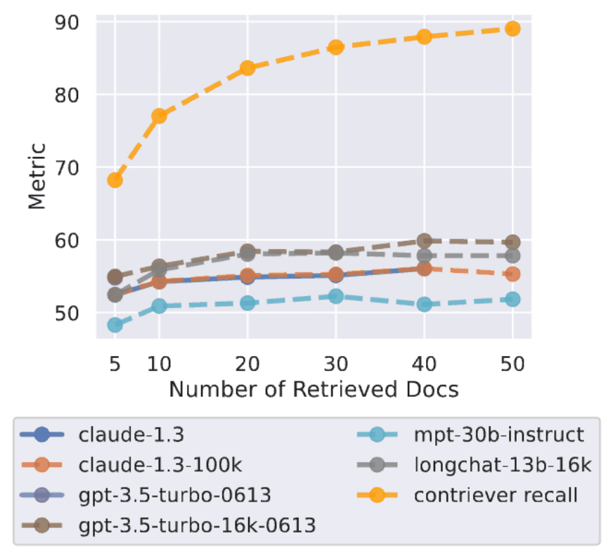
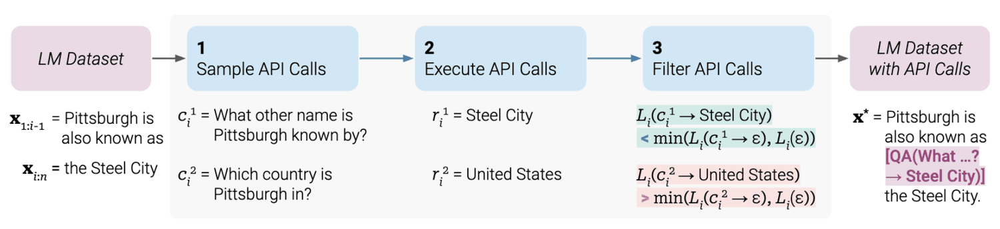

# 第 04 讲｜工具使用与函数调用

上一讲我们用 RAG 给大语言模型配上了“开卷查资料”的眼睛。但如果用户问的是：“$17,423 \times 892$ 等于多少？”或者“帮我查一下斯坦福此刻的气温，再把今天下午 3 点的会议推迟半小时”，光靠翻静态文档就彻底束手无策了。

归根结底，大语言模型是靠统计规律逐词续写的序列预测器：一遇到多位数乘法、长链符号推理或动态规划，问题规模稍大准确率就会断崖式跌落；它看不到此时此刻的实时股价或传感器读数；更不可能只靠吐出一段文字就去改动真实数据库或日历。**工具使用与函数调用（Tool Use & Function Calling）** 正是给大脑装上“双手”的桥梁。本讲先收尾 RAG 在长上下文和引用上的局限，再讲清模型怎样学会使用成千上万个工具（Toolformer、ToolkenGPT、ToolLLM、Gorilla），拆解从 REST API、Function Calling 到模型上下文协议（MCP）的三代接口演进与鉴权边界，最后落到 BFCL、ToolBench、$\tau$-bench 与 $\text{pass}@k / \text{pass}^k$ 评测及故障排查。

**本讲视频**　[斯坦福课程视频](https://youtu.be/s0S38lz6O7M) · [哔哩哔哩第 4 讲 · 中英字幕](https://www.bilibili.com/video/BV1JgyWzfEhg/?p=4)

## 学习目标

- **认清 RAG 边界与工具动因**：理解长上下文 RAG 的召回饱和、中间迷失效应与引用精确率/召回率，明确引入外部工具弥补的三大固有短板。
- **掌握四代工具学习范式**：看懂 Toolformer 的自监督损失过滤、ToolkenGPT 的专用工具词元嵌入、ToolLLM 的大规模 API 检索微调，以及 Gorilla 的检索感知训练（RAT）与 AST 幻觉评测。
- **吃透三代接口与 MCP 安全边界**：理清 REST API、JSON Schema Function Calling 到 MCP 协议的演进，掌握 `tools/list` 能力发现、`tools/call` 执行以及入站/出站双向鉴权隔离。
- **会测也会修工具 Agent**：掌握 BFCL、ToolBench、$\tau$-bench 与 $\text{pass}@k / \text{pass}^k$ 的适用场景，能系统排查单步、多步链路和对话策略三层故障。

## 知识讲解

### 1. RAG 收尾与工具动机

上一讲我们把 RAG 从切块、索引讲到了 Agentic RAG。在正式迈向通用工具之前，这一节先做一次关键收尾，回答两个衔接问题：**把检索文档数从 5 篇拉到 50 篇，回答一定会更准吗？又有哪些根本性任务是“再怎么检索文档”也解决不了、必须交给外部工具的？**

#### 检索规模与收益饱和

多捞几篇文档塞进上下文，助手真的就能答对更多题吗？Liu 等（2023）做了两组非常直击痛点的受控实验：

1. **只挪动正确证据的位置（中间迷失）**：在 20 篇文档里藏入 1 篇含正确答案的材料，其余 19 篇是干扰项，只改变那 1 篇在上下文里的顺位。结果正确证据放在最开头或最末尾时，模型答得最好；一旦挪到正中间，GPT-3.5-Turbo 在部分位置的准确率甚至跌破了“不给任何文档闭卷硬答”时的约 56%（而只单独给这一篇正确文档时，它能高达 88.5%）。这就是著名的**“中间迷失”（Lost in the Middle）**。
2. **持续增加检索文档数（收益饱和）**：在开放域问答里，多取文档确实能把“答案混在候选里”的召回率推高，但模型能不能在一堆干扰材料里把答案真正用对，还要看最终的端到端问答准确率。


图注：沿横轴从 20 篇看到 50 篇，上方的 Contriever 召回率从约 84% 升到 89%，下方各模型的问答准确率只小幅变化。这是这组问答实验中的读数。图源为 [Liu 等的原论文图 11](https://arxiv.org/html/2307.03172v3)，节选自 [Diyi Yang 的第 4 讲课件，第 7 页](https://web.stanford.edu/class/cs329z/slides/lecture04.pdf#page=7)。

#### 引用与长上下文诊断

就算在回答里贴上了 `[1]`、`[2]` 这样的引用编号，也不代表每句话都有据可查——模型照样可能胡乱标一个无关来源，这就是**引用幻觉（Citation Hallucination）**。Liu 等（2023）在评测生成式搜索引擎时，拆出了两个互补的指标。拿这句回答练练手：“周五有直达车 [1]。末班车在 22 点发车。”假设资料 `[1]` 是一张只标了“周五直达”、压根没写发车时间的线路图：

> [!NOTE]
> **引用精确率和召回率，各自数什么？**
> - **引用精确率（Citation Precision）**：从“已经给出的引用”出发，逐条检查它能不能支持对应的陈述。这里总共给了 1 条引用 `[1]`，它确实支持第一句，所以精确率是 $1/1$。
> - **引用召回率（Citation Recall）**：从“所有需要依据的陈述”出发，逐句检查它有没有被所附资料完整支撑。两句话都需要依据，但第二句既没引用又没证据，只有第一句过关，所以召回率是 $1/2$。

另外，看长上下文评测时别被单点测试迷惑：像**大海捞针（Needle-in-a-Haystack）**虽然能测出模型能不能从长文里精准揪出一句孤立事实，但“捞出一根针”不等于它能在长上下文里完成跨多处的逻辑聚合与精确计算。

#### 工具弥补能力与访问边界

把目光从“读文档”移向更广阔的真实世界，大语言模型在三大固有边界上必须借力外部工具（Tools）：

| 大语言模型的固有局限 | 具体表现场景 | 外部工具提供的解决方案 |
|---|---|---|
| **1. 无法精确计算的确定性任务（What LLMs can't compute）** | 多位数乘法、多步符号逻辑推导（如斑马谜题）、动态规划（Dziri et al., 2023 证明随着问题规模增大，零样本准确率迅速跌到零） | 计算器（Calculator）、Python 代码解释器、符号求解器与形式化验证器 |
| **2. 训练语料未曾涵盖的知识（What LLMs never saw）** | 长尾生僻事实、训练截止日期后的实时动态、企业内部私有数据库 | Web 搜索引擎、实时新闻/行情 API、内部语料库检索工具 |
| **3. 语言之外的外部世界与状态（What LLMs can't reach）** | 外部软件接口、数据库写入、物理世界交互、当前精确时间与传感器状态 | 函数调用（Function Calling）、MCP 服务、浏览器自动化、系统时钟 |

#### 完整工具链

**工具不是模型脑子里的功能，而是运行在模型外部的程序（Wang et al., 2024）。** 拿乘法题 `17,423 × 892` 走一遍完整工具链，你会看到四份彼此独立、绝不能混为一谈的运行记录：

| 这一步由谁负责？ | 这时能观察到什么？ |
| --- | --- |
| ① 模型提出调用 | 模型只输出结构化调用请求（例如函数名与乘数 `17,423`、`892`），此时运算尚未发生。 |
| ② 宿主执行 | 宿主程序核对函数名与参数类型无误后，才真正去调用外部乘法函数。 |
| ③ 工具返回 | 宿主拿到真实返回值 `15,541,316`，并把它和本次调用 ID 绑定起来。 |
| ④ 模型回复 | 宿主把这条工具回执拼回下一轮上下文，模型据此才向用户报告乘积。 |

> [!TIP]
> **判断依据**：如果日志停在第 ② 步并显示超时，只能说明宿主发出了调用尝试；在看到对应本次请求的第 ③ 步真实回执之前，绝不能向用户报告“算好了”或把“无返回”脑补成“结果为零”。

### 2. 怎样让模型学会工具

明确了为什么一定要接外部工具后，接下来进入技术核心：**最初的大语言模型根本没见过工具调用格式，研究者是怎么教会模型“什么时候该调工具、该挑哪个、又该怎么填参数”的？工具从 5 个涨到 16,000 个时，训练范式又发生了哪些变化？**

#### Toolformer 的五类工具

早期基础模型（如 60 亿参数的 GPT-J）并不具备原生工具能力。如果靠人工一条条手写几十万条工具调用示范，成本太高。**Toolformer（Schick et al., 2023）** 开创了经典的**自监督工具学习**范式，让模型在普通无标注文本上自己学会调用五类基础工具：**问答系统（QA）、计算器（Calculator）、维基百科搜索引擎（WikiSearch）、机器翻译系统（MT）与日历（Calendar）**。

#### 采样—执行—过滤—训练

自监督过滤的直觉非常巧妙——**用原文里已经存在的“后文”当天然裁判**。看“匹兹堡也被称为……”这句话，原文紧接着要写的是“钢铁之城（the Steel City）”。模型在这个位置可以采样出两个问题：“匹兹堡还有什么别名？”和“匹兹堡在哪个国家？”。两个调用查出来的都是真事实，但只有“别名问答”返回的 `Steel City` 能让模型预测后文变得容易得多！


图注：从左向右读两行候选，比较第二步的两个回答与原文后续的“the Steel City”。第三步只留下能让模型更容易预测这段后文的调用。方法出自 [Schick 等的 Toolformer 论文](https://arxiv.org/abs/2302.04761)，图节选自 [Diyi Yang 的第 4 讲课件，第 24 页](https://web.stanford.edu/class/cs329z/slides/lecture04.pdf#page=24)。

采样时，模型根据少量手写示例，在普通文本（如 CCNet）中挑选触发概率 $p_i > \tau_s$ 的位置 $i$，并在每个位置生成 $m$ 个候选调用。执行并过滤后，通过的“调用 → 结果”才插入原文，成为微调 GPT-J 的增强数据。下一节具体计算过滤时的分数。

#### 以未来损失衡量帮助

**工具返回值到底帮没帮上忙？** 对同一个插入位置 $i$，锁死后面要预测的真实词元和权重，分别算三次加权交叉熵损失（数值越小，代表模型猜中真实后文的概率越高）。下面用一组教学假设数演示过滤规则：

| 喂给模型的前缀 | 预测同一段后文的损失 |
| --- | --- |
| 原文，不插入任何调用 | 1.2 |
| 插入调用，但只显示提问（不含返回值） | 1.0 |
| 插入调用，并附上工具返回的答案 | 0.6 |

先从前两个基线里挑出更强的那个（即更小的损失）：$L_i^- = \min(1.2, 1.0) = 1.0$。完整带答案的损失是 $L_i^+ = 0.6$，净改善为 $L_i^- - L_i^+ = 0.4$。如果过滤阈值 $\tau_f = 0.3$，因为 $0.4 > 0.3$，就保留这条样本用于微调。**为什么一定要和 $\min(1.2, 1.0)$ 比、而不是只和纯原文 1.2 比？** 因为有时光把提问插进文本就能提醒模型猜中后文，取更强的基线才能扣掉“提问措辞本身的好处”，只留下真正由工具返回值带来的信息增量。

#### ToolkenGPT：把工具变成 token

Toolformer 通过微调整个模型学习调用工具，原论文在五类工具上验证了这种自监督方法。如果工具涨到几百个，能不能**不动大模型主干权重**，而是把每个工具当成一个新词元（**"Toolken"**）加进词表？

**ToolkenGPT（Hao et al., 2023）** 正是这样做的：
- **冻结主干、只训新词向量**：锁死预训练大模型参数，只为每个工具学一个专用嵌入向量（Toolken Embedding，排成矩阵 $W_\tau$）拼在词表分类头后面；
- **遇到工具词元就切模式**：正常逐词生成时，一旦模型吐出某个工具词元（如 `[square]`），生成立刻暂停，切进“参数填充模式（Tool-mode prompt）”，借少样本提示填参数、跑工具，再把返回值送回主上下文接着写；
- **极简位置监督**：训练 $W_\tau$ 时，遇到句子 `"the area is 256 square feet"`，只需在结果第一个数字 `2` 的位置要求预测 `[square]`，把后面的 `5`、`6` 标为 `[N/A]` 跳过算损失：
  $$\mathcal{L}(W_\tau) = \sum_{(s, s') \in \mathcal{D}} \sum_{i=1}^{N} -\log P(t'_i \mid t_{<i}) \cdot \mathbb{1}[t'_i \neq \text{N/A}]$$
  靠极小训练开销就能扩展到 234 个算术、知识与机器人控制工具。

#### ToolLLM / ToolLLaMA

当工具数再暴涨到上万个真实 REST API（比如 RapidAPI 平台上的 16,000+ 个接口）时，既塞不进提示词，也靠几个词元分不开。**ToolLLM（Qin et al., 2023）** 搭出了一套“先检索 API、再多步调用”的工业级链路：
1. 从 RapidAPI 收集 16,464 个真实 API，用 ChatGPT 合成单工具与多工具组合的复杂用户指令和深度优先搜索（DFSDT）调用轨迹（形成 **ToolBench** 数据集）；
2. 专门训练一个**神经 API 检索器（Neural API Retriever）**，先按用户指令从上万个接口里捞出最相关的 Top-$K$ 份 API 文档；
3. 在召回的 API 文档与多步轨迹上微调 LLaMA，得到 **ToolLLaMA**。

#### Gorilla 与 retrieval-aware training

面对更新飞快的机器学习与云计算 API，**Gorilla（Patil et al., 2023）** 收集了 HuggingFace Hub、PyTorch Hub 和 TensorFlow Hub 共 1,645 个 API 规范，用 GPT-4 通过 Self-Instruct 合成指令—代码对。

Gorilla 最有实战价值的一招叫**检索感知训练（Retrieval-Aware Training, RAT）**：
- 如果微调时只让模型“闭卷默写 API（Zero-shot）”，上线后你把最新检索出来的 API 文档塞给它，它往往不会照着读，反而容易被噪声带偏；
- 反过来，如果微调阶段就把检索到的文档放进上下文，而且**故意混入一部分正确文档和一部分无关干扰文档**，模型就能练出两项硬本领：文档对路时严格照着最新版参数名调用（立刻适应版本升级）；文档跑偏时果断无视干扰，靠自身知识作答。

#### API 幻觉与规模比较

怎么精确判断模型写出来的调用代码到底有没有瞎编 API？Gorilla 引入了**抽象语法树子树匹配（AST Sub-Tree Matching）**：把生成代码解析成语法树，和标准 API 库的签名树逐节点比对，从而干净区分“凭空捏造不存在的 API（Hallucination）”和“函数选对了但参数名/类型填错了”。

下表把这四代工具学习范式的核心取舍放在同一张表里对比：

| 维度 | Toolformer (2023) | ToolkenGPT (2023) | ToolLLM (2023) | Gorilla (2023/2024) |
|---|---|---|---|---|
| **工具调用的表征形式** | 嵌入正文的括号文本 | 词表中新增的专用 Token | ReAct 风格多步交互轨迹 | 文本与可执行 API 调用代码 |
| **训练更新的参数** | 完整模型权重（GPT-J 6B） | 仅新增的 Toolken 向量 | 完整模型权重（LLaMA 7B）+ 检索器 | 完整模型权重（LLaMA 7B） |
| **训练监督信号来源** | 自监督未来损失过滤 | 真实标注或合成调用数据 | ChatGPT 蒸馏的搜索轨迹 | GPT-4 Self-Instruct 合成数据 |
| **如何学会“何时调用”** | 损失下降阈值过滤 | 预测 Toolken 的位置概率 | 指令微调 | 指令微调 |
| **如何学会“传何参数”** | 模型微调 | 切换至上下文少样本提示 | 指令微调 | 检索感知微调（RAT） |
| **验证的工具规模** | 5 类基础工具 | 234 个工具 | 16,000+ 个 RapidAPI 接口 | 1,645 个深度学习框架 API |

### 3. 从 REST 到 MCP

上一节我们看到模型怎样通过训练学会调工具。但软件世界每天都在冒出新接口，总不能每新增一个 API 就重训一次模型。于是工程界换了思路，这也是这一节要解决的核心问题：**怎样把工具的说明书和调用协议彻底标准化，让任何模型不用重训就能零样本对接外部服务，同时还能把底层高权限密钥牢牢锁在模型之外？**

#### REST / HTTP 接口

这一演进走过了三代接口标准：
1. **第一代：面向人类开发者的 REST API**：靠 HTTP 动词（`GET` 读取、`POST` 创建、`PUT` 更新、`DELETE` 删除）和 URL 路径（如 `GET https://api.weather.com/v1/current?city=Stanford`）暴露能力。REST 原本是给程序员翻文档写代码用的，缺乏统一的机器可读调用契约，直接让模型手拼原始 HTTP 请求极易出错。

#### Function calling 与 schema

2. **第二代：面向模型的函数调用（Function Calling）**：宿主程序在上下文里为每个工具提供结构化的 **JSON Schema**，写清函数名（`name`）、功能描述（`description`）、参数类型（`properties`）和必填项（`required`）：

```json
{
  "name": "get_weather",
  "description": "获取指定城市的实时天气",
  "parameters": {
    "type": "object",
    "properties": {
      "city": { "type": "string" }
    },
    "required": ["city"]
  }
}
```

模型只管吐出符合 Schema 的 JSON 对象 `{"name": "get_weather", "arguments": {"city": "Stanford"}}`，参数校验和真实执行全交给宿主。但 Function Calling 留下了一个生态痛点：**工具封装死绑在每个应用自己的代码里**——你在应用 A 里写好的 GitHub、Slack 或数据库连接器，换到应用 B 或另一个 IDE 里又得重新写一遍。

#### MCP 的角色

3. **第三代：面向生态系统的模型上下文协议（Model Context Protocol, MCP）**：如果有 $M$ 个 AI 应用要对接 $N$ 个外部数据源，各自硬连就需要维护 $M \times N$ 套适配器。MCP 用一套开放标准把它降成 $M + N$，划分出三个清晰角色：
   - **MCP Host（宿主应用）**：运行大语言模型并和用户交互的主程序（如 Claude Desktop、Cursor IDE 或你自己写的 Agent）；
   - **MCP Client（客户端）**：藏在宿主内部，负责和某个 MCP Server 维护一对一协议连接；
   - **MCP Server（服务端）**：包在具体外部系统（如本地文件系统、PostgreSQL、Google Drive 或课程 LMS 系统）外层的标准服务，向外暴露三类原语：
     1. **Tools（工具）**：由模型决定调用的可执行函数（可能带计算或外部写入副作用）；
     2. **Resources（资源）**：由应用或用户挑出来塞进上下文的只读数据源（如文件内容、数据库记录）；
     3. **Prompts（提示模板）**：可复用的预定义工作流提示模板。

#### 发现与消息交换

MCP 基于 JSON-RPC 2.0 协议，把一次工具调用拆成清晰的两步握手：
- **第一步：动态能力发现（`tools/list`）**：Agent 启动或连上新服务时，Client 发送 `{"method": "tools/list"}`，Server 返回可用工具清单及各自的 `inputSchema`（例如 `weather_current` 与 `calculator_arithmetic` 及缓存有效期 `ttlMs`）。记住：**服务端列出了某个写接口，只代表“它具备这个能力”，绝不代表用户授权了这次写入。**
- **第二步：发起工具执行（`tools/call`）**：模型决定调用后，宿主校验参数并通过 Client 发送 `{"method": "tools/call", "params": {"name": "weather_current", "arguments": {"location": "Stanford", "units": "imperial"}}}`；Server 执行后返回结构化 `content` 数组（如 `[{"type": "text", "text": "Current weather in Stanford: 68°F..."}]`），Host 再交回给模型继续推理。

#### OpenAPI 到 MCP 与双向凭据

实际工程里，不用从零手写每个 MCP Server——借助 `FastMCP` 这类工具，可以把现有的 REST OpenAPI 规范（`openapi.json`）一键转成 MCP Server（比如把课程系统的 `GET /assignments`、`GET /submissions`、`POST /grade` 自动映射为 `list_assignments`、`get_submissions`、`post_grade`，并在适配层完成参数名映射）。

搭这层中间件时，最关键的安全红线是**把入站鉴权（Inbound Auth）和出站鉴权（Outbound Auth）彻底分开**：

```python
import os, httpx
from fastmcp import FastMCP
from fastmcp.server.auth.providers.jwt import StaticTokenVerifier

# 1. 出站凭据（Outbound：MCP Server → 后端 LMS REST API）
api = httpx.AsyncClient(
    base_url="https://lms.stanford.edu/api/v1",
    headers={"Authorization": f"Bearer {os.environ['LMS_TOKEN']}"}
)

# 2. 入站凭据（Inbound：Agent Client → MCP Server）
who_may_call = StaticTokenVerifier(
    tokens={os.environ["AGENT_TOKEN"]: {"client_id": "ta-agent"}}
)

mcp = FastMCP.from_openapi(
    openapi_spec=spec, client=api, name="Course MCP", auth=who_may_call
)
```

为什么要拆成两枚 Token？`AGENT_TOKEN` 管的是“哪位用户或哪个 Agent 有权调用这台 MCP Server、只读还是可写”；而通往底层数据库或后端 LMS 的高权限 `LMS_TOKEN` 被严严实实锁在 MCP Server 内部，**永远不放进大模型上下文**。这样哪怕 Agent 遭遇提示注入，攻击者也偷不走后端主密钥，而且 MCP Server 能在转发前按当前入站身份直接拦下越权写操作。

### 4. 评测与常见故障

工具学会了、协议也接通了，最后一道关口决定了它能不能放心上线：**离线测试里函数名和参数全对，为什么上线一跑多轮交互照样翻车？怎么用 `pass@k` 和 `pass^k` 拆穿“偶尔碰对”的假象，又该怎么沿三层清单快速排错？**

#### BFCL

伯克利提出的 **BFCL（Berkeley Function-Calling Leaderboard，Patil et al., 2025）** 覆盖 Python、Java、JavaScript、SQL 等多语言，从三个递进维度检验单步工具调用：
1. **基于 AST 的离线结构评估**：不真实跑外部 API，直接用抽象语法树核对函数名、参数名与参数类型是否精准匹配；
2. **基于真实执行的评估**：真刀真枪跑函数，核对返回值是否正确；
3. **复杂场景覆盖**：
   - **多函数选择（Multiple Functions）**：在 `add`、`mult` 等相似函数里为 `"2 + 3"` 选对 `add(a=2, b=3)`；
   - **并行函数调用（Parallel Functions）**：单步同时发出多个独立调用（如面对 `"What is (2+3) and (4+5)?"` 同时生成 `add(a=2, b=3), add(a=4, b=5)`）；
   - **相关性检测与拒答（Relevance Detection / Irrelevance）**：用户问 `"What is 2 * 3?"` 可手头只有 `add(a, b)` 时，靠谱的模型会明确拒答并指出缺乘法工具，而不是硬凑着乱调 `add`。

#### ToolBench

当候选工具扩大到上万个真实 API 时，**ToolBench（Qin et al., 2023）** 专门考察模型能不能在多步链路里先靠检索器找工具、现读陌生 API 文档，再把前一步返回的 ID 正确传进下一步完成跨领域组合调用（Multi-tool Composition）。

#### τ-bench

不过 BFCL 和 ToolBench 里的需求大多是一次性给全的。真实客服、机票改签或电商售后里，用户第一句话往往丢三落四，Agent 必须**一边多轮追问补齐信息，一边查公司政策，一边改后端数据库**。

**$\tau$-bench（Tool-Agent-User Interaction Benchmark, Yao et al., 2024）** 就是专门测这种动态交互的基准：由另一个大模型扮演带具体诉求的用户，Agent 跑完多轮对话后必须同时过两道硬验收——（1）后端数据库的最终状态与目标分毫不差；（2）全过程严守业务政策（例如“特价机票起飞前 24 小时内不可免费退票”）。

#### pass@k 与 pass^k

**同一批运行记录，怎么同时看清“撞大运至少对一次”和“次次都稳对”？** 假设同一个模拟客服任务从相同初始快照独立跑了 4 次：A、B、C 成功，D 失败。从这 4 条记录里不放回地抽 2 条组成一组，共有 $\binom{4}{2} = 6$ 种等可能组合：AB、AC、AD、BC、BD、CD：

| 使用条件 | 哪些组合达标？ | 估计值 |
| --- | --- | --- |
| 两次中至少一次成功（$\text{pass}@2$） | 全部 6 组（因为失败记录只有 1 条，凑不出“全败”） | $6/6 = 1.0$ |
| 两次都成功（$\text{pass}^2$） | 只有 AB、AC、BC 这 3 组 | $3/6 = 0.5$ |

推广到一般情况：总共独立跑了 $n$ 次、成功 $c$ 次，抽取 $1 \le k \le n$ 次的无偏估计公式为：

$$\text{pass}@k = 1 - \frac{\binom{n-c}{k}}{\binom{n}{k}}, \qquad \text{pass}^{k} = \frac{\binom{c}{k}}{\binom{n}{k}}$$

很好记：第一式用 $1$ 减去“抽到的 $k$ 次全是失败”，第二式直接算“抽到的 $k$ 次全是成功”。（注意区分：如果已知单次成功率 $p$ 去预测未来**独立重置**的 $k$ 次尝试，理论概率才是 $1-(1-p)^k$ 和 $p^k$；上表的 $1.0$ 只反映那 4 条已有样本。）

什么时候看哪个指标？如果是“生成多份代码补丁交给 CI 单元测试挑对的一份”，看 **$\text{pass}@k$** 更有意义；如果是“直接替客户改签或转账，绝不能出错”，就必须死盯 **$\text{pass}^k$**。

#### 工具 Agent 故障清单

工程排错时，可以把工具调用 Agent 的常见翻车点按三层检查清单逐项排查：

| 故障范围 | 典型失败模式 | 具体表现与防护重点 |
|---|---|---|
| **单次调用层（Single Call）** | **1. 工具误选（Selection）**<br>**2. 参数捏造（Arguments）**<br>**3. 工具幻觉（Hallucinated Tool）** | 选错工具或没合适工具时硬调；参数类型错、单位搞混或擅自瞎猜缺失默认值；凭空编造目录里不存在的 API。需在 Harness 层强制做严格 Schema 校验。 |
| **多步链路层（Multi-step Chain）** | **1. 顺序颠倒（Sequencing）**<br>**2. 死循环重试（Recovery）** | 跳过前置查询（比如没拿到订单号就直接调付款）；工具报错后一字不改反复硬重试，不懂回退或换路，或者断线重试引发重复扣款/重复下单。 |
| **对话与策略层（Conversation）** | **1. 违反业务政策（Policy Violation）**<br>**2. 盲目假设（Assumption）**<br>**3. 非确定性波动（Non-determinism）** | 无视规则越权操作；缺必填参数不问用户（`ask_user`）反而自行脑补；同一任务重跑时好时坏（$\text{pass}^k$ 偏低）。 |

## 原课程阅读清单与导读

- [Schick et al. "Toolformer: Language Models Can Teach Themselves to Use Tools." NeurIPS (2023).](https://arxiv.org/abs/2302.04761)
  导读：对照本讲第 2 节重点读论文第 2–3 节中“采样—执行—加权交叉熵损失过滤”的公式，看懂为什么取更强基线 $\min$ 才能筛出真正有信息增量的工具调用。
- [Patil et al. "Gorilla: Large Language Model Connected with Massive APIs." NeurIPS (2024).](https://arxiv.org/abs/2305.15334)
  导读：重点看检索感知训练（RAT）为什么能让模型既跟上 API 升级又抗住错误检索干扰，以及 AST 子树匹配如何精准量化 API 幻觉。
- [Model Context Protocol Specification, revision 2025-06-18. modelcontextprotocol.io (2025).](https://modelcontextprotocol.io/specification/2025-06-18)
  导读：对照本讲第 3 节理清 Host、Client、Server 的职责分工，分清 Tools、Resources、Prompts 三类原语谁来触发，以及 JSON-RPC 消息长什么样。

## 动手练习

合上讲义，用下面两道练习把“严格参数验证”和“可靠性指标计算”落到手写代码与数字判断上：

1. **实现工具注册表与严格参数验证**：写一个包含 `lookup_policy(doc_id: str, section: int)` 和 `calculate_reimbursement(amount: float, approved: bool)` 的工具注册表（直接衔接 HW1 第 5–6 题）。构造 8 条测试调用，覆盖未知工具名、缺必填字段、把布尔值传成字符串 `"true"`、以及工具内部抛异常四种边界情况，确保“参数验证层”和“真实执行层”彻底分离，且任何异常都会转成结构化错误回执而非把主循环炸掉。
2. **$\text{pass}@k$ 与 $\text{pass}^k$ 对比分析**：假设一个工具调用 Agent 在同一多步任务上独立运行 $n = 10$ 次、成功 $c = 7$ 次。请分别算出 $k = 1, 3, 5$ 时的 $\text{pass}@k$ 与 $\text{pass}^k$ 估计值，并结合计算结果说明为什么“自动生成代码补丁给 CI 单元测试筛”与“替客户执行银行转账”必须盯紧不同的指标。
