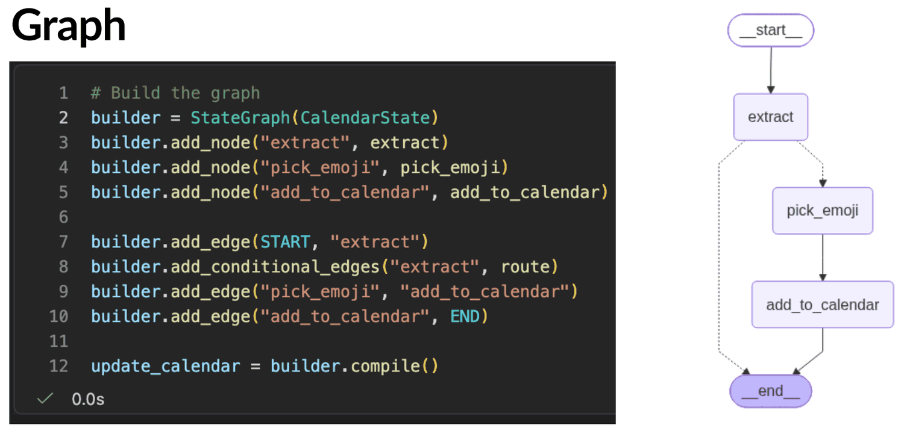
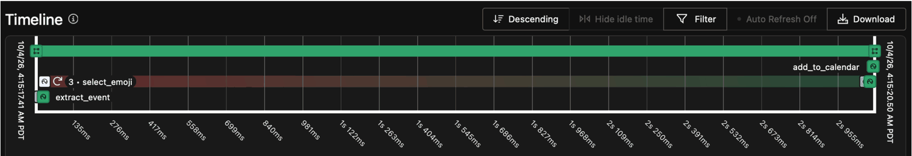

# 第 05 讲｜框架与持久编排

早期做深度学习，研究者得用 NumPy 一行行手推反向传播梯度；直到 PyTorch 和 JAX 把自动微分、张量运算与硬件调度抽象成简洁原语，搭复杂网络才变得既高效又不容易写错。

AI Agent 的工程化正在走完全一样的路。前四讲和 HW1 带你用原生 Python 亲手写检索器、工具协议和 `while` 循环，目的是把底层每一颗螺丝摸清；可一旦进了真实生产环境，反复手写提示模板、JSON 校验重试、分支状态流、崩溃恢复和全链路日志既累人又极易出 Bug。本讲围绕“从邮件提取日程并写入日历”这同一个实战任务，横向拆解四类核心工程基础设施：**DSPy**（声明式签名、组合与自动优化）、**LangGraph**（基于共享状态的显式有向图）、主流开源 **Agent Harnesses**（mini-SWE-agent、OpenHands、Pi、OpenClaw）的设计取舍，以及 **Temporal**（跨进程崩溃也能续跑的持久执行引擎）和生产级可观测性体系。

**本讲视频**　[斯坦福课程视频](https://youtu.be/q0Q-Hy8TTps) · [哔哩哔哩第 5 讲 · 中英字幕](https://www.bilibili.com/video/BV1JgyWzfEhg/?p=5)

## 学习目标

- **认清框架抽象的价值与控制权光谱**：围绕“数据、系统、评测”三大支柱，分清单次调用、预设工作流和自主 Agent 各自适合什么任务。
- **掌握 DSPy 三大原语**：理解 **Signatures（声明要什么）**、**Modules（定义怎么算）** 和 **Optimizers（拿数据与指标自动优化）** 如何取代手工硬改提示词。
- **掌握 LangGraph 显式状态流**：看懂 **State（共享状态）**、**Nodes（节点函数）** 与 **Edges / Conditional Edges（固定边与条件路由边）** 如何清晰编排复杂分支与澄清回路。
- **看懂开源 Agent 底座的设计权衡**：横向对比 mini-SWE-agent、OpenHands、Pi、OpenClaw 的工具、历史与持久化取舍，理解 HarnessTax 与 Meta-Harness。
- **掌握 Temporal 持久执行与幂等边界**：分清 Workflow 与 Activity 的职责，吃透确定性重放（Replay）、活动重试、耐久计时器以及外部写入的幂等键防护。

## 知识讲解

### 1. 为什么需要抽象

前四讲我们把模型、RAG 和工具调用都跑通了，但全靠手写 Python `while` 循环和字符串拼接。这一节先解决一个选型前必须想明白的问题：**手写脚本变复杂后，哪些反复出现的苦活值得交给框架抽象？面对同一个任务，到底该选单次调用、预设工作流还是自主 Agent？**

#### 从手写运算到系统抽象

框架真正该干的事，是把反复出现又容易写错的样板代码——比如提示词拼接、JSON 解析重试、状态传递、断点恢复和调用追踪——抽离出来，让工程师把精力集中在业务逻辑和评测指标上。评判任何框架值不值得用，始终回到 AI 系统工程的三根支柱：
1. **数据（Data）**：训练样本、运行轨迹（Rollouts）、少样本示范与人类反馈；
2. **系统（System / Model）**：语言模型、复合工作流与 Agent 控制环路；
3. **评测（Evaluation + Metric）**：通过率、精确匹配、LLM 裁判得分以及成本与延迟。

好抽象的标准只有一条：**让三根支柱的联动更透明、更好组合，绝不把底层为什么报错藏进黑盒。**

#### 自主程度与可靠性

沿着控制权光谱（Spectrum of Control Flow / Agency）看同一个任务——助手刚读完一封约会邮件，究竟由谁来拍板“要不要查日历”？

> [!NOTE]
> **读完邮件后，谁决定是否查询日历？**
> - **单次模型调用**：程序调模型 API 抽完日期，控制权立刻回到代码手里，要不要查日历全由调用方写死。
> - **预设工作流**：开发者用 DSPy 或 LangGraph 明确编排分支（例如有日期就查日历、缺日期就向用户追问），模型只在指定节点内做判断。
> - **自主 Agent**：在 OpenHands、Claude Code 或 Pi 这类运行底座里，模型自己看环境回执选下一步工具——比如先查空档，发现冲突再自主改查下一天。

无论落在光谱的哪一端，线上系统都可能需要跨进程容错和全链路追踪：前者交给 **Temporal** 负责持久执行，后者交给 **MLflow、LangSmith 或 Langfuse** 记录完整运行轨迹。

### 2. DSPy：声明、组合、优化

找准需要抽象的重复工作后，先看第一类核心痛点——**手工改提示词太脆弱，换个模型或加个字段就得重写大段字符串**。这一节解决的问题是：**怎么把“想让模型做什么”写成清晰契约，再让框架拿着数据和评测指标自动把提示词优化好？**

#### Signature 声明要做什么

传统提示工程把“任务输入输出定义”“JSON 格式要求”和“诱导思考的话术”全揉成一团大字符串。**DSPy（Khattab et al., 2024）** 把它改造成声明式编程，第一块基石叫 **Signature（签名）**——只管写清楚**输入是什么、输出是什么（What）**，不硬编码提示词怎么写：

```python
import dspy
from typing import Literal, Optional

class ExtractEvent(dspy.Signature):
    """Extract calendar event information from an email."""
    email: str = dspy.InputField()
    event_name: Optional[str] = dspy.OutputField(desc="Name of the event, or None if no event")
    date: Optional[str] = dspy.OutputField(desc="Date in YYYY-MM-DD format")
    start_time: Optional[str] = dspy.OutputField(desc="Start time in HH:MM 24-hour format")
    duration_hours: Optional[float] = dspy.OutputField(desc="Duration in hours")
```

用上标准 Python 类型注解（如 `Literal["positive", "negative", "neutral"]`、`float`、`Optional[str]`，显式允许缺日期时返回 `None`）后，DSPy 适配器会自动生成格式化提示并解析校验输出，确保下游代码拿到的数据严格符合契约。

#### Module 定义怎么组合

签好契约之后，第二块基石 **Module（模块）** 决定**怎样履行这份契约（How）**，你可以像换零件一样自由替换或嵌套：
- `dspy.Predict(Signature)`：最轻量的单次预测调用；
- `dspy.ChainOfThought(Signature)`：自动在输出字段前插一步 `reasoning`（思维链），让模型先推理再填结构化字段；
- `dspy.BestOfN`：多次采样并按奖励函数挑出最好的一条；
- `dspy.ReAct` 与 `dspy.RLM`：把工具列表或长上下文编程环境接进模块，靠多步循环完成 Signature 目标。

就像在 PyTorch 里写 `nn.Module` 的 `forward` 一样，你可以用普通 Python 控制流把多个 DSPy 模块串成复合程序。

#### Optimizer 使用数据与 metric

DSPy 最亮眼的突破在第三块基石——**Optimizer（优化器）**。只要准备好三样东西：
1. 一个 DSPy 程序；
2. 一小批带标注的开发集样本（比如几十封邮件）；
3. 一个量化评测函数 `metric(example, prediction)`；

DSPy 优化器（如 `BootstrapFewShot`、`MIPROv2`、`GEPA`）就能自动跑程序、筛选成功轨迹做成少样本示范（Demonstrations），或者自动改写各模块的系统指令（Instructions），不再靠人熬夜凭感觉微调提示词。

#### Notebook 的抽取与程序组合

在第 05 讲配套 Notebook（`lecture5.ipynb`）里，两个 `ChainOfThought` 模块和本地日历客户端 `tinycal` 拼成了一套干净的邮件日程更新程序：

```python
class UpdateCalendarFromEmail(dspy.Module):
    def __init__(self):
        self.extract = dspy.ChainOfThought(ExtractEvent)
        self.pick_emoji = dspy.ChainOfThought("event_name -> emoji")

    def forward(self, email: str):
        extracted = self.extract(email=email)
        # 若邮件中不包含有效日程（缺少名称、日期或开始时间），直接跳过写入
        if not (extracted.event_name and extracted.date and extracted.start_time):
            return dspy.Prediction(added=False, event=None)
        emoji = self.pick_emoji(event_name=extracted.event_name).emoji
        # 调用外部日历服务写入事件
        event = cal.add(
            title=f"{emoji} {extracted.event_name}",
            date=extracted.date,
            start=extracted.start_time,
            duration=extracted.duration_hours or 1.0,
        )
        return dspy.Prediction(added=True, event=event)
```

看清这里的分工：模糊的自然语言理解交给 `extract` 和 `pick_emoji`，硬性的非空校验与 `cal.add` 写入关卡留在确定性 Python 代码里。

#### Notebook 的 GEPA 实验

Notebook 里的优化实验把 50 封合成邮件按 `seed=0` 打乱，拆成 30 条训练集和 20 条测试集。直接拿轻量级模型裸跑未优化程序时，遇到“下周四”这类相对日期推算或默认时长规则频频翻车。

接着定义评测指标 `metric`（核对 `date`、开始时间前 5 个字符 `start[:5]` 和 `duration`），启动 **GEPA（Genetic Pareto Prompt Evolution）** 优化器（最多约 100 次指标评估），请更强的反思模型（Reflection LM）复盘训练集错题并自动演化 `ExtractEvent` 的指令说明。优化出的指令自动补齐了相对日期换算基准和缺省时长规则，轻量级模型在独立测试集上的准确率显著跃升。

> [!TIP]
> **判断依据**：如果你的 `metric` 只核对日期、开始时间和时长，那么把活动名从“读书会”错抽成“组会”，得分依然纹丝不动。想检验活动名称抽得准不准，必须单独核对该字段（且测试集不能和训练集共用同一套邮件模板）。

#### Notebook 的 ReAct / RLM

遇到固定两步走不通的任务——例如用户说“帮我跟 Alex 约个明天下午有空的半小时喝咖啡，顺便把周五例会的图标改成火箭”——Notebook 展示了两种动态模块：
- **`dspy.ReAct`**：把 `cal.today`、`cal.list`、`cal.find_free_slots`、`cal.add`、`cal.update` 等工具交给模型，由它看回执动态决定先查今天几号、再查空档、最后创建或修改；
- **`dspy.RLM`（Recursive Language Model）**：要在整批 50 封邮件里统计所有和 Gates 大楼有关的活动时，`dspy.RLM` 在沙箱里写代码迭代遍历筛选（设 `max_iters=8`），避免把 50 封邮件硬塞进上下文导致漏数或重复计数。

### 3. LangGraph：显式状态流

DSPy 解决了“怎么声明任务并自动优化提示”，但工程里还有另一类常见需求：**当流程包含复杂条件分支、人工澄清回路和多步状态流转时，怎么把“任务现在走到哪一步、谁把流程导去哪里”画得清清楚楚、方便调试和中断恢复？** 这正是 LangGraph 的主场。

#### State、nodes、edges

**LangGraph** 把复合系统显式建成一张**围绕共享状态流转的有向图（State Graph）**，核心只有三个部件：
1. **状态（State）**：整张图的共享工作区（常用 Python `TypedDict` 或 Pydantic 定义），集中保存原始邮件、抽取出的日程字段、选好的 Emoji、澄清次数和最终日历结果。
2. **节点（Nodes）**：图里的干活单元。每个节点就是一个普通 Python 函数 `node(state) -> partial_state`，从 `State` 里读所需字段、调模型或外部工具，再返回要写回 `State` 的增量字典。
3. **边（Edges & Conditional Edges）**：规定节点之间怎么跳转。普通边表示固定顺序（如 `START -> extract`）；**条件边（Conditional Edges）** 则读取当前 `State` 里的实际值动态分流（比如 `extract` 之后检查必填字段是否齐全，齐全就去 `pick_emoji`，缺日期就走澄清边或直接结束）。

#### 抽取到日历的图

拿两封邮件对照看图怎么跑：一封写着“周三上午 11 点看牙”，另一封只提醒“请查收额度通知”。两封邮件都从 `extract` 节点起步，把结果写进共享状态的 `details` 字段；接着 `route` 条件边检查名称、日期和开始时间是否齐全——看牙预约走右路经 `pick_emoji` 再由 `add_to_calendar` 写进日历；额度通知则直接走左路结束，绝不误建日程。


图注：在右图从 `extract` 沿两条虚线分别走一遍，只有右路经过写日历的节点；左侧第 8 行把这次分流交给 `route`。节选自 [Diyi Yang、Michael Ryan 与 John Yang 的第 5 讲课件，第 70 页](https://web.stanford.edu/class/cs329z/slides/lecture05.pdf#page=70)。

#### 预构建 Agent 的真实入口

如果想在状态图里直接嵌一个标准 ReAct 工具循环，你可以自己用两个节点（`llm_node` 与 `tools_node`）加一条判断是否含 `tool_calls` 的条件边手搭，也可以直接调 LangChain / LangGraph 提供的预构建入口 `from langchain.agents import create_agent`（底层同样基于 LangGraph 运行时），传入模型与日历工具函数列表即可跑起来。

### 4. 开源 harness 的设计空间

上面两节看的是工作流与状态图框架。再往自主 Agent 方向跨一步，这一节要解决的核心问题是：**把大语言模型包在里面的“运行底座（Agent Harness）”到底在管什么？为什么同一个大模型，换一套底座就能在基准上拉开两代模型的差距？**

#### Harness 包住模型做什么

包裹在大模型外层的运行代码统称为 **Agent Harness（智能体运行底座）**。它死死决定了四件事：**暴露哪些工具、怎么存历史与记忆、怎么裁剪上下文窗口、以及在什么隔离环境里跑动作**。

四套有代表性的开源 Harness 针对各自场景做出了截然不同的工程取舍：

| 开源底座（Harness） | 工具集设计 | 上下文与历史管理 | 执行环境与容错特色 | 适用定位与设计哲学 |
|---|---|---|---|---|
| **mini-SWE-agent** | 极致精简：**仅有 1 个 `bash` 工具** | 完全线性的消息列表（每步直接 `append`） | 每次动作调用独立的 `subprocess.run`（无持久 Shell 状态） | 用不到百行代码证明极简底座即可跑通 SWE-bench |
| **OpenHands** | 丰富的开发工具（Bash、文件编辑、浏览器等） | **持久化事件流（Event Stream）**：每步存为磁盘上的独立 JSON 事件文件，每轮调用前从事件流重建模型上下文 | 维护**持久化的 `tmux` 终端会话**（保留 `cd` 目录与虚拟环境）；内置卡死检测器（连续 4 次重复相同动作与结果即自动终止） | 面向复杂长周期软件工程的工业级全功能平台 |
| **Pi Agent** | 仅启用 4 个基础工具：`read`、`write`、`edit`、`bash`（系统提示 `<1,000` Tokens） | **树形会话历史（Tree-structured History）**：支持回退到任意早期消息节点并开辟新分支；支持技能文件与压缩 | 直接以当前宿主进程权限运行，**无内置审批、无子 Agent、无计划模式** | 极致极简主义底座，通过插件扩展适应个人工作流 |
| **OpenClaw** | 个人助手与多渠道通信工具 | 将身份与长期记忆存储为本地 Markdown 文件（`AGENTS.md`、`SOUL.md`、`USER.md`、`MEMORY.md`）并注入系统提示 | 单一长驻 Gateway 进程接管所有聊天渠道；**每 30 分钟触发一次心跳轮次（Heartbeat）**（无事时回复 `NO_REPLY` 保持静默），凌晨 3 点后台任务自动整理日记写入 `MEMORY.md` | 7×24 小时在线的主动式个人常驻 Agent |

#### mini-SWE-agent

**mini-SWE-agent** 把“少即是多”推到了极致：不造任何专用文件读写或搜索工具，只给模型一个 `bash` 命令入口；每次调用都起一个全新子进程，不保留上一步的 `cd` 目录和环境变量；历史记录就是最朴素的线性追加。实现极轻、并发极稳，代价是模型每条命令都得自己写全路径或环境激活前缀。

#### OpenHands

**OpenHands** 走的是工业级全功能路线，专为长周期复杂软件工程打造。它把每次用户输入、模型动作和环境输出都落盘成不可变的 JSON 事件日志（Event Log），每轮发给模型的 `messages` 都从事件日志动态投影出来；后台维护持久化 `tmux` 会话，保留目录与虚拟环境，并配了循环卡死检测器自动熔断死循环。

#### Pi

**Pi** 是面向开发者的极简可塑底座：默认只开 `read`、`write`、`edit`、`bash` 四个原子工具防工具膨胀；最大亮点是把对话历史存成**一棵树（Tree）**，调试走偏时直接回退到 5 步前另开分支。但因为它默认不设权限弹窗和沙箱，面对不可信输入或生产环境必须自己在外部包容器或系统沙箱。

#### OpenClaw

**OpenClaw** 展示了 7×24 小时主动式个人 Agent 的典型工程形态：每 30 分钟靠定时心跳（Heartbeat）唤醒检查待办（无事就回复 `NO_REPLY` 保持静默），凌晨再通过后台任务（Sleep-time Compute）把白天的零散经历整理归档进 `MEMORY.md`。

#### HarnessTax 与 meta-harness

为什么 Harness 绝不是可有可无的“外壳代码”？Arena.ai 的 **HarnessTax** 研究证实：**同一个基础模型换不同底座，编码基准上的分差甚至超过两代模型之间的代差**；而且没有哪套固定底座通吃所有模型——替模型 A 精调的提示和工具格式，硬搬到模型 B 身上反而可能掉分（即“底座税 Harness Tax”）。

更进一步，**Meta-Harness（Lee et al., 2026）** 不再纯靠人工试错手搓底座，而是引入元智能体（Meta-Agent），根据评测轨迹自动修改、搜索并演化 Harness 代码与上下文策略，把底座工程本身也纳入自动优化闭环。

### 5. Temporal：持久执行

前面聊的模型框架和 Harness 默认程序一直稳稳跑在内存里。但真实业务里，一个 Agent 流程常常要跑几十分钟甚至等两天审批。这一节要解决的核心问题是：**如果中途服务器重启、进程崩溃或网络断线，怎么让多步任务精确从断点续跑，同时还不把模型重复调两遍、不把外部日历或扣款重复写两次？**

#### 服务、工作流与活动

普通的内存 Python 脚本一重启，所有中间变量瞬间清零。**Temporal** 是专为这类场景设计的持久化执行引擎（Durable Execution Engine）。拿“从邮件创建日程”拆开看，先把两类代码彻底分清：

> [!NOTE]
> **创建日程时，哪些代码负责安排，哪些代码接触外部服务？**
> - **工作流（Workflow）**：只负责纯编排逻辑——按顺序安排抽取、选图标、写日历。只要输入同一段事件历史，它必须每次都作出完全相同的调度决定。
> - **活动（Activity）**：负责一切会和外部世界打交道、可能失败或有随机性的操作（如调大模型、调日历 API），返回抽取结果或新日程编号；超时或报错时，引擎按策略自动重试单个活动。

运行时分成三端协作：客户端（Client）向 **Temporal Server** 提交请求；Server 把任务排进持久化队列（Task Queue）并完整保存**事件历史与状态（Execution History & State）**；无状态的 **Workers** 进程从队列拉取并执行 Workflow 与 Activity。

#### Replay 与确定性

来看断点续跑到底怎么省钱又精准：假设 `extract_event` 已经从邮件抽出了“周三 15 点开读书会”并记进事件历史，结果刚进到“挑图标”这一步 Worker 挂了。新拉起的 Worker 会从头**重放（Replay）**Workflow 代码——走到 `extract_event` 那一行时，Temporal 发现历史里早就有完成记录，直接把“周三 15 点开读书会”原样塞回变量，**根本不会重调大模型**，接着无缝继续挑图标！

**怎样保证 Workflow 代码能安全重放？** 核心铁律是**确定性（Determinism）**：不能在 Workflow 里直接读本机时间 `datetime.now()`、生成真随机数或直接发 HTTP 请求（否则明天重放时走了不同分支就会和历史冲突）。凡是会随环境变化的操作一律放进 Activity，需要当前时间则必须调用 SDK 提供的可重放工作流时钟。

#### 重试策略与超时

课件为三个 Activity 分别设置 1 分钟的单次执行超时（`start_to_close_timeout`），重试策略的初始间隔为 1 秒，最多尝试 5 次，包含首次执行。演示把挑图标的 `select_emoji` 换成一个前两次会抛出异常的实现。第三次尝试成功后，工作流才进入写日历的 `add_to_calendar`。[课件中的重试配置，第 102 页](https://web.stanford.edu/class/cs329z/slides/lecture05.pdf#page=102)


图注：在时间线上找到中间一行的“3 · select_emoji”，再对照左下方的 `extract_event` 和右端的 `add_to_calendar`。三次尝试都落在挑图标这项活动上。节选自 [Diyi Yang、Michael Ryan 与 John Yang 的第 5 讲课件，第 111 页](https://web.stanford.edu/class/cs329z/slides/lecture05.pdf#page=111)。

#### 耐久计时器与 worker 重启

Notebook 最后还演示了跨进程存活的**耐久计时器（Durable Timer）**：子工作流里写了一句 `await asyncio.sleep(20)`，打算等 20 秒后发日程提醒。第 10 秒时直接杀掉本地 Worker 进程，几秒后重启——任务既没丢，也没从头重新数 20 秒，而是在原本的到期点一到立刻接手发出了提醒（如果到期时恰好没有 Worker 在线，Server 会记着“已到期”，等 Worker 一恢复就补发）。

#### 副作用的边界

但持久执行并不是万能护身符，遇到**外部写入副作用**时必须警惕一条致命缝隙——**“日历已经建好了，Worker 却在收到回执前断线了”**。对比下面两种中断时刻，差别一目了然：

| 中断前，Temporal 记下了什么？ | 恢复时会发生什么？ |
| --- | --- |
| 已经记录“写入完成，事件编号 E7” | 重放直接从历史取回 E7，Workflow 往下安排提醒，不会重复建。 |
| 日历服务已建出 E7，但 Temporal 还没收到回执 | Activity 超时后按重试策略再次发创建请求——此时日历里其实已经有一条 E7 了！ |

要让第二种情况也只留下一条日程，为同一次业务请求分配稳定的**幂等键**。在这个教学示例中，两次提交都携带同一键，日历服务在写入时按键去重，第二次返回已有的 E7。如果每次尝试都换个新键，服务就会把两次提交视为两次预约。[Temporal 对 Activity 幂等性的说明](https://docs.temporal.io/activity-definition#idempotency)

### 6. 可观测性与框架选择

前面把 DSPy、LangGraph、开源底座和 Temporal 全盘拆了一遍。最后一节解决最实际的落地收口问题：**系统上线跑慢了或跑偏了，靠什么证据迅速定位是模型慢、工具慢还是重试策略惹的祸？面对这么多框架，到底该怎么按业务需求做选型？**

#### Trace 要记录什么

线上 Agent 出故障时，只留一句最终输出日志根本没法查。完整的**全链路追踪（Tracing & Telemetry）**必须在同一个运行标识（Trace ID）下，按结构化跨度（Spans）记清全貌：每一步喂给模型的提示词、原始生成文本、解析出的工具调用与参数、工具回执或异常栈、状态流转、单步起止耗时、重试次数以及 Token 费用。

#### 观测平台的角色

**MLflow Tracing**、**LangSmith**、**Langfuse** 这类可观测性平台，能把嵌套的模块调用、LangGraph 节点跳转和 ReAct 循环画成一目了然的耗时火焰图与调用树，并把线上真实轨迹直接沉淀进离线评测集，打通 **“构建（Build）$\to$ 运行（Run）$\to$ 评测（Evaluate）$\to$ 改进（Improve）”** 的工程闭环。

#### 评测应贴合实际领域

挑框架时最忌讳“看谁最炫就用谁”或只看平均响应时间。按业务硬需求对号入座最稳妥：
- **步骤固定、可随时重跑的短任务**：优先写最简单的确定性代码或轻量工作流，别平白背上重框架负担；
- **多阶段提示词难调、需强结构化契约**：优先考虑 **DSPy** 的声明式签名与自动优化；
- **分支复杂、含人工澄清回路**：优先用 **LangGraph** 把状态和条件边画清楚；
- **长周期等待、不可丢状态、有外部写入副作用**：必须引入 **Temporal** 配合幂等键兜底；
- **最终拍板依据**：永远用**贴合自己真实业务数据的评测集与硬验收指标**说话，而不盲信通用排行榜。

#### 代码与环境边界

在本地跑配套的 `lecture5.ipynb` 时，可以对照 [配套代码架构导读](code-guide.md#2-lecture5-frameworks用同一任务横向对比三大框架)，依次观察 DSPy、LangGraph 和 Temporal 在同一批 50 封邮件上的运行轨迹，直观感受三种抽象在代码组织、报错处理和排错体验上的差异。

## 原课程阅读清单与导读

- [Khattab et al. "DSPy: Compiling Declarative Language Model Calls into Self-Improving Pipelines." ICLR (2024).](https://arxiv.org/abs/2310.03714)
  导读：对照本讲第 2 节，看 DSPy 如何类比 PyTorch 把大模型程序拆成 Signatures、Modules 与 Optimizers，并用量化指标自动合成示范和指令。
- [LangChain. "LangGraph Overview." LangChain Docs.](https://docs.langchain.com/oss/python/langgraph/overview)
  导读：结合本讲第 3 节的日历状态图，理清 State、Nodes、Edges 与 Conditional Edges 如何统一表达确定性工作流和循环 Agent。
- [Arena.ai. "HarnessTax: How Much Does the Harness Matter for Coding Agents?" Arena Blog (2026).](https://arena.ai/blog/coding-agents-harness-tax)
  导读：看清为什么同一底层模型换不同 Harness 得分会大起大落，思考以后看模型评测榜时为什么必须同时核对它配了什么底座。

## 动手练习

合上讲义，用下面两道练习把“框架抽象对比”和“崩溃恢复 + 幂等防重”落到真实设计里：

1. **同一任务的三种抽象实现对比**：围绕“从邮件提取日程并写入日历（缺少日期或开始时间就跳过）”这一需求，分别画出或写出（a）手写原生 Python 函数、（b）DSPy `Module`（含 `ExtractEvent` 与 `PickEmoji` 签名）、（c）LangGraph `StateGraph`（含条件边路由）的控制流。接着加一条新需求——“写入前先检查该时段是否已有冲突日程，有冲突就转人工确认”——对比三种实现的改动成本。
2. **Temporal 故障恢复与幂等设计**：阅读 `lecture5.ipynb` 第 57–69 单元格，追踪 `pick_emoji` 前两次抛异常时 Temporal 事件历史里各记了什么，验证为什么上游 `extract_event` 没有重跑；再为 `add_calendar_event` Activity 设计一套基于确定性请求哈希（Request Hash）的幂等键机制，确保回执丢失重试也不会建出两条重复日程。
