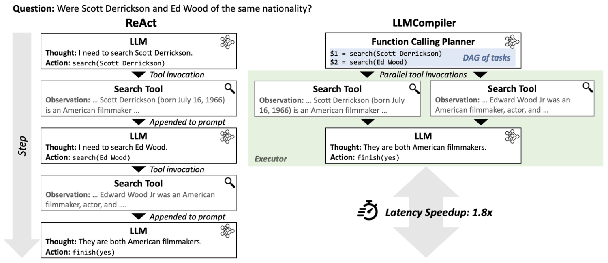
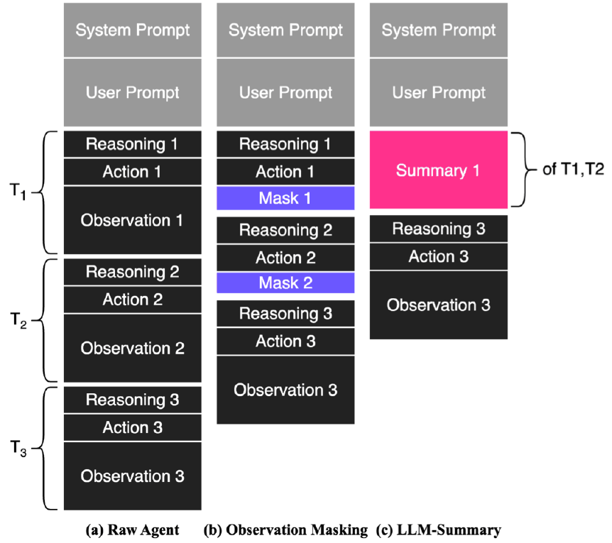

# 第 06 讲｜Agent 设计模式与上下文管理

软件工程大师 Martin Fowler 在《企业应用架构模式》中曾说：“设计模式都是半成品——这意味着你永远必须根据自己的具体环境亲手完成并调适它们。”在构建 AI Agent（智能体）系统时，这句话尤其贴切。

很多初学者在刚接触 Agent 开发时，容易走向两个极端：要么不管任务简单还是复杂，都套上一个完全自由的 ReAct 循环，结果在原本几行代码就能搞定的流程上既慢又贵、还不稳定；要么把所有历史对话和成百上千行工具输出原封不动地往模型输入里塞，导致几轮之后上下文膨胀腐化（Context Rot，指输入窗口里混杂了大量过时或无关信息，模型注意力被稀释，推理质量急剧下降），最终彻底迷失方向。

本讲将系统梳理经过工业界验证的三大类设计模式：
- **五大可组合的工作流模式（Workflow Design Patterns）**：解决“什么时候该用固定代码流程，而不是放任模型自由发挥”；
- **推理与行动模式（Reasoning & Acting Patterns）**：涵盖 ReAct、Reflexion、CRITIC、CodeAct、ReWOO 与 LLMCompiler，解决“模型如何更可靠、更高效地思考、试错并调用工具”；
- **长程上下文管理模式（Context Management Patterns）**：涵盖持久化事件日志、记忆卸载、上下文压缩、观测屏蔽、上下文隔离与渐进式披露，解决“多轮长任务下如何管好有限的上下文窗口”。

最后，我们将通过开源极简编码底座 **Pi** 的真实案例，看看这些模式如何在生产系统中协同运作、互相取舍。

**本讲视频**　[斯坦福课程视频](https://youtu.be/JC_pLC5EX_w) · [哔哩哔哩第 6 讲 · 中英字幕](https://www.bilibili.com/video/BV1JgyWzfEhg/?p=6)

## 学习目标

- 熟练掌握五种基础工作流设计模式（Prompt Chaining、Routing、Parallelization、Orchestrator-Workers、Evaluator-Optimizer）及其组合方式（如 STORM 与 Archon），能准确判断不同任务该交给确定性代码还是交给自主 Agent。
- 深入对比 Agent 推理与行动模式：理解 ReAct、Reflexion 与 CRITIC（工具辅助验证）的适用边界，掌握 CodeAct（以可执行代码作为动作空间）以及 ReWOO / LLMCompiler（规划与并行执行分离）的运行机制与工程权衡。
- 掌握上下文工程的两大核心原则（保持聚焦 Focus 与维持连续性 Continuity），能够组合运用五种上下文管理模式与渐进式披露，稳健控制长任务的 Token 窗口。
- 通过 Pi Agent Harness 的真实架构案例，分析极简工具集、树形上下文、技能渐进披露与安全边界背后的工程取舍。

## 知识讲解

### 1. 模式与五类 workflow

在动手写任何 Agent 代码之前，我们必须先回答一个最根本的架构问题：哪些步骤应该由程序员用代码写死，哪些步骤才值得交给大模型自主决策？这一节会先厘清“工作流”与“自主智能体”的边界，再拆解工业界最常用的五种基础工作流模式，为后面搭建复杂 Agent 系统打下地基。

#### 模式是可组合的选择

设计复合 AI 系统（由多个模型调用、工具和程序逻辑拼接而成的系统）时，第一道架构选择题永远是：**控制流（Control Flow，即“下一步该执行什么”的决策权）应该放在哪里？**

| 维度 | 工作流（Workflows） | 自主智能体（Agents） |
|---|---|---|
| **控制流主导者** | **程序代码（Code）** | **大语言模型（LLM）** |
| **动态适应方式** | 沿着预先编程写好的分支、路由与固定循环执行 | 根据每一步的环境观测（Observations）自主决定下一步动作 |
| **最佳适用场景** | 结构清晰、步骤可重复、需要高度可预测性的任务 | 路径无法预先穷举、需要多轮探索与灵活应变的开放任务 |
| **典型实例** | 客服工单分类 $\to$ 检索对应政策 $\to$ 生成回复草稿 | 使用终端与搜索工具自主排查并修复未知线上 Bug |

在真实生产系统中，Workflow 与 Agent 并非非此即彼，而是像乐高积木一样相互嵌套组合——外层可以用稳定的工作流兜底，局部探索环节再嵌入自主 Agent。Anthropic（Schluntz & Zhang, 2024）将最核心的复合工作流归纳为五种基础设计模式。

#### Prompt chaining

**提示链（Prompt Chaining）** 就像工厂流水线：它把一个复杂的宏大任务，拆解为一系列按固定顺序执行的子步骤（$\text{LLM}_1 \to \text{Gate} \to \text{LLM}_2 \to \text{LLM}_3$），让每次模型调用只专注于一件清晰的小事。更重要的是，它会在步骤之间插入确定性的**程序校验门（Programmatic Gate）**——也就是用普通代码检查上一步的输出是否格式合法、字段完整，不达标就拦截重试，绝不让脏数据流入下一环。

- **典型场景**：先让模型生成技术文档大纲 $\to$ 用程序校验门检查大纲是否覆盖了必选章节 $\to$ 按大纲逐节撰写正文 $\to$ 将正文翻译为目标语言。
- **工程权衡**：由于调用是串行排队的，端到端延迟（Latency）会增加，但它换来了每一步更高的准确率与可检查性。需要注意的边界是：如果省掉了中间的校验门，前一步的微小错误就会像多米诺骨牌一样向下游放大传递。

#### Routing

**路由模式（Routing）** 相当于医院的分诊台：先用一个轻量级分类器或小模型判断输入请求属于哪一类，再把它分发到专门定制的下游处理分支。不同分支可以各自拥有独立的提示词、专属工具集，甚至不同尺寸的模型。

- **典型场景**：将客户咨询路由到“退款售后”、“技术故障排查”或“常见 FAQ”三个不同分支；或者将简单问答路由给便宜快速的轻量级模型，只把困难的数学或编程问题交给高阶推理模型。
- **工程权衡**：它实现了软件工程中的**关注点分离（Separation of Concerns）**——每个分支只需写好自己那一类任务的提示词，避免把几十种互不相干的规则硬塞进同一个巨型提示词里导致模型顾此失彼；同时按难度分配模型也能显著降低推理成本。它的风险边界在于分类器本身：一旦首层路由分错类，下游专家再强也答非所问。

#### Parallelization

**并行化模式（Parallelization）** 让多个模型调用同时开工，再由一个**聚合器（Aggregator）** 收集并整合所有结果。以核对一张报销单为例，并行化主要有两种玩法：

> [!NOTE]
> **并行发出的调用分别要回答什么问题？**
> - **分片并行（Sectioning）**：把大任务拆成互不干扰的独立子项同时处理。例如，一组调用专门核对日期，另一组专门核对金额，最后把两项检查结果汇总到一起。这既能缩短等待时间，又能让每次调用注意力更集中。
> - **投票聚合（Voting）**：让多个调用反复审视同一个高风险判断。例如，让三次调用都独立判断同一笔金额是否超限，汇总时再按预设规则（如多数票）拍板，用额外算力换取更高的判断稳定性。

#### Orchestrator–workers

如果说分片并行的子任务清单是程序员提前写死的，那么**编排器—工作者模式（Orchestrator-Workers）** 则更进一步：由一个中央编排大模型（Orchestrator）先通读当前的具体输入，**现场动态拆解出所需的子任务**，再委派给多个专长工作者模型（Workers）并行或串行处理；最后，编排器收集所有 Worker 的产出，合成为最终答案。

> [!TIP]
> **判断依据**：区分固定分片并行与编排器—工作者模式，核心只看**子任务清单何时确定**。如果代码预先写死“每次都核日期与金额”，这就是固定分片；如果编排器读到这张报销单包含外币消费，才临时决定新增一项“汇率核查”子任务，就用到了动态拆解。

这种模式非常适合改动范围事先说不准的任务（例如跨多个代码文件修改功能），代价是编排器多了一次规划调用，且系统行为的可预测性略低于固定分片。

#### Evaluator–optimizer

**评估器—优化器模式（Evaluator-Optimizer）** 模仿了“作者写稿 + 编辑审稿”的迭代闭环：由生成模型（Generator）负责产出初稿或方案，评估模型（Evaluator）对照明确标准给出具体的改进反馈（Feedback），生成器再依据反馈修改，如此循环，直到通过评估或达到预设的最大轮数上限。

- **生效的两个前提条件**：第一，任务必须有**清晰、可明确表述的评价标准**（例如“译文需保留专业术语且符合口语习惯”），否则评估器只能泛泛而谈；第二，**评估器确实有能力挑出真毛病，且生成器拿到反馈后确实改得对**。如果评估器本身看不出错误，盲目循环只会白白烧掉 Token。

### 2. 组合模式与推理行动

上一节介绍的五种工作流模式就像基础零件，解决的是“流程结构”问题；但面对真正开放、充满不确定性的任务时，单靠固定零件还不够，我们既需要把多种模式组合起来，更需要让模型具备自主思考、试错和调用工具的能力。本节先看两个把基础工作流组合出强大能力的代表系统（STORM 与 Archon），再系统剖析 Agent 的核心推理与行动模式（ReAct、Reflexion、CRITIC 与 CodeAct）。

#### STORM 与 Archon

真实的复杂 AI 系统往往不是单一模式的独角戏，而是上述五种基础模式的有机组合：

- **STORM（Shao et al., 2024，斯坦福自动化维基百科长文生成系统）**：要写出一篇资料详实的长篇百科综述，直接让大模型一口气生成很容易遗漏视角、编造事实。STORM 巧妙串起了多种模式——先通过 **Orchestrator-Workers / Parallelization** 检索相关主题并生成多个不同视角的专家角色（Personas，例如历史学者、技术工程师等）；接着让每个专家视角与外部检索源展开多轮问答访谈，在追问中不断补全信息缺口（近似 **Evaluator-Optimizer** 式的追问闭环）；最后通过 **Prompt Chaining** 将访谈记录依次整理为大纲、分节草稿，并合成为带完整引用的综述长文。
- **Archon（Saad-Falcon et al., 2024）**：把推理时的各种常见组件——包括生成、多次采样、重排（Reranker，给多个候选结果打分排序）、融合（Fuser，把多份回答取长补短合并）和验证（Critic）——全部抽象为可插拔的模块化图层。只要给定一个算力预算，Archon 就能通过架构搜索自动尝试不同的拼装方案，找出性价比最高的复合推理架构。

#### ReAct

当任务路径无法提前穷举、必须让模型根据每一步的新发现自主与外部环境交互时，我们就进入了 **Agent 推理与行动模式（Reasoning & Acting Patterns）**。

其中最经典的基石是 **ReAct（Yao et al., 2023）**，名称取自 **Reason（思考）+ Act（行动）**。它的机制非常直观：强制模型在每次采取外部行动（例如调用搜索接口或执行命令）之前，先用自然语言输出显式的内部思考（Reason/Thought），说明“我现在知道了什么、缺什么、为什么要做下一步”；执行动作后，系统把环境返回的观测结果（Observe）拼回输入，模型再据此更新认知、决定下一步。

原始论文中有一项极具深远影响的实验发现：将 ReAct 与思维链（Chain-of-Thought）结合，尤其是**使用 ReAct 格式的成功轨迹对模型进行微调（Finetuning）**之后，模型表现会获得质的飞跃。如今，在后训练（Post-training，即模型完成基础预训练之后的对齐与能力强化阶段）中用工具调用轨迹微调模型，已经成为所有主流大模型的标准工序。

#### Reflexion

ReAct 能让模型在单次尝试（Trial）里边想边做，但如果整轮尝试最终失败了，怎么让模型在下一轮吸取教训，而不是重复踩同一个坑？**Reflexion（Shinn et al., 2023）** 引入了跨尝试的**语言强化学习**机制——它不修改模型权重，而是用自然语言写下“错题本”来指导下一轮。整个闭环包含三个角色：

1. **Actor（行动者）**：在环境中执行完整的动作轨迹（例如写一段代码并运行）；
2. **Evaluator（评估器）**：对这次轨迹的结果给出客观打分或成败判定（例如单元测试是否通过、任务是否完成）；
3. **Self-Reflection（自我反思模型）**：对照失败轨迹与外部评估信号，提炼出一段具体、可执行的自然语言经验教训（例如*“上次失败是因为我在未检查数组为空的情况下直接取了索引 0，下次应先加长度判断”*），把这条教训追加到短期情景记忆中，供 Actor 在下一轮尝试时参考。

消融实验（即逐个拆掉组件看效果变化的对照实验）清晰地证明：真正带来跨轮次准确率跃升的，是**由 LLM 提炼出的高浓缩反思总结（Reflection）**，而不是把上次失败时又长又乱的原始轨迹原封不动塞回上下文。

#### 自我批评的局限与 CRITIC

既然反思如此有效，初学者自然会想到一个偷懒的办法：在没有任何外部环境反馈的情况下，直接让大模型自己反问自己“你确定吗？请检查并修正你的答案”，行不行呢？

Huang et al.（2024）等研究揭示了**无外部证据的内省自我修正（Intrinsic Self-Correction）的重大局限**：当没有外部工具或真实验证器提供新信息时，让模型盲目自我批评往往适得其反，导致整体性能下降——原因很简单，没有客观依据时，模型很容易对自己的判断产生动摇，把原本做对的题目改成了错题！

为了打破这一僵局，**CRITIC（Gou et al., 2024）** 提出了**工具交互式批评（Tool-Interactive Critiquing）**：验证器（Verifier/Critic）不再靠空想挑刺，而是主动调用外部确定性工具来取证——比如用代码解释器真正跑一遍代码、用搜索引擎核查事实出处、用计算器验算数学公式——拿到客观的外部工具反馈后，再指导模型针对性修正。这一正一反的对比给出了非常明确的工程准则：**自我反思必须建立在外部环境或确定性工具提供的真实反馈信号之上**。

#### CodeAct

在传统的工具调用模式下，模型每次输出一段 JSON 对象来调用一个函数。这个机制在单次查询时很好用，但一旦遇到需要循环、条件判断和数据汇总的任务，就会显得非常笨拙。设想这样一个问题：

> “请比较智能手机型号 `CodeAct 1` 在美国、日本、德国和印度四个国家的税后折合美元售价，找出最划算的国家。”

如果使用 **JSON Actions**，模型必须一轮一轮地调用 `get_price`、等待结果返回、再调 `get_tax`、再调 `convert_currency`——4 个国家乘上 3 个步骤，来回交互需要十几个回合，不仅慢，每轮还要重复发送越来越长的历史上下文。

**CodeAct（Wang et al., 2024）** 提出了一个核心洞见：**可执行代码（Python Code）才是表达复杂动作组合最自然、最强大的媒介！** 在 CodeAct 模式下，模型直接生成一段包含 `for country in ["USA", "Japan", "Germany", "India"]:` 循环、变量赋值与 `min()` 比较的 Python 脚本，交给沙箱一次性运行，就能在 **1 个回合内**直接算出精确结果 `Japan 904.0`。

实验证明，将代码作为动作空间不仅大幅减少了交互轮数与 Token 消耗，还借助编程语言天然的控制流表达力（循环、分支、中间变量与复用第三方库），显著提高了复杂任务的成功率。当然，它的工程前提是必须配备安全隔离的代码执行沙箱，防止模型生成的脚本误伤宿主机。

### 3. 计划与执行分离

上一节的 ReAct、Reflexion 和 CodeAct 让 Agent 具备了强大的交互与纠错能力，但它们在默认情况下都是“走一步看一步”——每调一次工具，都要重新调用大模型思考下一步，既慢又费 Token。如果一个任务所需的工具步骤在动手前就能看清大概，我们能不能把“制定计划”和“执行工具”拆开，甚至让互不依赖的工具同时跑起来？这就是本节要解决的问题。

#### ReWOO

在标准 ReAct 循环里，模型每调用一次工具，系统都必须把之前所有的对话与工具输出重新送入模型，做一次完整的 **Prefill（预填充，即模型一次性读取并编码全部输入上下文的过程，输入越长，耗时与费用越高）**。如果任务步骤在初期就能预见，这种反复重读历史的做法就造成了巨大的浪费。

**ReWOO（Reasoning WithOut Observation, Xu et al., 2023）** 设计了“先一次性规划，再批量执行，最后汇总求解”的三阶段架构：

1. **Planner（规划器）**：在还不执行任何工具的情况下，直接输出一张带有占位变量的完整执行计划图。例如：`Plan 1: 搜索某电影导演 -> #E1`；`Plan 2: 搜索 #E1 的出生年份 -> #E2`；
2. **Worker（执行器）**：由普通程序按依赖顺序依次调用外部工具，把查到的真实结果填进占位变量 `#E1`、`#E2` 中——整个执行阶段**完全不需要调用大模型**；
3. **Solver（求解器）**：把原始问题和已经填满真实数据的证据变量一次性交给大模型，直接生成最终答案。

由于省去了中间每个工具步骤对长历史的重复 Prefill，ReWOO 大幅压低了 Token 开销（例如在多跳问答基准 HotpotQA 上，它用明显更少的 Token 取得了更高的准确率）。不过它的边界也很清楚：如果第一步工具返回的结果出乎意料、导致后续计划彻底失效，纯静态规划就会捉襟见肘。

#### LLMCompiler

**LLMCompiler（Kim 等，2024）** 在“计划与执行分离”的基础上，进一步引入了类似计算机编译器的**依赖调度思想**：不仅拆开规划和执行，还要找出哪些工具调用互不依赖，让它们并发执行。

例如，要比较两位导演的国籍，查第一位导演时完全可以同时去查第二位，不必傻等第一个结果回来；只有最后做比较的那一步，才需要等两份资料都齐全。LLMCompiler 的内部包含三个协同组件：
- **规划器（Planner）**：列出所有需要执行的工具调用及其先后依赖关系（构成一张有向无环图）；
- **任务调度单元（Task Fetching Unit）**：持续扫描计划表，只要某个调用所需的输入已经就绪，就立刻派发出去；
- **执行器（Executor）**：并发运行这些就绪的工具。

更关键的是，它补上了 ReWOO 的短板：如果某个工具返回的结果引出了新问题，系统可以把新信息交回规划器，动态更新后续计划（**Dynamic Replanning，动态重规划**）。

图注：阅读此图时，可从右上方的规划器沿两条分支箭头向下看——对两位导演的两次搜索互不依赖，因此并发执行，最终在下方的 LLM 节点汇合比较；左栏则对照展示了同一问题下 ReAct 逐次串行搜索的轨迹。图源为 [Kim 等的 LLMCompiler 论文](https://arxiv.org/abs/2312.04511)，节选自[斯坦福 CS329Z 第 6 讲，第 51 页](https://web.stanford.edu/class/cs329z/slides/lecture06.pdf#page=51)。

#### 现代并行调用与选择

随着现代前沿大模型原生支持**并行工具调用（Parallel Tool Calling，即模型在单次回复中直接同时发出多个独立的工具调用请求）**，面对简单的无依赖并发查询，开发者已经不必再专门部署一套复杂的 LLMCompiler 框架。

但在两类场景下，ReWOO 与 LLMCompiler 的“显式规划 + 依赖感知并发调度”思想依然是降低端到端延迟的利器：一是子任务之间存在多层嵌套依赖（如 A 和 B 并行，C 依赖 A，D 同时依赖 B 和 C）；二是需要统筹调度多个耗时较长的子 Agent（Sub-agents）协同工作时。

### 4. 长任务的 context patterns

前面的章节解决了“流程怎么编排”和“工具怎么高效调用”，但只要 Agent 跑上十几轮甚至几十轮，另一个致命问题就会浮出水面：上下文窗口越撑越大，推理越来越贵、越来越慢，模型还容易把最初的要求忘得一干二净。本节将聚焦长程任务的上下文管理，先给出两大核心设计原则，再介绍五种可自由组合的上下文管理模式与技能渐进披露机制。

#### Focus 与 continuity

假设你让助手核对一份差旅报销单，并明确要求“只给建议，先别提交”。目前它已经找到了 12 张票据，前 7 张都核对完毕，接下来只需核对第 8 张的税额。在构造这一轮发给模型的输入时，好的上下文必须同时满足两个看似矛盾的要求：

- **聚焦（Focus）**：把注意力留给当下最要紧的信息——保留第 8 张票据的编号和金额，省去已经核对完的前 7 张票据的冗长原始明细，避免无关噪音干扰判断。
- **连续性（Continuity）**：不能为了精简把全局脉络丢掉——必须保留“只给建议”的硬约束、当前核对到第几张的进度，以及原始凭证存放的位置。这样哪怕切换了一个全新的上下文窗口，助手也能无缝接着核对。

在具体实现上，工程界通常会先把系统指令、工具定义等稳定不变的内容固定在输入最前面，以便充分复用推理引擎的 **KV Cache（键值缓存，即大模型对历史前缀计算出的中间缓存；只要前缀一字不改，后续轮次就无需重算，能显著省钱提速）**，然后再灵活决定本轮要带上哪些动态历史。下面几种模式可以按需组合使用。

#### Event log 与重建

**模式一：持久化事件日志与视图重建（Event Log & Projection）**。核心思路是把“完整记录”和“发给模型的输入”彻底解耦：底层维护一份只增不减（Append-only）的**事件日志（Event Log）**，按时间顺序忠实记录每一条用户要求、助手动作和工具原始结果；而**上下文管理器**在每一轮推理前，再根据当前任务需要，从日志中挑选、裁剪并拼装出真正传给模型的 `messages` 列表。

这样做的好处在于可逆：哪怕把已处理的大段输出移出了本轮输入，只要保留事件编号，后续随时能按编号回查原文。沿用上面的报销例子，假设原始票据保存在本地，下面两列展示的是同一次运行中“底层留存”与“本轮喂给模型”的区别：

| 事件日志中留存的内容 | 核对第 8 张时传给模型的内容 |
| --- | --- |
| 用户说“只给建议，先别提交” | 保留原话，作为本轮操作边界。 |
| 工具列出 12 张票据的全部明细 | 保留“前 7 张已核对”及原始明细的事件编号。 |
| 工具读出第 8 张的金额和税额 | 保留这张票据的明细，用于下一步计算。 |

如果核对到后面突然发现第 3 张票据有疑点，模型只需按事件编号取回那一条凭证即可。这样既保留了完整的审计复查能力，又把宝贵的上下文窗口留给了眼前的判断。

#### Memory offloading

**模式二：记忆卸载（Memory Offloading，以 MemGPT 为代表）**。
当 Agent 在执行过程中遇到某段重要信息——例如刚查到的一篇长篇制度文档，或是阶段性的分析结论——目前暂时用不上、但未来可能还需要参考时，可以让 Agent 主动调用工具将其写入外部记忆存储（如数据库）或本地磁盘文件。落盘之后，就可以放心地把这段大文本从昂贵的上下文窗口中修剪掉，等后面真正需要时再按需检索读回。这就像人在做复杂项目时，把参考资料先归档到文件夹，腾空书桌专心做眼前的工作。

#### Compaction

**模式三：上下文压缩（Compaction）**。
当历史对话与动作序列不断累积、眼看就要逼近上下文上限或 Token 预算时，可以专门调用一次大语言模型，将早期的一连串“思考—行动—观测”提炼为一段高密度的结构化摘要（Summary），用几百 Token 的摘要替换掉原本动辄数万 Token 的早期历史。

对于步骤繁多的复杂任务，压缩本身不能只写一句“请总结以上内容”，而可以设计为一个专门的结构化子流程，逐项核对并保留五个关键要素：**当前目标、用户硬约束、已完成项、待办项与关键证据路径**，防止压缩时把关键限制条件顺手抹掉。

#### Observation masking

**模式四：观测屏蔽（Observation Masking）**专门用来对付“很长、但当下暂时用不上”的工具返回结果。沿用报销任务为例：在构建上下文时，我们可以保留“第 2 步调用了票据列表工具”这一动作痕迹，但把工具当时返回的那份上万字明细，直接替换成一句简短的占位符——“明细见事件 2”。只要原始数据仍安稳躺在事件日志里，后续随时可以按编号取回。

图注：阅读此图时，从左栏的 Observation 1 水平向右对比。中栏（观测屏蔽）只把早期的长工具输出压缩成了简短占位符，仍保留了每次调用的骨架；右栏（上下文压缩）则把早期动作与观察一并概括成了一段连续摘要；三种方案都完整保留了最新一轮 T3 的全部细节。图源为 [Lindenbauer 等的研究](https://arxiv.org/abs/2508.21433)，节选自[斯坦福 CS329Z 第 6 讲，第 67 页](https://web.stanford.edu/class/cs329z/slides/lecture06.pdf#page=67)。

把**压缩（Compaction）**和**观测屏蔽（Observation Masking）**放在一起对比，工程取舍一目了然：
- **压缩**是用自然语言把多轮历史改写成较短的叙述（例如“前 7 张已核对”），能把很长的历史压得很小，但需要额外调用一次大模型来生成摘要，且存在摘要漏掉细节的风险；
- **屏蔽**保留了工具调用发生的位置和先后次序，只替换选中的冗长返回值。它完全可以由确定性代码完成，**零额外模型调用成本**。不过使用屏蔽时要注意边界：如果下一步推理恰好依赖某条被隐藏的税额，系统必须先把它按编号取回，否则模型只能瞎猜。

#### Context isolation

**模式五：上下文隔离（Context Isolation / Sub-agents）**。
当主 Agent 遇到一个需要翻阅大量文件、反复试错的局部脏活累活时（例如“在几百个文件的代码库里，找出某个函数的定义位置和调用链”），千万不要在主 Agent 的上下文里直接展开这十几步搜索。更好的做法是派生一个拥有**独立、全新上下文窗口的子智能体（Sub-agent）**去专门干这件事：子智能体在自己的小房间里跑完十几步搜索后，只把最终查到的几行核心结论汇报给主 Agent。随着子智能体任务结束并销毁，中间产生的成千上万 Token 的搜索弯路和报错日志也随之消失，丝毫不污染主上下文。

#### Progressive disclosure 与 skills

上下文隔离的另一个重要体现，是**渐进式披露（Progressive Disclosure，以 Agent Skills 机制为代表）**。在实际业务中，一个通用 Agent 可能需要掌握几十种专业工作流（比如做财务对账、写 SQL 报表、发版巡检），如果把所有操作手册和参考脚本一股脑塞进初始系统提示词，还没开始干活上下文就被塞满了。

渐进式披露的做法像图书馆的检索目录：只在初始提示词中放入每项技能（Skill）的**简短名称与一行触发说明**；只有当 Agent 判断当前任务确实命中了某项技能时，才按需去读取对应的 `SKILL.md` 详细操作指南与附属资源文件。这既保住了系统的扩展性，又把日常的初始 Token 开销压到了最低。

### 5. Pi 案例

学完了工作流、推理行动与上下文管理的诸多模式，你可能会问：在真实代码里，难道要把上面所有花哨的机制全部堆在一起吗？恰恰相反，优秀的工程架构往往取决于“克制”与“取舍”。本节我们通过开源极简编码底座 **Pi（pi.dev）** 的真实设计，看看这些模式如何被精炼组合，以及它为什么刻意删掉了很多看似标配的功能。

#### 小核心与四个工具

Pi 的设计哲学非常鲜明：*“Pi 是一个极简的 Agent 底座。让 Pi 适应你的工作流，而不是反过来。”*

打开 Pi 的默认配置，你会惊讶于它的克制：它默认仅启用 4 个基础工具——**`read`（读文件）、`bash`（执行命令）、`edit`（修改文件）、`write`（写文件）**，整个系统提示词被严格控制在 **1,000 Tokens 以内**。

为什么它不像许多同类工具那样，专门提供 `grep`（搜索文本）、`find`（找文件）或 `git`（版本控制）工具呢？因为这些操作本质上全都是 `bash` 命令的子集，现代大模型原本就非常熟悉标准命令行。坚持极简的工具列表，彻底消除了**工具膨胀（Tool Bloat，指注册了几十个功能重叠的工具，既白白占满系统提示词，又让模型在选工具时频频出错）**。

#### 树形会话、日志与扩展

在主循环与上下文管理上，Pi 并没有堆砌复杂框架，而是采用了精巧的组合设计：

1. **ReAct JSON 循环 + 树形上下文**：底层沿用简洁可靠的 ReAct 工具调用循环，并将每次交互以持久化事件日志保存，进而组织成一棵**分支树（Tree）**。这就像代码里的 Git 分支——当一条排查思路走入死胡同时，开发者随时可以回退到之前的某个历史节点，另开一条分支尝试全新方案，而不必从头再来；
2. **三层上下文管理**：把上一节讲到的多种模式自然串联——（a）底层从事件日志转换重建每轮的 LLM 输入；（b）通过 **Skill Files（技能文件）** 实现专业知识的渐进式披露；（c）当对话过长、窗口将满时，自动触发 **Compaction（上下文压缩）** 腾出空间。

#### 没有内建功能的取舍

同样耐人寻味的是 Pi **明确选择不内建（Deliberately Omitted）** 的功能清单：它没有内建子 Agent、没有计划模式（Plan Mode）、没有待办清单工具（To-do lists）、没有后台 Bash，甚至**没有内建权限确认弹窗（No Permission Checks）**——Pi 直接继承启动它的操作系统的用户权限来执行命令。

这种极致克制的取舍是一把双刃剑：
- **优势**：内核极其轻量、行为透明，高级开发者可以毫无阻碍地通过插件按需扩展自己的工作流，不会和框架内置的繁琐规则打架；
- **风险与安全边界**：正因为没有内置权限弹窗拦截危险命令，一旦你在处理不可信外部输入（例如运行未知仓库代码）或自动化批量评测时使用它，**开发者必须自己在外部包裹容器或操作系统级沙箱（如 Docker 或 macOS 的 `sandbox-exec`）**，用硬隔离来兜底安全边界。

## 原课程阅读清单与导读

- [Yao et al. "ReAct: Synergizing Reasoning and Acting in Language Models." ICLR (2023).](https://arxiv.org/abs/2210.03629)
  导读：Agent 领域的奠基之作。建议重点对比论文中 Reason-only（只思考不行动）、Act-only（只行动不思考）与 ReAct 三者在知识密集型问答（HotpotQA）和交互决策环境（ALFWorld）上的表现差异，并留意作者关于“用 ReAct 轨迹微调模型”能带来大幅跃升的实验结论。
- [Schluntz & Zhang. "Building Effective AI Agents." Anthropic (2024).](https://www.anthropic.com/engineering/building-effective-agents)
  导读：非常接地气的工业界实践指南。重点精读五种工作流模式（Prompt Chaining、Routing、Parallelization、Orchestrator-Workers、Evaluator-Optimizer）的适用边界与决策建议，体会“尽可能保持设计简单，仅在固定流程搞不定时才增加自主度”的工程原则。
- [LangChain. "Context Engineering." LangChain Blog (2025).](https://www.langchain.com/blog/context-engineering-for-agents)
  导读：帮你建立上下文管理的全局地图。文章系统梳理了写入上下文（Write）、筛选上下文（Select）、压缩上下文（Compress）与隔离上下文（Isolate）四大维度，读完后可以和本讲第 4 节的五种模式一一对应起来。
- **拓展阅读**：[Shinn et al. "Reflexion: Language Agents with Verbal Reinforcement Learning." NeurIPS (2023).](https://arxiv.org/abs/2303.11366)
  导读：重点分析 Actor、Evaluator 与 Self-Reflection 三个组件如何串联成跨轮次改错闭环，并结合本讲 CRITIC 的讨论，体会“外部环境客观反馈信号”在防止模型盲目自省中的决定性作用。
- **拓展阅读**：[Wang et al. "Executable Code Actions Elicit Better LLM Agents." ICML (2024).](https://arxiv.org/abs/2402.01030)
  导读：重点看 CodeAct 与传统 JSON / 纯文本动作格式在多工具组合控制流、交互轮数以及任务成功率上的定量对比实验，思考为什么编程语言天生更适合作为复杂 Agent 的动作空间。

## 动手练习

1. **工作流与 Agent 架构选型**：针对“读取用户提交的报销单 PDF，核对公司差旅制度，计算各项汇率转换，并生成审批结论与财务入账条目”这一真实业务需求，设计一套结合 **Routing + Parallelization + Evaluator-Optimizer / CodeAct** 的混合系统架构图。请逐一说明每个环节为什么选择固定工作流或动态 Agent（提示：思考哪些步骤规则明确适合写死流程，哪些步骤涉及复杂计算适合 CodeAct，哪些步骤适合并行提速或引入评估闭环把关）。
2. **Observation Masking 与 Compaction 对比实现**：用你熟悉的语言构造一段包含 15 轮工具调用的模拟长轨迹（要求：第 1 轮包含用户的预算硬约束，第 2 轮和第 5 轮包含长达 20,000 字符的文件列表输出）。编写一个上下文投影函数，将三种策略组合落地：① 完整保留最近 3 轮输出；② 对更早的超大工具输出执行 Observation Masking（替换为带事件编号的占位符）；③ 当总长度仍超出 4,000 Tokens 时触发摘要 Compaction。运行并验证最终生成的 `messages` 是否既严格控制在 Token 预算内，又完整保住了第 1 轮的预算硬约束（本题直接衔接 HW1 第 10–11 题）。
