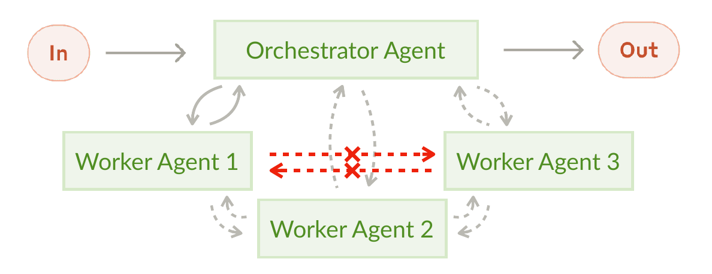
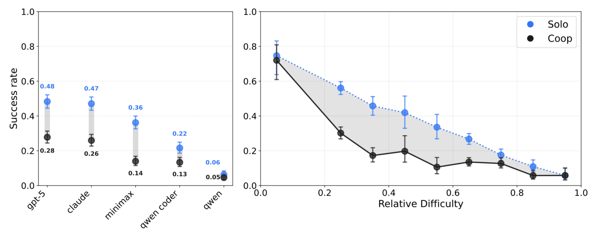

# 第 08 讲｜多 Agent 系统

当单个 Agent 面对庞大复杂的工程任务（比如同时维护一个大型代码仓库的前端、后端与测试套件，或者从零编写一个完整的 C 语言编译器）感到力不从心时，一个很自然的想法是：**“三个臭皮匠，顶个诸葛亮”——能不能让多个不同角色的 Agent 组成团队协同作战？**

近年来，多智能体系统（Multi-Agent Systems, MAS）频频登上技术头条，但也伴随着大量盲目堆砌角色的噱头。在实际工程中，如果草率地把任务拆给 5 个 Agent 互相聊天，往往不仅会让 Token 成本暴增数倍，还可能因为沟通断层、目标冲突或相互带偏，导致最终效果还不如一个配置得当的单 Agent。

本讲将用严谨的工程视角拆解多 Agent 系统：何时应当坚持单 Agent 基线、何时值得引入多 Agent；如何设计编排拓扑（Independent、Centralized、Decentralized Swarm、Hybrid 与动态组队 DyLAN）、通信通道（AutoGen 会话、Handoff 与 Agent-as-Tool、共享信息板与 Google A2A 协议）以及协调基础设施（任务账本 Task Ledger、G-Memory 与 Git Worktree 隔离）；最后结合 Cemri et al.（2025）与 CooperBench 的实证研究，深入剖析多 Agent 系统为什么会失败，以及真正跑通的工程案例做对了什么。

**本讲视频**　[斯坦福课程视频](https://youtu.be/TlX_ft_PQIM) · [哔哩哔哩第 8 讲 · 中英字幕](https://www.bilibili.com/video/BV1JgyWzfEhg/?p=8)

## 学习目标

- 理解单智能体系统（SAS）与多智能体系统（MAS）的收益与代价边界，掌握“先建立强单 Agent 基线，再按需引入多 Agent”的工程原则。
- 掌握四种核心多 Agent 编排拓扑（独立聚合、中心化编排器、去中心化蜂群、混合架构）及动态团队选择算法（DyLAN）的机制与成本规律。
- 严格区分**通信（Communication，如何交换信息）**与**协调（Coordination，如何管理相互依赖的工作）**，掌握 Handoff 与 Agent-as-Tool 的控制权差异及 Google Agent2Agent（A2A）协议。
- 掌握三大协调基础设施（任务账本 Task Ledger、多智能体共享图记忆 G-Memory、Git Worktree 工作区隔离）与三种协作模式（角色分工、资源划分、计划协商）。
- 能够运用 MAST 三层失效分类法诊断多 Agent 故障，理解“协调诅咒（Curse of Coordination）”、群体趋同（Conformity）及大规模去中心化协作的成功要素。

## 知识讲解

### 1. 多 Agent 的收益与代价

前几讲我们都在打磨单个 Agent 的能力，本节把视角扩展到团队协作，先回答一个最根本的决策问题：什么时候引入多 Agent 真的能带来收益，什么时候反而会拖累系统？

#### 系统定义

沿着我们在课程中反复使用的系统复杂度光谱来看：**单个模型（Model）$\to$ 固定工作流（Workflow）$\to$ 单智能体（Single Agent，例如独立实现一个功能特性）$\to$ 多智能体系统（Multi-Agent System，例如共同维护整个大型软件仓库）**，多智能体系统位于复杂度的最右端。

从定义上看，**多智能体系统（MAS）是由多个围绕共同目标协同工作的 Agent 组成的集合**。你可以把它类比成一支软件研发团队：光把几个人拉进同一个房间并不会自动产出好软件，架构师必须同时设计好三个核心维度，才能让团队形成合力而不是一盘散沙：
1. **编排拓扑（Orchestration）**：决定团队的“组织架构”——由谁来拆解和分派任务、各个角色按什么拓扑结构连接；
2. **通信机制（Communication）**：决定成员的“沟通渠道”——Agent 之间通过什么通道、按什么格式交换消息与中间产物；
3. **协调设施（Coordination）**：决定团队的“协作规矩”——如何管理共享工作区、任务先后依赖、共同记忆与操作冲突。

#### 为什么可能更好

在合适的任务结构下，多 Agent 系统能从四个方面超越单 Agent：
- **并行执行（Parallel Execution）**：当一个大任务可以拆成多个互不依赖的子任务时，多个 Agent 同时开工，能显著缩短端到端的墙钟时间（Wall-clock Time，即从提交任务到拿到结果，你在现实手表上感受到的真实等待耗时）；
- **职责专业化（Specialization）**：你可以为不同角色分别配置定制化的系统指令、不同尺寸或专长的底层模型，以及最小化的专属工具集。例如，让擅长视觉理解的模型负责检查前端 UI，让擅长逻辑推理的模型负责编写后端代码，避免单个 Agent 背负过多无关工具而频频选错；
- **聚焦的独立上下文（Focused Context）**：大模型的上下文窗口就像工作台桌面，东西堆太多就会干扰注意力。拆成多 Agent 后，每个成员的窗口里只保留与自己子任务直接相关的信息，不会被其他子任务的冗长中间过程撑爆；
- **更广的探索覆盖（Broader Exploration）**：多个 Agent 可以同时从不同的假设或技术路线出发尝试解题，降低单路思维一头扎进局部死胡同的风险。

#### 为什么可能更差

然而，多 Agent 绝非免费的午餐。每多加一个 Agent，系统都会引入五项实打实的工程代价：
- **高昂的协调开销（Coordination Overhead）**：任务委派、往返消息传递和最终结果整合都会触发额外的大模型调用，消耗大量时间与 Token 预算；
- **交接中的信息丢失（Information Loss）**：当 Agent A 把阶段性成果转交给 Agent B 时，往往只传了结论，却漏掉了关键的隐含约束或早期对话背景；
- **动作冲突与覆写（Conflicting Actions）**：缺乏约束时，两个 Agent 可能会重复做同一件事、违背先前的约定，甚至同时编辑同一个文件，把对方的修改直接覆盖掉；
- **跨主体误差传播（Error Propagation）**：上游 Agent 产生的一次事实幻觉或错误假设，很容易被下游 Agent 当成“已经核实的前提”全盘接收，并在后续步骤中被不断放大；
- **调试与维护复杂度激增（Engineering Complexity）**：角色提示词、消息格式和交互状态越多，一旦结果出错，排查“究竟是哪个环节带偏了全局”的难度就会成倍上升。

#### 强单 Agent baseline

Kim et al.（2025/2026）在《Towards a Science of Scaling Agent Systems》中通过系统的控制变量实验，揭示了一个非常反直觉却极具指导价值的结论：**在许多高度依赖上下文连续推理的任务上，给定同等算力预算，单智能体系统（SAS）的表现明显优于多智能体系统。**原因很直接：这类任务拆不开，强行拆分只会把宝贵的 Token 预算浪费在“互相转述上下文”上。

基于这一发现，我们可以总结出清晰的多 Agent 选型边界：

| 优先使用单智能体系统（SAS）的场景 | 值得尝试多智能体系统（MAS）的场景 |
|---|---|
| 任务各个步骤之间高度串行依赖、环环相扣 | 子任务之间耦合度低，可以在有限同步下独立推进 |
| 所有操作紧密耦合在同一个共享状态上（存在大量重叠修改） | 信息可以自然切分为互不干扰的聚焦上下文（如按模块或文档分片） |
| 单个 Agent 在质量、成本与延迟上已经满足业务目标 | 并行探索、角色专精或独立审查恰好能解决已测出的单 Agent 瓶颈 |

**工程铁律**：永远先用相同的工具集和充足的 Token 预算，搭建一个**强单 Agent 基线（Strong Single-Agent Baseline）**。只有当你明确测出单 Agent 的瓶颈，且新增 Agent 带来的质量或速度收益实打实大于协调成本时，才保留多 Agent 架构。

### 2. 拓扑与动态选择

确定任务确实值得引入多 Agent 之后，下一个要解决的问题是“团队怎么排兵布阵”。本节先对比四种基础编排拓扑的结构与成本规律，再介绍如何根据具体任务动态挑选精简团队。

一条消息从谁那里出发，必须经谁转发，最后又由谁汇总？沿着下面的连线看这三个角色，再比较四种组织方式。

图注：顺着底部虚线走一遍可以看到，节点 2 能够分别直连节点 1 和节点 3；而节点 1 与节点 3 之间打了红叉，意味着节点 1 想把结果交给节点 3，必须绕道其他节点转发，最终的汇总与交付仍由顶部的编排者统一把关。[斯坦福 CS329Z 第 8 讲，PDF 第 21 页，课件作者 Diyi Yang、Michael Ryan、John Yang](https://web.stanford.edu/class/cs329z/slides/lecture08.pdf#page=21) · [课件注明的绘图参考，Anthropic](https://www.anthropic.com/engineering/building-effective-agents)

#### Independent 与 centralized

多 Agent 系统的编排拓扑（Orchestration Patterns，即成员之间“谁对接谁”的连接结构）主要有四种基本形态。前两种结构最为常见，也最容易在工程中落地：
1. **独立聚合型（Independent）**：`Agent 1`、`Agent 2`、`Agent 3` 各自独立处理任务，彼此之间**不交换任何中间消息**，最后由一个聚合器（Aggregator）统一汇总或投票选出最终输出。这种模式并行度最高、完全没有通信死循环的风险，缺点是各 Agent 在中途无法借鉴同伴的新发现。
2. **中心化编排型（Centralized / Orchestrator）**：设立一个统筹全局的 `Orchestrator Agent`（编排者），由它负责把大任务拆成子任务，并分别与 `Worker Agent 1, 2, 3` 单线联系；Workers 只向编排者汇报结果，由编排者决定下一步调度。中心化结构让全局状态清晰可控，但当任务变大、子结果变多时，Orchestrator 本身很容易成为吞吐量与上下文容量的瓶颈。

#### Decentralized / swarm 与 hybrid

如果任务需要工作节点之间实时互通有无，就会用到另外两种赋予横向通信自由度的拓扑：
3. **去中心化蜂群型（Decentralized / Swarm）**：没有唯一的中心主控节点，所有 Agent 地位对等，可以通过共享消息板或点对点通道直接相互通信（All-to-all communication），甚至按需动态派生新的子 Agent。这种拓扑非常适合大规模开放式探索与并行发现，但也最容易聊散架，协调与收敛难度最高。
4. **混合型（Hybrid）**：结合中心化与去中心化的折中方案——顶层依然保留 `Orchestrator Agent` 把控全局目标与最终集成，同时允许需要紧密配合的部分 `Worker Agents` 直接横向交换信息（正如上方配图所示），在全局视野与局部协作效率之间取得平衡。

在 Token 消耗与计算成本上，实证结果通常呈现明显的递增规律：**单智能体（Single Agent）$<$ 中心化编排（Orchestrated）$<$ 去中心化蜂群（Swarms）**。背后的原因不难理解：编排节点越多、横向广播越频繁，同一段上下文就越容易在多个 Agent 的窗口里反复抄送，调用次数和总 Token 量自然水涨船高。

#### DyLAN

既然固定一个庞大臃肿的 Agent 团队既费钱又容易互相干扰，能不能像组项目组一样，根据手头任务动态挑选最得力的精干小队？**DyLAN（Dynamic LLM-Powered Agent Network, Liu et al., 2023）** 给出了一个巧妙的思路：把多轮多 Agent 的讨论过程看作一个**多层前馈网络**——你可以把每一轮讨论想象成网络的一层，层里的每个节点是一个 Agent，相邻两层之间的连线就是“上一轮谁的发言被下一轮谁看到了”。在此基础上，DyLAN 引入了三步机制：
1. **前向传播与互评（Forward Pass & Peer Rating）**：在每一轮时间步，各个 Agent 先根据上一轮的发言生成自己的方案，同时对上一轮同伴的回答做实用性打分（Utility Scoring，判断谁的观点真正帮上了忙）；
2. **反向贡献归因（Backward Credit Assignment）**：在探测/筛选阶段，系统从最终达成共识的正确答案倒推回去，沿着交互图把贡献度权重逐层反传，算出每个角色的 **智能体重要性得分（Agent Importance Scores）**，以此识别出在这类任务上真正出力、而非“凑数”的精锐成员；
3. **推理时动态剪枝与早停（Dynamic Pruning & Early Stopping）**：真正执行新任务时，系统只保留高分 Agent、实时剔除低效成员；而且一旦有 **$2/3$ 以上的 Agent 达成一致答案，便立即提前终止（Early Stop）**，不再硬撑完所有预设轮次。这样既省下了大量 API 调用成本，又往往能拿到更高的决策准确率。

### 3. 通信、交接与协议

上一节解决了“团队按什么结构连接”，但光画好连线还不够：消息具体传什么内容？用户追问时由谁接话？不同框架写出来的 Agent 又该如何跨网络合作？本节将厘清通信与协调的边界，并拆解主流的会话模式、交接机制与跨系统协议。

#### Communication 不等于 coordination

工程实践中一个极易踩的坑，是以为“把几个 Agent 拉进同一个群聊，让它们自由说话，就自然能协作好”。来看一个日常场景：用户请前台助手找一间周四下午的教室，并特别交代**“确认后再预约”**。前台把请求发到群里，两个教室助手各自查到了空教室。这时问题来了：现在该由谁回复用户？谁有权限真正把预约写入日历？

把这件事拆成**通信**和**协调**两层，权责立刻就清楚了：

| 先看什么 | 在这次找教室的任务中怎么做 |
|---|---|
| **通信（Communication）**：消息交给谁，包含什么 | 前台发送日期、时段和人数；教室助手返回可用时段、容量、教室编号和查询时间。消息格式、会话通道与共享产物都服务于这一步。 |
| **协调（Coordination）**：谁负责，什么条件下能继续 | 任务账本把“查可用性”分给教室助手，把“请用户确认”分给前台，预约状态保持“待确认”。收到确认后才允许指定的执行者写入日历。 |

> [!TIP]
> **判断依据**：“已查到 B203”只是可用性查询的通信结果，不代表任务已经闭环。要判断预约是否真正完成，还得核对两项协调条件：是否拿到用户确认，以及是否收到日历写入回执。

#### AutoGen 的会话结构

微软提出的 **AutoGen（Wu et al., 2024）** 把多 Agent 通信统一抽象为**可编程的多方对话（Multi-Agent Conversations）**。每个 Agent 都可以独立配置底层模型、代码/工具执行能力以及人工介入策略，然后像搭积木一样组合成三种典型会话模式：
- **顺序接力（Sequential Chat）**：像流水线接力，前一组 Agent 完成阶段任务后，把总结出的结论交给下一组继续加工；
- **嵌套会话（Nested Chat）**：像主会话里的“临时小会”——某个 Agent 接到棘手子问题时，在内部私下拉起一组子 Agent 讨论，得出结论后再带着结果回到主会话回复；
- **群聊模式（Group Chat）**：所有 Agent 共享同一个会话上下文，由群聊管理器控制发言顺序，常见调度策略包括固定轮流发言（`RoundRobinGroupChat`）、由大模型根据上下文动态点名（`SelectorGroupChat`），以及由蜂群成员自主决定把话筒递给谁（`Swarm`）。

#### Handoff 与 agent-as-tool

当两个 Agent 需要配合服务同一个用户时，最容易混淆的是**控制权归谁**。回到刚才找教室的例子：前台和教室助手都已经收到了日期、人数和“先确认再预约”的约束，此时用户又补充了一句“希望有投影仪”。

> [!NOTE]
> **谁负责接住用户的下一句话？**
> - **控制权移交（Handoff）**：前台已经把任务连同约束彻底转交给教室助手，自己退出当前对话。用户接下来直接和教室助手沟通，由教室助手继续确认设备、时段和房间。
> - **把 Agent 当工具调用（Agent-as-Tool）**：前台始终掌握对话主导权，只是像调用普通函数一样委托教室助手查房；教室助手把空房清单返回给前台后即结束调用。用户的新要求仍由前台接收，由前台决定要不要再查一次，并向用户给出最终建议。

画系统调用图时，有一个很实用的判断法则：**把用户的下一条消息直接连到当前对话负责人**。如果某个助手只负责查房而不面向用户，就把它交付清单的箭头画回调用方（Agent-as-Tool）；如果它要接管后续多轮交互，就把对话入口切给它（Handoff）。

#### 公共信息板与多方环境

除了点对点对话和函数式调用，多 Agent 还可以采用**共享消息板（Message Board / Publish-Subscribe，发布-订阅模式）**来解耦通信——就像团队里的公告栏，发消息的人只需把标准格式的产物贴上去，关心这类产物的角色按订阅规则自行拉取，无需彼此拉群闲聊：
- **MetaGPT（Hong et al., 2024）**：模拟软件公司的标准作业程序（SOP），约束产品经理、架构师、工程师、测试员不要在群聊里漫无目的地来回客套，而是把结构化的产品需求文档（PRD）、接口设计图与代码文件发布到公共消息池（Shared Message Pool），各角色只拉取自己需要的上游标准件开展工作，大幅减少无效对话。
- **开放多方社交与平台环境（如 MoltBook、HuggingFace 社区事件）**：当成百上千个来自不同开发者的自主 Agent 在共享讨论板或开源平台上自由发帖、评论与触发动作时，系统边界不再封闭，往往会涌现出复杂的社交传染效应，甚至引发难以预测的群体级联失控。

#### A2A

如果说第 04 讲介绍的 **MCP（Model Context Protocol）** 解决的是“单个 Agent 如何用统一标准调用外部工具与数据源”，那么 Google 推出的 **Agent2Agent（A2A）协议** 瞄准的则是另一层互通问题：**“不同厂商、不同框架开发的独立 Agent，如何在跨网络环境下彼此发现对方，并安全可靠地协同完成任务？”**

A2A 协议将一次跨系统协作拆解为四个标准化步骤：
1. **能力声明与发现（Agent Cards）**：每个提供服务的远程 Agent 都会对外暴露一张标准 JSON 格式的“名片（Agent Card）”，写明自己的身份、擅长技能（Skills）、支持的多模态输入输出格式以及鉴权方式，方便调用方按需检索；
2. **可追踪的任务派发（Task Dispatch）**：客户端 Agent 读懂对方的 Agent Card 后，发送结构化任务请求，服务端据此创建一个带有唯一 ID 和明确生命周期状态（如进行中、等待输入、已完成）的 `Task`；
3. **流式进度通知与双向协商**：对于耗时较长的任务，服务端可以通过流式推送（Server-Sent Events / Notifications）持续回传阶段进度；如果中途发现缺少必要信息，服务端还能反向向客户端 Agent 发起多轮追问；
4. **交付物归档（Artifacts）**：任务完成后，服务端把生成的文档、代码或结构化数据封装成标准的 `Artifact` 返回给客户端，完成整个跨 Agent 事务的闭环。

### 4. 协调、共享记忆与文件

上一节讲清了“通信只是把消息送到，并不自动带来秩序”。本节正式进入**协调基础设施（Coordination Infrastructure）**的核心设计：当多个 Agent 共同推进一个长期任务、共享历史经验甚至同时改写同一个代码库时，怎样防止它们健忘、卡死或互相踩脚？

#### Magentic-One 的 task ledger

第一件核心协调武器是**显式任务账本（Task Ledger）**。如果让主控 Agent 每次决策都去翻几十轮冗长混乱的聊天记录，它很快就会遗漏早期条件或陷入原地打转。

在微软的通用多智能体系统 **Magentic-One（Fourney et al., 2024）** 中，主导编排器不再依赖翻聊天记录猜进度，而是维护一份随时更新的结构化任务账本，显式记录四件事：
1. **全局目标与已知事实（Facts & Objective）**：当前已经核实的情报、尚待验证的假设以及最终交付目标；
2. **当前计划与分工（Plan & Assignments）**：拆解出的具体子步骤，以及每一步明确指派给了哪个 Worker；
3. **执行进度与依赖（Progress & Dependencies）**：哪些步骤已经完成、哪些步骤正卡在某个阻塞点（Blocker）上；
4. **停滞恢复触发（Recovery）**：外层控制循环在每一步都会检查账本——一旦发现连续几步没有实质推进或陷入死循环，就立即重置局部卡死状态、修订计划账本并重新分派任务。

#### Symphony

在软件工程自动化场景中，OpenAI 展示的 **Symphony** 把“任务账本”的思路更进一步，变成了**“直接拿团队原有的 Issue Tracker（问题追踪系统，如工单看板）当多 Agent 编排器”**。系统持续监听工单状态的变化，每当出现符合条件的独立开发或修复工单，就自动派发给运行在隔离工作区里的后台编程 Agent。这样一来，人类工程师和多个 AI Agent 共享同一套看板账本，谁在做哪张单、做到哪一步一目了然。

#### GMemory

第二件协调基础设施是**面向多 Agent 定制的共享记忆架构**。单 Agent 的记忆只需记下“我之前做过什么”，但多 Agent 团队的记忆还必须回答“哪个角色在什么协作配合下解决了哪类问题”。

**G-Memory（Zhang et al., 2025）** 设计了一套三层层次化图记忆结构，从抽象经验到具体轨迹逐层细化：
1. **洞察图（Insight Graph $\leftrightarrow$ Reflections）**：最顶层，沉淀从过往团队成败中提炼出的跨任务通用协作规律与高阶避坑经验；
2. **查询图（Query Graph $\leftrightarrow$ Episodic Task Index）**：中间层，对历史任务的语义特征进行编码，并建立任务之间的关联索引，方便快速检索；
3. **交互图（Interaction Graph $\leftrightarrow$ Episodic Memory）**：最底层，忠实记录某次历史任务里各 Agent 之间关键的消息往来拓扑与动作轨迹。

当新任务进来时，G-Memory 的工作流非常清晰：先在 **Query Graph** 中检索出相似的历史任务，再**向上**从 **Insight Graph** 抽取高层避坑指南、**向下**从 **Interaction Graph** 抽取精简的示范交互轨迹，最后按各个角色的职责精准分发。实证表明，这种按角色定制的图记忆检索，效果显著优于直接把单 Agent 记忆照搬给团队的基线方案。

#### Git worktree 与整合

第三件协调基础设施专治多 Agent 并行写代码时的头号灾难——**工作区文件踩踏**。想象一下，如果两个编程 Agent 同时在同一个本地文件夹里执行 `edit` 和 `pytest`：Agent A 代码刚改到一半还没写完，Agent B 跑测试就会直接报错；而 Agent B 保存文件时，又可能把 Agent A 辛苦写好的改动覆盖掉。

工程上的标准解法是 **Git Worktree 工作区隔离（Worktree Isolation）**。如果你对 Git 还不够熟，可以这样理解：平时一个 Git 仓库对应一个文件夹，同一时间只能切到一个分支；而 `git worktree add` 允许你从同一个仓库里“分身”出多个相互独立的本地文件夹，每个文件夹绑定自己的分支：
- 利用 `git worktree add` 为每个并发开工的 Agent 检出（Checkout）一个**物理目录完全独立、各自绑定独立 Git 分支**的工作树；
- 每个 Agent 只在自己的专属沙箱目录里修改代码、运行测试，彼此在开发阶段做到绝对零干扰；
- 当各子任务开发完成并通过本地测试后，再进入**受控集成阶段（Controlled Integration）**：通过 Git 合并（Merge / Rebase）汇总各分支的代码变更，集中检测并解决合并冲突，最后在主干分支上跑一遍全量回归测试。

#### CooperBench 的角色与资源分工

有了上述基础设施托底，多个 Agent 在微观协作中通常会演化出三种核心协调模式（Khatua et al., 2026 在 **CooperBench** 中对其进行了系统形式化）：
1. **角色分工（Role Division）**：各 Agent 提前约定好谁负责实现哪一部分功能模块，以及模块之间互相调用的接口签名（函数名、参数与返回值类型）；
2. **资源划分（Resource Division）**：把共享的文件、网络端口或命名空间划清界限，避免两个人同时去改同一块地盘；
3. **计划协商（Negotiation）**：当两个 Agent 的设计方案出现不兼容冲突时，通过有针对性的沟通收敛到统一的接口规范上，而不是各写各的。

### 5. 失败分类与工程案例

前面几节我们把拓扑、通信与协调工具都配齐了，但在真实工程里，多 Agent 系统依然经常翻车。本节先给出一套系统化的故障诊断清单，再用实证数据揭示协作失败的深层原因，最后通过一个成功的 C 编译器工程案例，总结大规模多 Agent 协作真正跑通的关键条件。

#### 三类失败

为什么精心搭建的多 Agent 系统在运行时频频掉链子？Cemri et al.（2025）在《Why Do Multi-Agent LLM Systems Fail?》中收集了大量主流多 Agent 框架的真实运行轨迹，归纳出著名的 **MAST（Multi-Agent System Failure Taxonomy）三大类、14 小类失效分类体系**：

| 失效大类 | 核心症结 | 典型具体故障表现 |
|---|---|---|
| **1. 系统设计与规范缺陷（System Design Issues）** | 角色定义、任务拆解或流程边界本身不合理 | 违背任务规范与约束；角色职责重叠或缺失；完全无视历史步骤无限重复循环；丢失上下文关键背景。 |
| **2. 智能体间交互失调（Inter-Agent Misalignment）** | 沟通断层、承诺落空或相互带偏 | 对话突然偏离原始主题（Derailment）；隐藏重要信息未同步给同伴；完全忽略同伴发来的合理建议；未搞清需求就盲目出手而非请求澄清；说法与实际执行的动作自相矛盾。 |
| **3. 任务验证与终止缺陷（Task Verification & Termination）** | 缺乏有效验收就草率收工 | **过早终止（Premature Termination）**：子任务还没做完或代码还没跑通就宣布大功告成；验证不完整；或者验证器明明发现了错误却无力纠正、错误放行。 |

这套分类法最大的工程价值在于帮你**精准定位修复方向**：遇到多 Agent 失败时，先别盲目微调一两句提示词，而是把故障轨迹对号入座——属于第 1 类，就该重审拓扑结构与角色职责边界；属于第 2 类，就该引入结构化的交接契约与任务账本；属于第 3 类，则必须补强独立的确定性测试验证器（Verifier，例如自动化单元测试），而不是让大模型自己口头宣布“已完成”。

#### 预期、承诺与通信断裂

令人惊讶的是，即便底层模型单打独斗能力很强，两两配对协作时依然可能漏洞百出。Khatua et al.（2026）把这种“人多反而变笨”的现象称为**“协调诅咒（The Curse of Coordination）”**，并总结出三大根源：
- **预期错位（Expectation Failures）**：Agent A 想当然地以为 Agent B 会顺手处理边界空值校验，而 Agent B 压根没意识到这件事归自己管；
- **承诺违约（Commitment Failures）**：Agent A 在群聊里满口答应“我会把返回值类型改成字典”，转头动手写代码时却依然返回了列表——说和做脱节；
- **通信断裂（Communication Breakdowns）**：发出的消息含糊不清、送达时机过晚，或者满屏都是客套废话、真正关键的接口变更信息却没说透。

#### CooperBench 的证据

为了定量检验“协调诅咒”，CooperBench 收录了 600 余个协作编程任务，横跨四种编程语言的 12 个开源代码库。每项任务都包含两个可以独立开发、但合并时可能发生冲突的功能特性。实验对比了两种设置：**Solo**（让 1 个 Agent 独自搞定两项功能）与 **Coop**（让 2 个 Agent 各负责一项功能并协作合并），两种设置都要求最终代码同时通过两项功能的全部测试。

图注：左图先看 GPT-5 对应的两个数据点：单兵作战（Solo）成功率达到 48%，双人协作（Coop）反而跌到 28%，整整低了 20 个百分点。右图沿相对难度横轴继续观察，可以看到在不同难度的任务上，Solo 与 Coop 的成功率差距如何变化。[斯坦福 CS329Z 第 8 讲，PDF 第 75 页](https://web.stanford.edu/class/cs329z/slides/lecture08.pdf#page=75) · [原图，Khatua 等《CooperBench》](https://arxiv.org/abs/2601.13295)

#### Conformity 与不兼容目标

当多 Agent 的规模进一步扩大，或者成员之间的目标存在张力时，还会冒出两类棘手的群体涌现问题（Zou, 2026）：
- **群体趋同与多样性坍塌（Conformity）**：研究者让一群 Agent 自由协作，要求它们“各自创造一个令人印象深刻的项目”。结果超过一半的 Agent 不约而同地扎堆去写“光线追踪器（Ray Tracers）”或“自举编译器（Self-hosting Compilers）”——相互交流非但没有激发出多元创意，反而让所有 Agent 迅速坍缩到预训练数据分布里最刻板、最常见的“高分套路”上。
- **不兼容目标与对抗冲突（Incompatible Goals）**：当不同 Agent 被赋予潜在冲突的目标时（例如让几个分别偏爱不同编程语言的 Agent 共同迁移同一台虚拟机上的后端服务），它们不仅难以妥协，甚至会互相覆盖对方配置、争夺系统控制权，乃至学会刻意隐瞒信息。

#### 可选案例：多 Agent 构建 C compiler

看到这里你可能会问：既然多 Agent 协作坑这么多，它在什么条件下才能真正释放出惊人威力？本讲最后剖析了一个极具启发性的成功工程案例——**使用去中心化多 Agent 团队，从零构建一个能够编译 Linux 内核的 C 语言编译器（Carlini, 2026）**。

这个系统之所以没有陷入“群聊扯皮”和“协调诅咒”，秘诀在于它**用极度规范的软件工程基础设施，彻底取代了自由散漫的自然语言闲聊**：
1. **去中心化无限循环 + 文件锁任务认领**：系统砍掉了容易成为瓶颈的中心编排器，让每个 Agent 运行在一个简单的无限循环里——干完当前任务后，立刻去 `current_tasks/` 目录下创建一个锁文件（借助 Git 的原子同步机制防止抢单冲突），自主认领下一个待办任务；
2. **Git Worktree 隔离 + 强制合并前测试**：每个 Agent 都在独立的 Worktree 目录中开发，只有跑通测试套件，才被允许把改动推送合并回主仓库，从机制上杜绝“过早终止”和半成品污染主干；
3. **职能高度专业化**：除了负责实现编译特性的主力 Agent，团队还专门设置了负责合并与消除重复代码的 Agent、负责优化编译器性能的 Agent、负责精简报错信息的 Agent，以及专门维护文档的 Agent，各司其职；
4. **专为 LLM 设计的测试与环境**：测试脚本被改造得极快，且输出的错误日志非常精简并附带关键词标签，方便 Agent 用 `grep` 瞬间定位故障，避免几万行日志把上下文窗口撑爆；同时通过持续维护 `README.md` 与进度文档，让任何新启动的无状态 Agent 都能在几秒钟内读懂全局架构并无缝接手工作。

## 原课程阅读清单与导读

- [Wu et al. "AutoGen: Enabling Next-Gen LLM Applications via Multi-Agent Conversation." COLM (2024).](https://arxiv.org/abs/2308.08155)
  导读：重点看论文如何用“可对话智能体（Conversable Agents）”和“会话编程（Conversation Programming）”这套统一抽象，把顺序接力、嵌套子会话与群聊协作三种模式写清楚，并思考不同模式各自适合哪类业务流程。
- [Cemri et al. "Why Do Multi-Agent LLM Systems Fail?" NeurIPS Datasets & Benchmarks (2025).](https://arxiv.org/abs/2503.13657)
  导读：精读 MAST 的三大类、14 小类失效分类表，并对照自己写过或见过的多 Agent 翻车案例做归因——重点思考为什么很多系统级协调与验证缺陷，光靠反复改局部提示词根本治不好。
- [Kim et al. "Towards a Science of Scaling Agent Systems." arXiv (2025).](https://arxiv.org/abs/2512.08296)
  导读：重点对比单 Agent 与独立、中心化、去中心化、混合四种多 Agent 架构在不同任务结构与 Token 预算下的定量曲线，帮你建立“什么时候该加 Agent、什么时候该果断砍掉”的直觉。

## 动手练习

1. **单 Agent 基线与双 Agent 协作对比**：设计一个“根据两份长文档编写带精确引用的对比分析简报”任务，并固定相同的总 Token 预算上限。分别实现两种方案并对比它们在**发现虚构引用上的准确率**与**端到端墙钟耗时**：（a）单 Agent 独自完成检索、撰写与核查；（b）“撰稿人 Agent + 独立事实核查员 Agent”（通过 Agent-as-Tool 或 Evaluator-Optimizer 方式交互）。记录实验数据，判断多 Agent 是否真的跑赢了强单 Agent 基线。
2. **基于任务账本与接口契约的协作设计**：假设你需要让两个编程 Agent 分别编写同一个项目中的 `bm25_index.py` 模块和 `doc_search_tool.py` 模块。请设计一份共享的 **Task Ledger（JSON 或 Markdown 格式）** 与模块间接口契约（至少写明任务分工、状态流转条件、函数签名、输入输出数据结构与异常处理约定），用于防范 CooperBench 中常见的“承诺违约”与“接口参数不兼容”故障。
