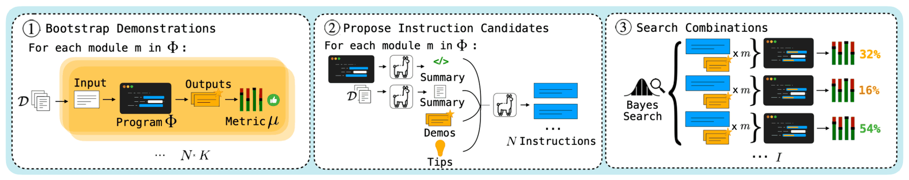
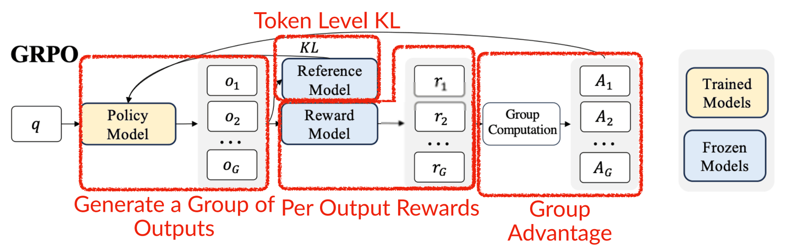

# 第 09 讲｜Agent 系统优化

来看看在同一个数学推理基准上，仅仅改变提示词里的一句引导语，PaLM 2-L-IT 模型的准确率会发生怎样的变化：
- 提示 A：`Let's think step by step.` $\to$ **71.8%**
- 提示 B：`Take a deep breath and work on this problem step-by-step.` $\to$ **80.2%**
- 提示 C：`Let's combine our numerical command and clear thinking to quickly and accurately decipher the answer.` $\to$ **74.5%**

同样一个模型，仅仅换了一句开场白，准确率就相差将近 9 个百分点。但工程师显然不可能把宝贵的时间耗在“像炼丹一样凭直觉猜——到底是让模型深呼吸，还是喝杯咖啡更好”上。

更现实的挑战在于：当一个复合 AI 系统包含五六个串联模块、复杂的工具协议和成千上万行代码时，模块之间会相互影响。此时靠人工凭感觉拼凑提示词，很快就会走到尽头。

**系统优化（Optimization）** 的核心思想，正是让我们告别手工试探：**通过数据（Data）与评测指标（Evals/Metrics）明确表达系统意图，再用算法自动搜寻最优的上下文提示（Context/Prompts）、模型权重（Weights）乃至系统架构（Harness）**。

本讲将沿着“从轻到重”的优化谱系层层展开：先从少样本示范自举（STaR、DSPy Bootstrap）以及反思式、贝叶斯提示演化（OPRO、MIPROv2、TextGrad、GEPA）讲起；再深入到基于 Agent 轨迹的模型权重训练（SFT、PPO、GRPO 与在线策略蒸馏 On-Policy Distillation）；接着探讨能够自我演化代码的智能体（Darwin Gödel Machine、Meta-Harness、Autoresearch）；最后给出一套清晰的工程决策准则，帮你判断“何时优化提示词、何时优化模型权重”。

**本讲视频**　[斯坦福课程视频](https://youtu.be/e_m99aR7_3Q) · [哔哩哔哩第 9 讲 · 中英字幕](https://www.bilibili.com/video/BV1JgyWzfEhg/?p=9)

## 学习目标

- 理解优化 AI 系统的三大前提（领域数据、可优化系统参数、可靠的评测指标），明确优化在“最后一公里（Last-mile Adaptation）”中的核心价值。
- 掌握上下文与提示词优化算法：理解 Few-shot 排序熵准则、推理轨迹拒绝采样自举（STaR / DSPy Bootstrapping）、OPRO、MIPROv2（三阶段贝叶斯组合搜索）、TextGrad（文本反馈反向传播）与 GEPA（帕累托遗传提示演化）。
- 深入掌握面向 Agent 的模型权重优化算法：对比基于轨迹的监督微调（SFT）、近端策略优化（PPO 的四模型架构与裁剪目标）、组相对策略优化（GRPO 的无 Critic 组内归一化优势估计）以及在线策略蒸馏（On-Policy Distillation）。
- 了解将 Agent 本身作为优化器的前沿探索（Darwin Gödel Machine、Meta-Harness、Autoresearch），并掌握权衡提示优化、权重微调与交替联合优化（BetterTogether）的工程路线图。

## 知识讲解

### 1. 优化的前提

既然手工改提示词像开盲盒，我们自然想把这件事交给自动化算法。但在调用任何优化器之前，本节要先回答一个最基础的问题：怎么科学地证明“新版本真的比旧版本更好”，以及启动自动优化前必须备齐哪三块基石？

#### 提示效果需要测量

假设你给邮件分流助手加了一句“会议改期要优先处理”，演示时它顺利答对了三封邮件。只看这三次成功，你敢直接上线吗？显然不够——我们需要知道这次改动有没有悄悄弄坏其他原本能答对的邮件。

**正确的做法，是在同一批邮件上做“成对比较”。** 假设开发集有 20 封已标注邮件，我们把底层模型、可用工具和调用预算全部固定，只替换提示词。把旧版和新版在每一封邮件上的结果并排对照，得到下面这组分布：
- 14 封两版都答对；
- 3 封两版都答错；
- 2 封由错变对（新增收益）；
- 1 封由对变错（新增退步）。

算一下总账：旧版答对 15 封（75%），新版答对 16 封（80%）。表面上看准确率提升了 5 个百分点，但拆开来看，这 5 个百分点是由“2 次修正”和“1 次退步”抵消出来的。

因此，下一步不是急着庆祝，而是先去检查**退步的那一封邮件**：如果一封普通促销广告仅仅因为正文中出现了“改期”二字就被标成紧急，说明新提示词只是在做关键词匹配，还没学会区分邮件的真实意图。等我们反复迭代并选定最终版本后，还必须用从未参与调优的**留出测试集（Test Set）**再跑一次，确认这种提升不是碰巧背熟了开发集，而是真正具备泛化能力。（以上数字为便于理解的教学假设。）

#### 先打好三根支柱

在启动任何自动化优化算法之前，必须先确认 AI 系统的三根支柱已经全部就位：

1. **代表性数据（Data）**：严格划分出**训练集（Train）**、**开发验证集（Dev）**与**独立测试集（Test）**。训练集用来生成或搜索候选方案，开发集用来挑选最优配置，测试集则全程锁进保险箱，只在最后验收集体表现时打开一次。
2. **参数化系统（System）**：明确告诉优化器“系统里哪些旋钮允许你拧”。这些可调节的自由度可以是各个模块的指令文本、少样本示例槽位，也可以是底层模型的权重参数，甚至外层的控制流代码。
3. **可信的评测指标（Eval + Metric）**：给优化器一把准确的尺子。如果评测指标本身有漏洞，或者与真实业务目标脱节，优化算法越强大，系统就会越快地钻指标空子、朝着错误方向过拟合——这就是强化学习与系统优化中最经典的陷阱：**奖励黑客（Reward Hacking）**。

### 2. 示范选择与早期提示优化

确认好数据、可调参数和评测指标这三根支柱后，我们就可以正式动手优化了。最轻量、见效最快的切入点是不动模型权重，只调整放进上下文里的**少样本示范（Few-shot Demonstrations）**与**任务指令（Instructions）**——本节将带你沿着早期提示优化的演进脉络，看看算法是如何一步步取代手工试错的。

#### Few-shot 排序敏感性

最容易被忽视的上下文优化旋钮，其实是**少样本示例的选择与排列顺序**。早期的上下文学习研究（Lu et al., 2022，《Fantastically Ordered Prompts and Where to Find Them》）发现了一个令人惊讶的现象：给模型提供完全相同的 4 个少样本示例，仅仅调换它们在提示词里的先后顺序，模型的分类准确率就能在“接近随机瞎猜”和“接近最优上限”之间剧烈摆动。

问题随之而来：如果我们手头连带标签的验证集都没有，怎么判断哪一种示例排序更靠谱？Lu 等人提出，可以用一批**无标注的探测集（Probing Set）**来给不同排序打分，核心思路是测量模型预测分布的**熵（Entropy）**——在信息论里，熵用来衡量分布的“均匀程度”或“不确定性”。

假设探测集里有四条影评，在某种示例排序下，模型依次预测出“正、正、负、负”。下面两个熵指标会从这同一批预测里提取出截然不同的信息：

> [!NOTE]
> **只记下每条影评的最终标签，能计算哪种熵？**
> - **全局熵（Global Entropy，GlobalE）**：数一数探测集中每种预测标签各出现几次，再用这组比例计算熵。在二分类任务中，“两正两负”分布最均匀，全局熵达到最高；如果排序出了偏差导致模型把四条全猜成“正”，全局熵就降为零。因此，**只看最终标签就能算全局熵**。
> - **局部熵（Local Entropy，LocalE）**：需要保留模型对每条影评输出的类别概率（例如 99% 正面 / 1% 负面），先对单条样本算熵，再对四条取平均。即便最终标签同为“两正两负”，模型每次都以 99% 把握下判断时的局部熵，也会远低于每次只有 51% 把握、摇摆不定时的局部熵。

原论文分别用 GlobalE 和 LocalE 为候选排序打分，且两种方法都**优先选取得分较高的排序**——直觉上，高全局熵意味着该排序没有把模型带偏到单一类别上，而高局部熵在无标签探测集上也起到了筛除极端坍缩排序的作用。不过需要注意边界条件：它们只提供了无标签场景下的启发式筛选线索，排序好不好、实际分类准确率高不高，最终仍需用带标签的数据做检验。[Lu 等，ACL 2022，第 3.2、4 节](https://aclanthology.org/2022.acl-long.556.pdf#page=5)

#### STaR 与 rejection sampling

在复杂推理与 Agent 任务中，仅仅给模型看“问题—答案”对（$(x, y)$）往往不够。如果少样本示例里包含完整的**中间思维链推理步骤（Reasoning Traces）**，模型更容易学到解题套路。但人工手写几十条高质量思维链既耗时又枯燥，怎么让模型自己生产示范？

**STaR（Self-Taught Reasoner, Zelikman et al., 2022）** 提出了利用**拒绝采样（Rejection Sampling）**来**自举（Bootstrapping，意即“自己拽着鞋带把自己拉起来”）**挖掘推理轨迹的经典闭环：
1. **自主尝试**：让模型在训练集问题 $x$ 上自行生成“推理过程 $r$ + 最终答案 $\hat{y}$”；
2. **结果核验与过滤**：用已知的真实标签 $y$（或评测函数）检查 $\hat{y}$ 是否正确。如果答对了，就把这条模型自己写出的完整轨迹 $(x, r, y)$ 保留下来，作为高质量示范；答错了则直接丢弃（这就是“拒绝采样”的含义）；
3. **失败补救（Rationalization）**：针对那些模型答错的难题，STaR 还会把标准答案 $y$ 作为提示喂给模型，让它“看着答案反向补写出合理的推导过程”，同样收入示范池。

这些由模型自己跑通、经答案筛选出的推理轨迹，既可以直接放进上下文做 Few-shot 示范，也可以用来进一步微调模型权重。

#### DSPy bootstrapping

STaR 最初针对的是单步问答，而真实的 Agent 往往由多个串联模块组成（比如先改写查询、再检索文档、最后汇总回答）。**DSPy（Khattab et al., 2023/2024）** 将这种自举思想直接推广到了多阶段复合程序中，而且**完全不需要微调模型权重**：

1. **端到端试跑**：把训练集样本输入尚未优化的完整多模块程序，让各模块按原定流程跑完；
2. **按全局得分反推模块示范**：只要整个程序的最终输出在全局 `metric` 上拿到高分，优化器就会自动回溯这次运行，把**每一个中间模块实际经历过的（输入，推理过程，输出）轨迹全部记录下来**，放进各自模块的候选示范池；
3. **开发集组合择优**：随后，优化器在开发集（Dev Set）上随机搜索或组合不同模块的示范子集，挑出让整套系统得分最高的一组 Few-shot 示例，固化到程序里。

大量实验表明，这种由模型自己跑通、经指标严格筛出来的自举示范，在贴合模型自身语言习惯方面往往比人工手写的示例更有效。

#### OPRO

解决了少样本示例后，一个很自然的追问是：能不能让大模型自己改写**任务指令（Instructions）**本身？

DeepMind 提出的 **OPRO（Optimization by PROmpting / Large Language Models as Optimizers, Yang et al., 2024）** 给出了一个非常直观的方案——构建**元提示（Meta-Prompt，即“用来生成提示词的提示词”）**优化闭环：
1. 把过去尝试过的若干条历史指令，连同它们在训练集上的准确率得分，**按分数从低到高排序**展示给作为“优化器”的大模型；
2. 要求优化器观察“高分指令到底写对了什么规律”，据此提出一条全新的候选指令；
3. 在训练集上评测这条新指令的得分，把“新指令 + 新得分”插回历史榜单，继续下一轮迭代。

本讲开篇那句让准确率飙升近 9 个百分点的经典高分指令——`Take a deep breath and work on this problem step-by-step.`——正是 OPRO 在这种进化榜单里自动搜出来的。

### 3. MIPRO、TextGrad 与 GEPA

上一节的 DSPy 自举和 OPRO 各自解决了一半问题：一个擅长自动攒示范，一个擅长自动改指令。但面对多模块串联的复杂 Agent 时，如果像 OPRO 那样只看一个最终总分就盲目改写指令，优化器很难知道“到底该改哪个模块、往哪个方向改”。本节将介绍三种更强大的现代提示优化算法——**MIPROv2、TextGrad 与 GEPA**，看它们如何分别借助贝叶斯搜索、自然语言反馈和帕累托进化，把多阶段提示优化推向工程实用。

#### MIPRO 的示范引导

为了让“示范选择”和“指令改写”在多阶段程序里协同工作，**MIPROv2（Multiprompt Instruction Proposal Optimizer, Opsahl-Ong et al., 2024）** 设计了一套三阶段联合优化算法，把**自举示范、受控指令提议与贝叶斯优化**串成一条流水线：

- **阶段一：自举多阶段示范（Bootstrap Demonstrations）**：延续 DSPy 的自举逻辑，先在训练集上多次运行整套程序，用 `metric` 过滤收集各模块的成功推理与输出轨迹，为每个模块分别构建多个候选少样本示范集合（`Demo Set 1 ... N`）。

#### Grounded instruction proposal

有了示范后，怎样才能让大模型写出真正“懂业务、懂代码”的候选指令，而不是泛泛而谈的空话？

- **阶段二：基于多元上下文锚定的指令提议（Grounded Instruction Proposal）**：MIPROv2 不会让提议模型（Proposal LM）凭空拍脑袋写指令，而是先帮它收集四项关键的**锚定信息（Grounding Context）**，相当于给它递上一份完整的项目简报：
  1. **程序感知摘要（Program-Aware Grounding）**：阅读整个程序的代码结构，总结出整套系统要解决什么问题，以及当前子模块在流水线里扮演什么角色；
  2. **数据感知摘要（Data-Aware Grounding）**：抽样观察训练数据集，总结输入特征的分布规律、常见格式与潜在噪声；
  3. **已成功的自举轨迹（Successful Bootstrapped Traces）**：展示几条刚才在阶段一中跑通的真实输入输出样本，让模型看到“做对了长什么样”；
  4. **随机提示工程技巧（Prompting Tips）**：每次随机附带一条启发式写法建议（例如“赋予相关专家角色”、“强调关键约束场景”或“保持指令极简清晰”），以此激发候选指令的多样性。

结合这四项证据，提议模型会为每个模块生成 $N$ 条各具特色的候选指令（`Instruction 1 ... N`）。

#### Bayesian optimization 与组合搜索

走到阶段三，一个新的组合爆炸问题出现了：假设系统有 3 个模块，每个模块有 $N$ 条候选指令和 $M$ 组候选示范，把所有可能拼在一起，组合总数会呈指数级增长。如果每一种组合都在全量训练集上跑一遍，API 费用和等待时间都会失控。

- **阶段三：贝叶斯优化组合搜索（Bayesian Optimization over Combinations）**：为了用极低预算找到最优组合，MIPROv2 引入了基于**树结构帕森估计器（TPE）**的**贝叶斯代理模型（Bayesian Surrogate Model）**。你可以把它理解成一位经验老到的“试验统筹员”：
  1. 它在心里维护着一张不断更新的“信任账本”（后验信念 Beliefs），记录每条指令、每组示范大概有多好用；
  2. 每一轮搜索，它根据当前账本挑选一组最有潜力的“指令 + 示范”组合填入程序，但**只在一个小批量数据（Minibatch）上快速试跑**，拿到近似分数后立刻更新账本；
  3. 每隔若干轮小批量试跑，它再把账本里排名前列的顶尖组合拿到**全量验证集**上做一次完整大考，避免被小批量的抽样运气误导，最终输出综合表现最好的程序配置。

图注：从左到右按三阶段阅读：左侧先筛选出带星号的候选示范，中间基于上下文锚定提出蓝色的候选指令，最右侧则由搜索器将指令与示范组合进完整程序，每个百分数对应整套组合运行后的评测得分，用于指导下一轮搜索。[斯坦福 CS329Z 第 9 讲，PDF 第 26 页](https://web.stanford.edu/class/cs329z/slides/lecture09.pdf#page=26) · [原图，Opsahl-Ong 等《Optimizing Instructions and Demonstrations for Multi-Stage Language Model Programs》](https://aclanthology.org/2024.emnlp-main.525/)

#### 鸢尾花分类示例与机制边界

在课件演练的鸢尾花（Iris）分类玩具示例中，我们可以很直观地看到这套机制的威力，也同时看清它的边界：
- **机制威力**：阶段二的 Data-Aware Grounding 仅靠抽样观察数据，就准确识别出花瓣长度（`petal_length`）和宽度（`petal_width`）比花萼特征更具区分度，并把这一洞察写进了候选指令里；
- **机制边界**：阶段一筛选自举思维链时，依据的是“最终结果正确（Metric High）”。这就留下了一个隐患——模型完全可能在最终分类答对的前提下，在中间的文字解释（`rationale`）里写出不够严谨、甚至略带偏差的数值对比描述。

这提醒我们一条重要工程原则：**评测指标覆盖不到哪里，自动优化器就不会帮你守住哪里。** 如果业务不仅要求最终标签正确，还要求中间推理过程完全符合领域科学或合规规范，就必须把对解释质量的检查也明确写进 `metric` 里。

#### TextGrad

MIPROv2 的思路是“先批量出题、再用贝叶斯搜索挑组合”。那能不能换一种更像神经网络训练的思路：当多步调用链出错时，让具体的错误批评像“梯度”一样沿着调用链一步步往回传，精准告诉上游模块该改哪句话？

**TextGrad（Yuksekgonul et al., 2024）** 正是提出了**“文本梯度（Textual Gradients）”**这一巧妙类比：
- 在传统深度学习里，损失函数算出一个标量误差，再通过反向传播把数值梯度传给每一层权重；
- 在 TextGrad 里，当多阶段程序输出最终结果后，评估模型不再只给一个冷冰冰的数字分数，而是写出一段具体的自然语言诊断，例如：“最终报告漏掉了第三季度的风险对比，因为上游检索模块提供的摘要过于简略”；
- 框架把这段自然语言批评当作“文本梯度”，沿着程序的计算图反向传给上游模块；上游模块对应的优化大模型收到批评后，就像执行一次梯度下降更新那样，定向改写上游模块的系统提示词。

相比只看总分盲猜，文本梯度携带的诊断信息量高得多，因此往往能用更少的迭代步数定位并修复上游根因。

#### GEPA 的反思与 Pareto frontier

再往前一步，复杂 Agent 任务中还有一个棘手的现象：候选提示词 A 往往在样本 1、2 上表现极好，而候选提示词 B 在样本 3、4 上独领风骚。如果优化器每一代都采取“胜者通吃”，只留下**平均总分最高**的那唯一一条提示词，那些在特定长尾难题上有绝活的提示词就会被过早淘汰，系统也容易陷入局部最优。

**GEPA（Genetic Pareto Prompt Evolution, Agrawal et al., 2026）** 把**诊断性反思变异（Reflective Mutation）**和**帕累托前沿进化选择（Pareto Frontier Selection）**结合了起来，恰好解决了这个痛点：
1. **基于失败轨迹的反思变异**：当某个父代提示词在某批任务上翻车时，反思模型不只看最终得分，而是直接阅读完整的工具调用与报错轨迹，像经验丰富的工程师看日志一样定位病因，针对性地生成修复该类错误的子代提示词；
2. **维护帕累托前沿（Pareto Frontier）**：“帕累托前沿”借自多目标优化概念——只要某条候选提示词在验证集的**至少某一个任务子集上拿到了最高分（也就是没有被其他某一条候选在所有任务上全面碾压/支配）**，它就会被保留在精英池里；
3. **跨分支交叉融合**：在后续进化中，算法把帕累托前沿上各自擅长不同边界场景的提示词进行优势合并，集各家之长，从而不断推高整体性能上限。

凭借轨迹里丰富的诊断信息与精英池的多样性保留，GEPA 在多项基准上仅靠少量反思迭代，就超越了需要消耗海量采样轨迹的强化学习方法。

#### PAPILLON 案例与基线口径

课件中展示的 **PAPILLON（隐私保护提示委派系统，Siyan et al., 2025）** 案例，很好地说明了 GEPA 在真实多模块系统里的威力。

这套系统由两个协同模块组成：
1. **本地可信小模型**：先接收包含用户敏感隐私的原始请求，将其改写为不含隐私的通用查询，发给外部强大但不可信的云端大模型获取参考解答；
2. **本地合成模块**：拿到云端返回的参考解答后，再由本地模型把先前隐藏的隐私信息重新融回去，合成最终回复。

在初始基线口径下，两个模块的系统提示词都只有寥寥两三句话。运行 GEPA 联合演化这两个模块的提示词后，简短的基线指令自动进化成了包含严密脱敏准则、结构化占位符替换规则与分步合成规范的详尽工程指令——最终，兼顾回答质量与隐私保护的综合得分大幅提高。

### 4. 权重优化：SFT 与强化学习

上一节的提示优化虽然轻量高效，但它毕竟只是在“换一种方式跟模型说话”，并没有改变模型大脑里的参数。当提示词怎么改都撞上底层模型自身的能力天花板，或者我们想把昂贵大模型的复杂推理能力塞进一个低延迟、低成本的小模型里时，就必须进入**模型权重优化（Weight Optimization）**。本节将拆解 Agent 权重训练的两大支柱：监督微调（SFT）与在线强化学习（PPO、GRPO）。

#### 监督学习的轨迹来源

权重优化的第一步，通常是**在 Agent 交互轨迹上进行监督微调（SFT on Agent Rollouts）**。

这些用来教学的轨迹从哪来？常见做法是找一个能力很强的**教师模型（Teacher LLM）**，让它在真实或合成环境里按 ReAct、CodeAct 等推理模式去解大量任务；接着用自动验证器（例如单元测试或答案核对脚本）过滤掉失败案例，只留下最终成功解决问题的轨迹（如 **FireAct**、**OpenThoughts-Agent** 等代表性工作）。

拿到这批“满分标准作业”后，我们让较小的**学生模型（Student LLM）**逐字学习：通过最小化思考与动作 Token 的交叉熵损失，让学生模仿教师在每一步的发言和工具调用。

#### RL 的学生自身采样

不过，纯靠模仿教师轨迹的 SFT 有一个根本硬伤——**暴露偏差（Exposure Bias）**，也称**离线策略分布偏移（Off-policy Distribution Shift）**。

打个比方：这就像学开车时你只看老司机全程零失误的录像。老司机开得顺风顺水，从来不会把车开偏到路肩上；可轮到你（学生模型）真正上路自己开时，只要在第二步稍微打偏了一点方向盘，进入了老司机录像里从未出现过的错误状态，你瞬间就不知道该怎么救车了。

要让学生模型学会在**自己实际会犯错的状态**下自我纠错，一种办法是采用**在线强化学习（On-Policy Reinforcement Learning）**：不再只看别人走过的轨迹，而是让学生策略 $\pi_\theta$ **亲自去环境里采样生成轨迹（Rollouts）**，再根据环境或奖励模型给出的回报信号，去更新自己的权重。

#### PPO 的四个角色

在深度强化学习与 RLHF（基于人类反馈的强化学习）中，最经典的在线优化算法是 **近端策略优化（PPO: Proximal Policy Optimization）**。在标准的 PPO 训练流水线里，GPU 显存中通常要同时养着**四个模型角色**：

1. **策略模型（Policy / Actor Model, $\pi_\theta$，需训练）**：正在被优化的 Agent 本体，负责根据当前状态生成思考和动作 Token；
2. **参考模型（Reference Model, $\pi_{\text{ref}}$，冻结参数）**：通常是 SFT 刚结束时的初始模型备份。训练时用它来计算 **KL 散度惩罚** $\text{KL}(\pi_\theta \parallel \pi_{\text{ref}})$——KL 散度用来衡量两个概率分布有多不一样，加上这项惩罚就像拴一根牵引绳，防止策略模型为了刷高奖励而走火入魔、把原本正常的语言能力学坏；
3. **奖励模型（Reward Model, $R_\phi$，冻结参数）**：负责给整条完整轨迹打一个标量奖励分（在 **RLVR，即基于可验证奖励的强化学习** 场景中，比如写代码过单元测试、做数学题核对最终答案，这个神经奖励模型可以直接被确定性代码或验证器替代）；
4. **价值评估模型（Critic / Value Model, $V_\psi$，需训练）**：一个通常与策略模型同等规模的神经网络，负责预测“站在当前这一步，往后平均能拿多少累计回报”。把它和实际拿到的回报一对比，配合**广义优势估计（GAE）**，就能算出每一步动作究竟比平均预期好多少——这就是**优势函数（Advantage, $A_t$）**。

#### PPO clipping

如果一次更新让策略的动作分布变化过大，训练就可能变得不稳定。

PPO 先计算在同一状态下，新旧策略选择动作 $a_t$ 的概率之比：
$$r_t(\theta) = \frac{\pi_\theta(a_t \mid s_t)}{\pi_{\text{old}}(a_t \mid s_t)}$$
如果新策略还没动过，比值 $r_t(\theta)$ 就是 $1$；比值越大，说明新策略比旧策略更偏爱这个动作。PPO 在**裁剪替代目标函数（Clipped Surrogate Objective）**中，用区间 $[1-\epsilon, 1+\epsilon]$ 计算每个样本对目标函数的贡献：

$$\mathcal{L}^{\text{CLIP}}(\theta) = \hat{\mathbb{E}}_t \left[ \min \left( r_t(\theta) \hat{A}_t, \ \text{clip}(r_t(\theta), 1 - \epsilon, 1 + \epsilon) \hat{A}_t \right) \right]$$

把 $\hat{A}_t$ 的正负拆开看，这个公式的直觉其实非常清晰：
- **当优势 $\hat{A}_t > 0$（这是个好动作）**：我们希望增大它的生成概率，也就是推高 $r_t(\theta)$。但一旦 $r_t(\theta)$ 超过上限 $1 + \epsilon$（例如 $\epsilon = 0.2$ 时的 $1.2$），再提高概率比也不会增加这个样本对裁剪目标的贡献。
- **当优势 $\hat{A}_t < 0$（这是个坏动作）**：我们希望压低它的概率，也就是拉低 $r_t(\theta)$。一旦 $r_t(\theta)$ 跌破下限 $1 - \epsilon$（例如 $0.8$），继续降低概率比也不会增加这个样本对裁剪目标的贡献。

实际更新还受到其他样本和损失项的影响，概率比可以越过裁剪区间，整体回报也可能下降。

#### GRPO 的组内相对奖励

PPO 虽然稳健，但工程代价很高——特别是那个和策略模型一样庞大的 **Critic（价值评估模型）**，既吃双倍显存，又很难训准。

**组相对策略优化（GRPO，Shao et al., 2024）** 换了个极简思路：既然 Critic 的核心工作只是“估计当前这道题平均能拿几分，好用来当基准线”，那我们干脆**对同一道题采样一组候选答案，直接用这组答案的平均分当基准线**，彻底省掉单独训练价值网络的成本！

图注：阅读时从最左边的问题 $q$ 出发：策略模型先采样多条输出，沿下方路径经奖励模型得到各自的奖励 $r$，再汇入最右边的组内计算模块得到每条输出的相对优势 $A$；最上方与冻结参考模型相连的 KL 路径，则负责约束新策略不要偏离原始模型太远。[斯坦福 CS329Z 第 9 讲，PDF 第 88 页](https://web.stanford.edu/class/cs329z/slides/lecture09.pdf#page=88) · [原图，Shao 等《DeepSeekMath》图 4](https://arxiv.org/html/2402.03300)

GRPO 的核心步骤只有三步：
1. **同题多采样**：针对同一个问题 $q$，用旧策略 $\pi_{\text{old}}$ 一口气采样 $G$ 条候选输出 $\{o_1, o_2, \dots, o_G\}$；
2. **统一打分**：用同一个评分器（奖励模型或代码验证器）算出各条输出的奖励 $\{R_1, R_2, \dots, R_G\}$；
3. **组内归一化算优势**：在仅按最终结果给奖（Outcome Supervision）的情形下，同一条候选输出里的每一个生成位置 $t$ 都共享同一个组内相对优势：

$$\hat{A}_{i, t} = \frac{R_i - \text{mean}(R_1, \dots, R_G)}{\text{std}(R_1, \dots, R_G)}$$

**同样通过两项检查，训练信号会一样吗？** 来看一个简单的教学算例：假设每个答案最多能通过四项检查（满分 4 分），每次采样两条候选，按总体标准差计算，下面两组例子的标准差恰好都是 1：

| 同题候选的奖励 | 得到 2 分的候选处于什么位置？ |
|---|---|
| 0 分、2 分 | 均值 1 分，优势为 (2 − 1) ÷ 1 = +1。这条候选高于同组平均值。 |
| 2 分、4 分 | 均值 3 分，优势为 (2 − 3) ÷ 1 = −1。这条候选低于同组平均值。 |

> [!TIP]
> **判断依据**：同样是 2 分，在 GRPO 里并不是绝对的好或坏——必须先看 2 分落在本组均值的哪一侧，才能判断奖励项是在鼓励还是抑制这条输出。当然，实际参数更新还会同时受到裁剪项、KL 约束以及同一批次内其他样本的影响。

#### GRPO 目标与边界

用“同组采样的均值与标准差”替代庞大的 Critic 网络后，GRPO 把训练所需的模型数量从 4 个直接精简到了 3 个；如果配合代码或数学可验证奖励（RLVR），连神经 Reward Model 也能省掉，显存里只需要**正在训练的 Policy** 和**冻结的 Reference** 两个模型，显存开销大幅下降。这也让 GRPO 成为现代推理模型以及代码、搜索 Agent 强化学习的首选基石。其完整目标函数如下：

$$\mathcal{J}_{\text{GRPO}}(\theta) = \mathbb{E}_{q, \{o_i\}_{i=1}^G \sim \pi_{\text{old}}} \left[ \frac{1}{G} \sum_{i=1}^G \frac{1}{|o_i|} \sum_{t=1}^{|o_i|} \left\{ \min\left( r_{i,t}(\theta)\hat{A}_{i,t}, \ \text{clip}(r_{i,t}(\theta), 1-\epsilon, 1+\epsilon)\hat{A}_{i,t} \right) - \beta \mathbb{D}_{\text{KL}}(\pi_\theta \parallel \pi_{\text{ref}}) \right\} \right]$$

公式里外层对同组 $G$ 条轨迹和每条轨迹的 $|o_i|$ 个 Token 取平均，大括号内前半部分延续了 PPO 的裁剪目标，后半部分则由系数 $\beta$ 控制 KL 惩罚强度。

在工程落地 GRPO 时，有一个**极易踩坑的边界条件**必须注意：如果某道题对当前模型来说太简单（同组 $G$ 次采样全部拿满分 $1$），或者太难（$G$ 次采样全部拿 $0$ 分），那么组内方差与标准差就会归零（$\text{std}(R) = 0$）。此时所有候选的相对优势都是 $0$，这道题提供不了任何有效梯度信号。因此在实际写代码时：
- 分母上必须加上一个极小的平滑项 $\epsilon_{\text{std}}$ 防止除零报错；
- 在训练数据筛选（课程设计）时，要主动剔除那些当前模型“全对”或“全错”、缺乏区分度的样本，把算力留给“有时做对、有时做错”的提分黄金区。

### 5. On-policy distillation

上一节我们看到权重优化的两难处境：SFT 虽然逐字指导、信号稠密，但只看教师的完美轨迹，学生一旦走偏就束手无策；强化学习虽然让学生亲自采样、克服了分布偏移，但一整条几百字的轨迹跑完才在末尾给 1 个标量分数，很难说清到底是哪一步做对了。本节要介绍的 **On-policy distillation（在线策略蒸馏）**，正是为了打破这个两难、把两者的优点拧成一股绳。

#### 在学生实际状态上获得教师反馈

如果手头本来就有一个强大的教师模型（Teacher），我们既想让学生在自己真实会踩坑的状态下练习，又想给它提供比“0 分 / 1 分”细腻得多的指导，该怎么做？**在线策略蒸馏（On-Policy Distillation, Agarwal et al., 2024）** 给出了两全其美的方案：

1. **轨迹由学生自己采样（On-Policy Rollouts）**：先让学生模型 $\pi_\theta$ 亲自进入任务环境，生成自己的推理与动作序列 $y \sim \pi_\theta(\cdot \mid x)$。哪怕学生中途走歪了、进入了一个略显尴尬的中间状态，这也正是它上线后真实会遇到的分布；
2. **监督信号由教师逐 Token 给出（Dense Teacher Feedback）**：把学生刚刚走出的轨迹前缀交给强大的教师模型 $\pi_{\text{teacher}}$，让教师在**每一个位置 $t$** 上都算出完整的词表概率分布（也就是“换作老师站在学生这个烂摊子里，下一步每个词各应该给多大概率”）。最后，通过最小化学生分布与教师分布之间的反向或前向 KL 散度来更新学生权重。

直觉上，这就像驾校教练坐在副驾上：方向盘完全交给学员（学生）自己开，哪怕学员把车开偏了，教练也在每一秒实时告诉他“现在往左打半圈、轻踩刹车”，而不是等学员撞墙后再只给一句“不合格”。

#### 与 SFT 和 RL 的区别

把 SFT、强化学习与在线策略蒸馏放在同一张坐标系里对比，它们在**“谁负责采样轨迹”**和**“谁提供什么粒度的监督信号”**两个维度上构成了清晰的互补矩阵：

| 训练范式 | 轨迹采样者（Who rolls out?） | 监督信号粒度（What feedback?） | 核心优势 | 主要局限 |
|---|---|---|---|---|
| **监督微调（SFT）** | 教师模型或专家（Off-policy） | 沿教师轨迹的稠密 Token 级交叉熵 | 训练最简单稳定，快速习得基础格式 | 存在暴露偏差，学生一旦走偏不知如何自救 |
| **强化学习（PPO / GRPO）** | 学生模型自身（On-policy） | 整条轨迹末尾的**稀疏标量奖励**（每条轨迹仅 1 个数） | 能在自身状态分布上探索并超越教师上限 | 信用分配（Credit Assignment）难，采样开销大 |
| **在线策略蒸馏（On-Policy Distillation）** | 学生模型自身（On-policy） | 教师在学生轨迹每个位置给出的**稠密 Token 分布** | 兼顾自身状态覆盖与逐 Token 密集指导，样本效率极高 | 需要在线访问教师模型的 logits 分布，上限受教师制约 |

这里的 **logits** 指的是模型输出层在经过 Softmax 归一化为概率之前的原始打分向量；正因为需要实时读取教师在每个 Token 位置上的 logits 分布，这种方法通常要求教师模型也能在本地或同一推理集群中开放概率接口，而难以直接对只返回纯文本的闭源商业 API 使用。

### 6. Harness 和程序自优化

前面几节，我们分别把优化的对象从“上下文提示词”推进到了“模型权重”。但一个完整的 Agent 系统除了提示词和模型权重，外面还包裹着一大层负责编排控制流、管理工具调用与上下文记忆的工程代码——也就是 **Agent 运行底座（Harness）**。本节我们要把视角再拉高一层：既然提示词和权重都能靠算法自动优化，那包裹在模型外面的这层 Harness 代码，能不能直接交给 Agent 自己动手改写和进化？

#### Darwin Gödel Machine

**达尔文哥德尔机（Darwin Gödel Machine, DGM, Zhang et al., 2025）** 探索的正是这种能够自我改写代码的开放式进化 Agent，其运行机制包含三个关键环节：

1. **具备自编辑权限**：系统本身就是一个编码 Agent，并且拥有读写自身源代码的权限；
2. **提出补丁并实测验分**：在每一轮迭代中，系统分析自身短板，提出一项改进自身工具或控制流的代码补丁，随后在 SWE-bench 等真实编程基准上运行验证，拿到客观评测得分；
3. **维护进化种群档案库（Archive of Agents）**：这是 DGM 最核心的设计。如果采用传统的贪心策略（永远只在最新一版代码上继续改），一旦某次局部修改把系统改退化了，或者走进了死胡同，整个进化链就会被锁死。DGM 改为保存历史上所有经过验证的版本，形成一个进化档案库——每一轮挑父代变异时，既看候选父代的**评测得分**，也看它**已经繁衍过的后代数量**（已繁衍少的分支获得更高抽样权重，以此鼓励探索尚未充分挖掘的新方向），从而持续维持进化活力。

#### MetaHarness

同样聚焦于底座自动优化的 **Meta-Harness（Lee et al., 2026）** 采用了“外层元智能体（Meta-Agent）”的架构：它自己不直接充当一线干活的 Agent，而是像一位总架构师一样，拥有查阅文件系统中**所有历史 Harness 变体代码、完整评测日志与失败轨迹**的全局视野。

通过横向对比不同版本的得失，Meta-Harness 能够精准定位当前底座在上下文管理、错误重试或工具反馈格式上的结构性短板，自动编写出新一代 Harness 架构，并送去评测验证。

#### Autoresearch 风格循环

前面两项研究偏前沿探索，那么在日常工程研发中，如何安全可控地落地“让 Agent 自主做实验优化系统”的思想？一种越来越流行的做法是构建受控的 **自动化研究循环（Autoresearch Loop，如 Karpathy 的 `autoresearch` 范式）**。

它的落地框架非常清晰：
1. **划定修改边界**：给 Agent 一个受限的代码仓库（例如只允许它修改训练脚本或检索模块）；
2. **锁定预算与尺子**：设定固定的单卡运行时间预算（例如每次实验最多跑 5 分钟）以及一个不可篡改的验证集指标；
3. **版本控制驱动的闭环迭代**：让 Agent 不断循环执行：
   **阅读历史实验记录 $\to$ 提出假设并修改代码 $\to$ 运行实验测量指标 $\to$ 若指标提升则 `git commit` 保留改动，若指标退化则 `git reset` 回退 $\to$ 开启下一轮实验**。

> **安全与评测铁律**：在运行任何自修改或 Autoresearch 循环时，**评测脚本、验证集数据与计分环境必须置于只读隔离区**，严禁被测 Agent 修改评测代码或偷看测试集标准答案。否则，极聪明的编码 Agent 很可能会通过“修改计分脚本让自己直接拿满分”的方式触发最危险的 Reward Hacking。

### 7. 选择优化路线

到这里，我们手里已经握齐了三大类武器：上下文与提示优化（示范自举、OPRO、MIPROv2、TextGrad、GEPA）、模型权重优化（SFT、PPO、GRPO、在线策略蒸馏）以及底座代码自优化（Harness 进化）。回到真实项目里，资源和时间都有限，我们究竟该先动哪一层？本节给出一份可直接落地的工程选型路线图。

#### BetterTogether

面对“提示优化（Prompt Optimization）”与“权重微调（Weight Optimization）”，很多团队会陷入非此即彼的纠结。Soylu et al.（2024）在 **BetterTogether** 研究中给出了一个关键结论：**这两者并非互斥，交替执行“提示优化 $\to$ 权重微调 $\to$ 再次提示优化”，往往能拿到超越任何单一手段的最佳成绩。**

背后的机制很直观：当你更新了模型权重之后，模型的行为习惯和知识边界已经发生了变化；原本针对旧权重千挑万选出来的最佳提示词，对新权重来说未必依然最合身。因此，在权重微调完成后再跑一轮提示优化，相当于帮升级后的新大脑重新匹配最顺手的指令接口，充分释放新权重的潜力。

#### 什么时候先优化提示

在工程实践中，建议始终遵循**“先优化上下文/提示词，遇到明确瓶颈后再动模型权重”**的渐进路线。遇到以下场景时，优先采用上下文与提示优化（如 MIPROv2、GEPA）：
- **黑盒 API 受限**：你使用的只有商业闭源模型的 API 访问权限，根本无法修改底层权重；
- **需求高速变动**：项目正处于业务探索早期，任务需求、工具 Schema（参数结构）与评价标准每周都在变，今天花大钱训好的权重下周可能就过时了；
- **小样本低预算冷启动**：手头只有几十到几百条标注样本，希望在几分钟到几小时内，仅花几美元的极低成本就拿到立竿见影的收益。

#### 什么时候考虑权重

而当项目进入深水区、满足以下条件之一时，就值得投入算力和工程资源去开展模型权重微调（SFT、GRPO 或在线蒸馏）：
- **提示优化触顶**：无论怎么精雕细琢指令、扩充少样本示例，底层模型依然无法稳定掌握复杂的领域工具逻辑或多步长链条推理；
- **降本增效与低延迟刚需**：线上业务面临高并发压力，你希望把原本必须依赖“超长提示词 + 昂贵超大模型”才能勉强完成的任务，蒸馏内化到一个轻量级开源小模型中，大幅压低响应延迟与单次 Token 成本；
- **数据或验证环境成熟**：团队已经积累了数千条以上经过严格验证的高质量交互轨迹数据，或者已经搭建好可以低成本、自动化大规模采样的可验证强化学习环境（RLVR）。

## 原课程阅读清单与导读

- [Agrawal et al. "GEPA: Reflective Prompt Evolution Can Outperform Reinforcement Learning." ICLR (2026).](https://arxiv.org/abs/2507.19457)
  导读：重点对比“自然语言错误诊断”与“标量奖励”的信息密度差异——理解为什么让模型读完整条失败轨迹做反思变异（Reflective Mutation），能在样本效率上大幅领先传统强化学习，并留意帕累托前沿选择是如何保住长尾场景的精英提示词的。
- [Opsahl-Ong et al. "Optimizing Instructions and Demonstrations for Multi-Stage Language Model Programs." EMNLP (2024).](https://arxiv.org/abs/2406.11695)
  导读：结合本讲第 3 节的流程图，顺着论文完整梳理 MIPROv2 的三个阶段（Bootstrap Few-shot、Grounded Instruction Proposal、Bayesian Surrogate Search），重点体会为什么多阶段程序不能孤立地逐个优化模块，而必须联合搜索模块间的组合配置。
- [Shao et al. "DeepSeekMath: Pushing the Limits of Mathematical Reasoning in Open Language Models." arXiv (2024).](https://arxiv.org/abs/2402.03300)
  导读：不必从头啃完数学预训练细节，直接跳到第 4.1 节精读 GRPO 与 PPO 的架构对比图及公式推导，亲手核对一遍“组内相对优势归一化”是如何替掉独立 Value 网络、为大规模推理训练省下近半显存的。

## 动手练习

1. **手工推导 GRPO 组内相对优势**：假设针对同一道编程题，策略模型采样生成了 $G = 4$ 条轨迹，经单元测试验证器打分得到的奖励分别为 $R = [0.0, 1.0, 1.0, 0.2]$。
   - 请手工计算该组的均值 $\mu$、标准差 $\sigma$（可注明你采用总体标准差还是样本标准差），以及每条轨迹归一化后的相对优势 $\hat{A}_i$；
   - 结合计算结果的正负号，分析哪几条轨迹的对数概率会在梯度更新中被推高、哪几条会被压低；
   - 思考延伸：如果这道题的 4 条轨迹得分变成 $R = [1.0, 1.0, 1.0, 1.0]$，公式会发生什么情况？工程代码里该如何处理？

2. **闭环提示演化实验**：基于 HW1 第 1 题（邮件优先级分类 `priority`），亲手走通一遍“成对测量 $\to$ 反思改写 $\to$ 留出集验收”的完整闭环：
   - **数据划分**：将公开的 60 条标注样本按 40/20 划分为开发集与留出测试集（注意：在调优结束前不要打开留出测试集）；
   - **基线评测**：先测出你初始手写提示词在 40 条开发集上的准确率与混淆矩阵，找出最容易混判的类别对；
   - **模仿 GEPA 反思改写**：收集开发集上全部错判案例的原文与错误输出，编写一段诊断提示，让大模型针对错判根因定向修改分类准则（检查新版本在开发集上是否出现“修正旧错、引入新错”的退步）；
   - **留出集验收**：选定开发集上的最佳提示词后，在从未参与调优的 20 条留出测试集上一次性检验准确率是否真正提升。
