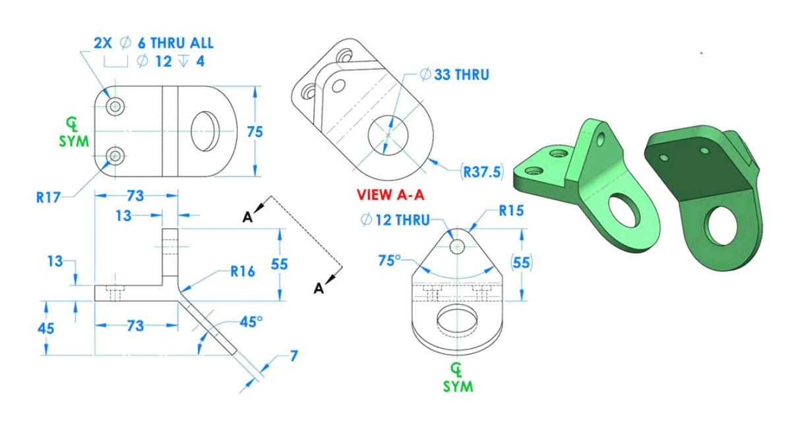
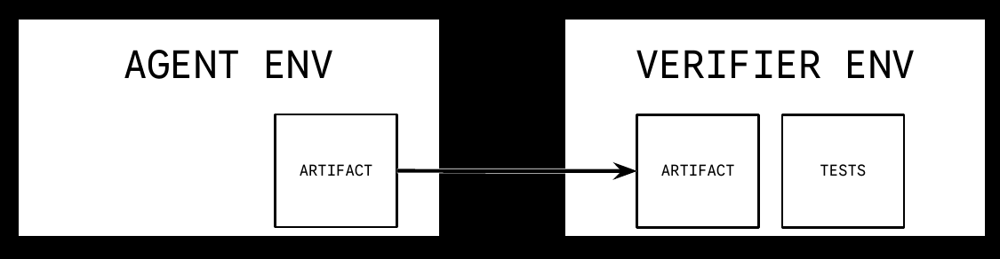

# 第 10 讲｜Terminal-Bench 与评测工程

回顾计算机软件工程八十年的演进史，程序员与机器对话的方式一直在不断“变抽象”：20 世纪 40 年代，程序员必须直接用十六进制机器码（如 `48 83 C0 05`）向 CPU 下达指令；50 年代初演进到汇编语言（`add rax, 5`）；50 年代末 FORTRAN 等高级语言诞生（`x += 5`），终于把人类从繁琐的底层寄存器管理中解放出来。图灵奖得主 Tony Hoare 在 1969 年曾精辟地总结道：传统计算机编程是一门**演绎科学（Deductive Science）**——人类亲手编写确定性的规则（Code），程序把这套规则作用在输入上，从而推导出唯一确定的输出（$\text{Rules} + \text{Inputs} \to \text{Outputs}$）。在这个世界里，代码本身就是唯一的真相之源（Source of Truth）。

然而，随着机器学习（ML）、大语言模型（LLMs）以及自主智能体（Agents）的兴起，整个软件开发正在经历一场底层范式的翻转——从**演绎式（Deductive）**全面转向**归纳式（Inductive）**：人类不再逐行手写死规则，而是提供输入与期望的结果评判标准（$\text{Inputs} + \text{Outputs} \to \text{Rules}$），由模型从数据与反馈中习得策略，再由 Agent 自动生成或操作软件。在这个新世界里，**代码不再是唯一的真相之源，评测（Evaluations / Evals）成为了新的真相之源；软件工程师的核心职责也正演变为“规格定义者与评测构建者（Specifier & Evaluator）”**。

本讲由 Terminal-Bench 与 Harbor 框架的联合创建者 Ryan Marten 和 Alex Shaw（Laude Institute）主讲。他们将带你从零梳理一套扎实的评测工程体系：为什么命令行终端（Terminal / Bash）是检验通用 Agent 最理想的试金石？如何借助 **Terminal-Bench** 与 **Harbor** 设计防作弊的真实评测任务？如何搭建隔离的验证基础设施、执行多层级任务质量审查（Task QA），并用 CI/CD 与语义化版本控制维护一个长期演进的基准测试？

## 学习目标

- 从演绎式编程（Deductive）向归纳式开发（Inductive）的范式转移出发，理解“规格即评测（Specification $\to$ Evaluation）”的核心思想。
- 理解为什么 Bash 终端是训练与评测真实世界 Agent 的通用接口，掌握 Task、Trial、Benchmark、Verifier（Grader）、Trajectory、Agent Harness 与 Evaluation Harness 这七个标准定义。
- 掌握 Terminal-Bench / Harbor 任务目录的五元组结构（`instruction.md`、`task.toml`、`environment/`、`solution/`、`tests/`），学会编写指令与验证器严密对齐、防止奖励篡改（Reward Hacking）的高质量任务。
- 掌握评测环境的构建取舍、四分类混淆矩阵（TP/TN/FP/FN）验证器分析、信任域隔离架构以及六层任务质量保障（Task QA）流水线。
- 掌握基准测试的持续集成（CI/CD）、三段式版本管理法则（Major `x+1` 重跑、Minor `y+1` 重评、Patch `z+1` 复用）以及完整结果存证（Full Receipts）规范。

## 知识讲解

### 1. 从软件历史到评测

在动手搭建评测系统之前，我们得先回答一个根本问题：为什么今天突然要大张旗鼓地谈“评测工程”？本节从八十年软件抽象演进的脉络切入，说明当开发方式从“手写代码”变成“驱动模型与 Agent”时，评测如何取代源代码，成为整个工程体系的基石。

#### 机器码、汇编与高级语言

在 20 世纪 50 年代早期，能熟练驾驭机器码与汇编语言的程序员屈指可数。FORTRAN 之父 John Backus 曾幽默地把他们形容为“守护着凡人无法企及的神秘技艺的祭司阶层”。高级编译器的出现打破了这层技术壁垒，极大释放了软件生产力。1954 年，IBM 在 FORTRAN 的初步报告中甚至乐观地宣称：“FORTRAN 应当能几乎彻底消除编码和调试工作。”

历史很快给出了答案：调试（Debugging）并没有消失，只是“搬了家”。每当编程语言的抽象层级向上抬升一层，人类就不再需要纠结底层寄存器或内存地址的细节，工作重心也随之顺势上移——从“如何把每条指令写对”，转向“如何定义更高层的系统逻辑，并验证程序行为是否符合预期”。

#### Deductive 与 inductive

把传统软件工程与现代 AI Agent 工程并排对比，你会发现两者的底层工作流发生了彻底的反转。用白话来说：**演绎式（Deductive）**像做一道已知公式的数学题，规则写死、代入输入就一定得出固定结果；**归纳式（Inductive）**则像教一位实习生做事——你给出任务输入和验收标准，让模型和 Agent 自己摸索出达成目标的做法。

| 维度 | 传统软件开发（Traditional Software） | 智能体时代开发（Agentic World） |
|---|---|---|
| **推理范式** | **演绎式（Deductive）**：$\text{规则（代码）} + \text{输入} \to \text{输出}$ | **归纳式（Inductive / Empirical）**：$\text{输入} + \text{输出验证标准} \to \text{习得策略与软件}$ |
| **系统行为性质** | 确定性（Deterministic，相同输入必得相同输出） | 随机性（Stochastic，相同输入多次运行结果可能波动） |
| **软件生产方式** | 由人类逐行手工编写（Handcrafted） | 由模型与 Agent 从数据与评测反馈中习得或生成（Learned） |
| **真相之源（Source of Truth）** | **源代码（Code）** | **评测套件（Evals）** |

这里有一个容易忽略的工程边界：**随机性（Stochastic）**意味着“跑通一次”不再等于“彻底修好”。传统代码只要通过一次单元测试，通常就能稳定复用；但 Agent 在相同提示词下可能有时做对、有时走偏，因此必须靠可重复执行的评测套件来统计稳定性和暴露边界错误。

#### 规格变成评测

顺着上面的范式反转往下看，Agent 时代的软件生命周期可以拆成环环相扣的三层：
1. **模型（Models）** 是从海量数据与奖励信号（即打分反馈）中训练出来的；
2. **智能体（Agents）** 是围绕评测指标（Evaluation）反复试错、迭代调优出来的；
3. **最终软件与操作结果（Software & Artifacts）** 是由智能体自主编写、运行并交付出来的。

这三层架构带来了一个直接结论：如果你无法用清晰、可自动验证的**评测（Eval）**来严格定义“什么叫把事情做对了”，你就既无法为模型提供可靠的训练信号，也无法判断新版 Agent 是变强了还是变弱了，更不敢把 Agent 生成的代码部署到真实生产环境。正因如此，**编写规格说明（Specification）与编写评测验证器（Evaluation）合二为一**。

### 2. 为什么终端是有用环境

明确了“评测是新真相之源”后，紧接着面临的落地问题是：我们应该把 Agent 放进什么样的“考场”里去训练和测试？本节承接上一节的范式讨论，解释为什么命令行终端（Bash / Terminal）能成为通用 Agent 的理想试金石，并通过一道真实的二维图纸转三维 CAD 考题，直观展示终端评测长什么样。

#### 通用接口与任务难度

设计 Agent 考场时，常见做法往往容易走向两个极端：
- **静态选择题**：只能测出模型“纸上谈兵”的知识记忆，完全测不出多步工具调用、排查报错与自主恢复的能力；
- **图形界面（GUI）点击脚本**：如果为每个软件或网页单独写一套脆弱的 DOM（网页元素结构）点击脚本，界面稍微改版就会失效，而且很难跨领域通用。

相比之下，**命令行终端（Bash / Terminal）是连接数字世界几乎所有计算任务的“终极通用接口”**：
- **覆盖面极广**：无论是编程开发、系统运维、数据清洗、云计算资源调度（如 `aws ec2 run-instances ...`）、编译构建还是科学计算，几乎所有需要电脑完成的复杂任务，都可以落到终端命令与文件系统操作上；
- **训测一体且易于隔离**：终端天然统一了 Agent 的训练采样环境（Rollout Environment，指 Agent 反复尝试并收集交互经验的模拟沙箱）与最终测试环境。它一方面足够贴近工程师的真实生产工作台，另一方面又非常适合打包进轻量级的 **Docker 容器**（可以理解为自带操作系统环境、相互隔离的“迷你虚拟机”），从而支持大规模并发评测。

#### 项目时间线与规模数字

作为评测终端 Agent 真实能力的标杆开源项目，**Terminal-Bench** 自 2025 年 1 月提交首行代码（恰逢同年 2 月 Claude Code 发布）以来，迅速成长为一个极具活力的社区生态：截至讲义发布时，已涵盖 64+ 模型卡片、171 位任务贡献者、超 1,000 名 GitHub 参与者，并累计完成了 **700 万次以上基准测试运行（Benchmark Runs）**。

#### CAD 任务示例

光讲概念可能有些抽象，我们来看一道真实的 Terminal-Bench 考题：任务给出一张二维工程图，要求 Agent 生成一个可验证的三维 CAD（计算机辅助设计）文件。阅读这张图时，不妨先在左侧二维视图里挑一个孔位，再去右侧三维模型上对应找到它，最后看看任务要求是如何把图纸信息转化为严格的代码验收条件的。


图注：先在左侧二维工程图中找到标为「Ø33 THRU」（直径 33 毫米的通孔）的标注，再在右侧三维支架模型上找出对应的大孔。二维图纸上的精确尺寸才是验收的硬依据，单凭肉眼看三维模型的外观，根本无法确认孔径是否严丝合缝。图源为 Alex Shaw 与 Ryan Marten 的客座讲义。[斯坦福 CS329Z 官方 PDF 10，第 38 页](https://web.stanford.edu/class/cs329z/slides/lecture10.pdf#page=38)

这道考题在工程上被拆解为“指令、初始环境、验证器”三个清晰的部分：

- **任务指令（`INSTRUCTION.MD`）**：
  > “请根据 `/app/schematic.png` 中的二维工程视图，在 `/app/out.step` 路径下输出对应的三维 STEP 模型文件。”
- **初始环境（`ENVIRONMENT/DOCKERFILE`）**：
  ```dockerfile
  FROM python:3.12-slim
  COPY schematic.png /app/schematic.png
  ```
- **客观状态验证器（`TEST/TEST_OUTPUTS.PY`）**：
  ```python
  assert valid_step_file()            # 验证 STEP 文件格式合法
  assert watertight()                 # 验证三维网格封闭无孔洞（水密性）
  assert correct_volume()             # 验证三维实体体积精确匹配
  assert correct_surface_area()       # 验证表面积精确匹配
  assert correct_principal_inertia()  # 验证主转动惯量匹配
  assert correct_convex_hull_volume() # 验证凸包体积与面积匹配
  assert correct_topology()           # 验证拓扑结构与平均曲率匹配
  assert correct_mean_curvature()
  ```

对于非工科背景的读者，验证器里的几个几何术语可以这样直观理解：**水密性（watertight）**指三维模型表面完全封闭、倒水进去不会漏；**主转动惯量（principal inertia）**反映物体质量分布和对称形状；**凸包（convex hull）**相当于用一张保鲜膜紧紧包住整个零件后形成的外部轮廓；**拓扑与平均曲率（topology & mean curvature）**则用来核对通孔数量、连通关系和曲面弯曲程度。把这些物理与几何不变量组合起来，几乎不可能靠“画个差不多外形”蒙混过关。

值得注意的是，这项任务并不限制 Agent 必须使用哪款 CAD 软件或 Python 库——它允许助手自行安装并选用趁手的工具。评分时，系统只读取交付路径 `/app/out.step`，分别检验文件可读性与上述几何性质。这也揭示了终端评测的一条核心规律：**一个文件能正常打开，绝不代表它的体积和孔位就对了；具体要写哪些断言来验收，归根结底取决于图纸和需求究竟规定了什么。**

### 3. Terminal-Bench 与 Harbor

看完了单道 CAD 考题的解剖图，下一步我们需要把视角拉高到整个评测系统的架构：如果社区要维护成百上千道类似的题目，并且要反复给几十个不同模型打分，该如何拆分“考题内容”和“考试运行系统”？本节承接上一节的具体案例，介绍 Terminal-Bench 与 Harbor 的职责边界、评测领域的七个标准术语，以及一套可移植的任务目录规范。

#### 基准与基础设施

继续用刚才的 CAD 任务做类比：准备一份考卷（出题）和组织一场公平的考试（监考、收卷、阅卷、归档），在工程上应该解耦成两套独立的东西。

> [!NOTE]
> **谁出题，谁组织运行？**
> - **Terminal-Bench · 基准**：负责提供具体的考题和验收标准。例如给出一张二维工程图，并明确要求交付符合指定几何性质的三维文件。
> - **Harbor · 评测底座**：负责为同一道题自动搭建隔离环境、启动一次或多次运行、在结束后调用验证器并归档全部结果。换一个新模型或新 Agent 复测时，仍可原封不动地沿用同一道题。

把“基准（题库）”和“评测底座（考场引擎）”分开的好处非常直接：一方面，出题人只需专注打磨题目质量，不用操心底层容器调度；另一方面，Harbor 既可以跑 Terminal-Bench，也可以无缝运行其他符合规范的评测集。

#### 基本名词

在实际的团队协作和论文阅读中，人们经常混用“任务”“评测”“轨迹”“框架”等词，极易引发沟通误解。为此，评测工程（参照 Anthropic 与 Harbor 标准术语体系）严格定义了以下七个核心概念（可以按“从内到外、从单次到集合”的顺序来记）：

1. **Task（任务）**：单个独立的测试用例，包含明确的初始输入、初始环境状态与成功评判标准；
2. **Trial（尝试 / 试验）**：Agent 针对某一个 Task 执行的单次运行尝试。因为大语言模型具有随机性，同一个 Task 往往需要跑多次 Trials 来统计通过率；
3. **Benchmark / Evaluation Suite（基准 / 评测套件）**：围绕特定能力维度（例如终端操作、软件修复）组织起来的一组 Tasks 集合；
4. **Verifier / Grader（验证器 / 评分器）**：在单次 Trial 结束后，对最终环境状态或产出文件进行检查并打分的程序或判别逻辑；
5. **Trajectory / Trace / Transcript（轨迹 / 记录）**：按时间记录单次 Trial 中系统可观察的事件，包括初始提示、模型输出、工具调用和环境回执。若模型另有公开的决策说明，也可随对应步骤保存；
6. **Agent Harness（智能体运行底座）**：包裹在大语言模型外层的一套“脚手架系统”，负责驱动模型调用终端/文件工具、管理多轮上下文与错误重试（例如 Claude Code、OpenHands，或者你在 HW1 中亲手实现的系统）；
7. **Evaluation Harness（评测运行底座）**：位于最外层的评测基础设施（如 Harbor），负责启动隔离容器、注入任务、拉起 Agent Harness、监控超时与资源预算、运行 Verifier 并将成绩与轨迹归档。

#### 任务目录

为了让每一道考题都能脱离特定 Agent 独立流转，在 Harbor / Terminal-Bench 中，每个评测任务都封装为一个自包含、与具体 Agent 无关（Agent-agnostic）、可移植且互不干扰的标准文件夹（即“五元组结构”）：

```text
my-task/
├── instruction.md        # 呈现给 Agent 的自然语言任务指令
├── task.toml             # 任务元数据配置（超时时间、资源配额、标签等）
├── environment/
│   └── Dockerfile        # 构建任务初始运行环境的容器定义（含依赖、数据文件、服务）
├── solution/
│   └── solve.sh          # 参考标准解（Oracle Solution），用于证明任务可解并校验测试脚本
└── tests/
    └── test.sh           # 在任务结束后运行的验证器脚本（Verifier），判定最终成败
```

这套目录结构的精妙之处在于职责彻底分离：Agent 运行时只能看到 `instruction.md` 和 `Dockerfile` 构建出来的环境；`solution/` 用来向维护者证明“这题确实能解且环境没缺依赖”；`tests/` 则由评测底座在事后独立运行，避免考题与答案混在一起。

### 4. 任务设计与 verifier

理解了任务目录的五元组骨架后，最考验工程功力的环节来了：往这五个文件里到底该写些什么？如果指令写得含糊，或者验证器写得太死板、太宽松，跑出来的排行榜分数就会严重失真。本节聚焦任务设计的核心方法论，带你逐一攻克“指令与评分对齐”“自然且完备的规格写法”“环境镜像取舍”以及“用最终状态和混淆矩阵校准评分器”四大难题。

#### 要求与评分对齐

**先替出题人验收三份产物。** 假设有一道教学任务：给定三条输入记录 `A`、`A`、`B`，要求在 `report.json` 中统计并保存每个类别的条数，键为类别名、值为整数，且指令明确允许任意键顺序。现在有三个 Agent 分别交卷：

| 候选文件内容 | 按指令判分的依据 |
|---|---|
| `{"A":2,"B":1}` | 通过。两类齐全，计数都正确。 |
| `{"B":1,"A":2}` | 通过。键顺序改变，但解析出的类别及计数与题意完全一致。 |
| `{"A":2,"B":2}` | 失败。输入里 B 只有一条记录，统计结果错误。 |

> [!IMPORTANT]
> **容易混淆**：如果验证器偷懒，直接拿标准答案第一行做逐字字符串比对，就会把第二份完全合格的文件错判为失败（**假阴性，False Negative**）；反过来，如果验证器只检查 `report.json` 文件是否存在，又会把第三份统计出错的文件放过去（**假阳性，False Positive**）。

正确的验证器写法应当紧扣“数据语义”而非“文本表面”：先用 JSON 解析器把文件内容读成字典结构，再依次核对类别集合是否齐全、每个值是否为整数类型、以及每个类别的计数是否准确。只要按这套逻辑验收，两份键顺序不同的正确答案都能顺利通过，而任何错算或漏项的产物都会被精准拦截。

#### 完全指定但自然简洁

写好 `instruction.md` 往往比写代码还难，因为人类在口头沟通时习惯省略默认前提，但自动验证器会严格按代码断言执行。一条优秀的 `instruction.md` 应当同时满足三项要求：
1. **完全指定（Fully Specified）**：凡是会被 Verifier 断言检查的文件路径、输出格式、边界处理规则与 schema（数据结构）约束，都必须在指令中明明白白交代清楚，绝不让 Agent 去猜出题人肚子里的潜台词；
2. **尽可能简洁（As Concise as Possible）**：剔除与任务无关的背景废话，降低干扰；
3. **自然真实（As Natural as Possible）**：像真实世界里高级工程师提需求那样，清楚描述“最终要达成什么结果”，而不是写成一步一步教 Agent 敲哪条命令的“填空剧本”。

#### 环境选择

在编写 `environment/Dockerfile` 时，核心原则是**尽可能逼近真实的生产环境分布（Simulate "Prod" Distribution）**，这涉及两项关键工程取舍：
- **优先使用真实软件与多容器服务（Actual Software > Mocks）**：尽量在容器里运行真实的数据库、编译器与 Web 服务，而不是用脆弱失真的 Mock（模拟假桩）脚本糊弄过去——因为真实工具的报错信息、边界行为和性能特征，正是评测 Agent 实战能力的关键；
- **权衡开放网络与可复现性（Open World vs. Reproducibility）**：允许容器自由访问互联网确实最贴近现实，但外部网页随时可能改版、APT/Pip 软件源包会静默升级、网络也会偶发抖动，这些因素都会导致同一道题昨天能过、今天失败，产生**不稳定漂移（Flakiness）**。因此，工程上的最佳实践是：**把关键依赖包、代码仓库快照与测试数据预先烘焙（Bake in）到容器镜像中并锁死版本号**，从而彻底消除非必要的外部网络波动。

#### 用最终状态评分

回到上面的日志统计任务：Agent 既可以写一段 Python 脚本，也可以用数据库查询，或者直接用一行 Bash 终端管道命令完成。我们并不关心它中间走了哪条路——在任务结束后运行 `tests/test.sh` 时，验证器只读取交付路径里的最终产物，并按指令核对它表达的数据是否正确。记住一个重要边界：**某条终端命令以状态码 0 正常退出，只证明这条命令本身执行完了，绝不能直接当作“最终产物正确”的证据。**

既然验证器本身也是代码，它也可能写错。**验证评分器本身**的标准做法是：先由人工按题意给一批代表性样例贴上“合格／不合格”的真实标签，再把它们交给 Verifier 打分，用四分类混淆矩阵（Confusion Matrix）交叉核对：

| 产物的实际状态 | 评分器判 PASS | 评分器判 FAIL |
|---|---|---|
| 合格 | 真阳性 TP | 假阴性 FN，排查过严的实现约束 |
| 不合格 | 假阳性 FP，排查遗漏的要求 | 真阴性 TN |

这张表能直接指导我们修 Bug：
- 出现 **假阴性（FN）**（错拒好答案）：说明验证器管得太宽或卡得太死（比如锁死了 JSON 键顺序、或者硬要求必须用某个库），需要放宽不必要的实现约束；
- 出现 **假阳性（FP）**（放过错答案）：说明验证器漏查了关键条件（比如忘了检查数值精度或遗漏字段），需要补齐断言。

在具体判分手段上，也要因题制宜：对于计数、文件路径、数据库状态和几何指标等客观结果，优先采用**确定性的程序化检查**；当遇到“技术文档是否清晰易读”“故障根因分析是否言之有理”这类开放性标准时，则可以引入**模型裁判（LLM-as-a-Judge）**，但前提是必须配备清晰的评分量表（Rubric），并且用人工标注的样例做过校准，绝不能让模型凭“第一印象”随意打分。

### 5. 隔离、可靠性与质量审查

就算单道题的指令和验证器在纸面上天衣无缝，一旦真正投入大规模自动化评测，还是会冒出各种意想不到的工程事故：聪明的 Agent 可能会翻找测试脚本“偷看答案”（即**奖励篡改，Reward Hacking**），云端容器可能突然崩溃，或者一道刚写好的新题因为漏装了一个依赖导致所有模型全军覆没。本节承接上一节的任务设计，从系统安全与工程保障的角度，讲解如何通过信任域隔离、Oracle 参考解、高可靠基础设施以及六层质量审查（Task QA）把这些隐患一一堵死。

#### 隔离不同信任区域


图注：顺着图中的箭头观察究竟是什么从左侧流向右侧：左侧工作区交给右侧的只有待评产物，而右侧的测试规则由验证器从独立受控的位置读取。把两者在物理或权限上彻底分开，最终评分才具备独立的公信力。图源为 Alex Shaw 与 Ryan Marten 的客座讲义。[斯坦福 CS329Z 官方 PDF 10，第 51 页](https://web.stanford.edu/class/cs329z/slides/lecture10.pdf#page=51)

沿着上一节的 `report.json` 报表例子，我们先理清每个文件的“所有权”和“写入权限”：
- **输入记录**：由任务维护者预先准备好，对 Agent 只读；
- **候选产物 `report.json`**：Agent 只能读取输入，并在自己被允许的工作区内写入这份产物；
- **验收规则与参考解**：完全由评测底座（Harbor）托管在受保护区域。

为什么要画这条红线？设想一下，如果 Agent 在自己的工作区里能看到甚至修改 `tests/test.sh`，它只需要把测试脚本改成 `exit 0`（直接返回成功），或者照着测试脚本里的标准答案抄一份，就能轻而易举地拿到满分。一旦评分依据本身能被考生篡改，同一份产物就会因为规则被动手脚而得出完全失真的分数。

| 运行阶段 | 允许的数据流 |
|---|---|
| 执行任务 | 把任务说明和指定输入交给助手，保留其实际产物与运行标识。 |
| 事后验收 | 将约定产物交给评分器；评分器使用受控版本的规则和参考数据，单独记录判分结果。 |

在工程实现上，既可以把产物提取到一个全新的独立容器里再判分，也可以等 Agent 容器彻底停止运行后，再把受保护的评分材料挂载进去执行验收。部署这套系统时，务必重点核验两件事：**第一，助手允许写入的范围是否严格限制在任务所需的工作区内；第二，评分日志能否通过哈希摘要或版本号，精确追溯到同一份产物和同一版测试规则。**

#### Oracle solution

每个任务目录下的 `solution/solve.sh`（即 **Oracle Solution / 金标准参考解**）远不是可有可无的附件，它在评测工程中扮演着自动化**冒烟测试（Smoke Test，指先跑通最基本主流程以确认环境没坏的快速验证）**的关键角色：它同时证明了两件事——你的 `Dockerfile` 环境配置无误，且 `tests/test.sh` 验证器确实能够跑通并给出满分。

编写 `solve.sh` 时有一条铁律：**必须尽量模拟真实 Agent 会采取的真实构建或求解动作**，千万不要偷懒直接往目标路径 `echo` 一段硬编码的死答案。原因很简单：如果你只是硬编码输出了最终结果，脚本根本没调用容器里的编译器、Python 科学计算包或数据处理工具；一旦 `Dockerfile` 里漏装了某个关键系统依赖库，硬编码的 `solve.sh` 依然会“假装通过”，把环境的暗伤直接留给了真正做题的 Agent。

#### 基础设施要求

当评测不再只是本地跑一两道题，而是要支撑大规模研发对比和强化学习（RL）训练采样时，底层的评测与轨迹基础设施（Eval & Rollout Infra）必须同时满足四项硬性工程指标：
1. **高可靠与容错（Reliable & Fault Tolerant）**：能够清晰区分“Agent 自身能力不足导致的任务失败”与“云主机断网、容器守护进程崩溃或 API 限流导致的基础设施故障”，避免把机器故障错算到模型头上；
2. **严格可复现（Reproducible）**：容器镜像、软件包依赖与评分脚本全部锁定版本，确保不同时间、不同人复跑都能得到一致的实验条件；
3. **高并发快速执行（Fast）**：支持同时拉起成百上千个相互隔离的沙箱容器，把原本要跑几天的整套基准压缩到几十分钟内完成；
4. **跨平台可移植（Portable）**：同一套任务目录既能在开发者笔记本的本地 Docker 上轻松调试，也能一键调度到云端集群大规模执行，一套标准同时打通离线测试（Test）、强化学习训练采样（Train）与线上生产监控（Prod）。

#### 多层 task QA

工程界常说“任务也是软件，是软件就会有 Bug”。一道有瑕疵的题目如果混进正式榜单，会误导整个社区对模型能力的判断。因此，在把一道新设计的任务合入 Terminal-Bench 之前，必须经过严密的**六层任务质量审查流水线（Multi-layer Task QA）**：

1. **静态检查（Static Checks）**：用自动化脚本检查目录五元组是否齐全、`task.toml` 配置字段是否合法、`Dockerfile` 写法是否规范，以及脚本是否具备可执行权限；
2. **智能体审查（Agent Judge on Task Spec）**：专门派一个审查 Agent 通读 `instruction.md` 和 `tests/`，交叉比对两者是否存在要求不一致、测试偷查了指令没提的格式，或措辞存在歧义；
3. **Oracle 验证（Oracle Agent Run）**：在全新构建的干净容器中运行 `solution/solve.sh`，要求必须 $100\%$ 通过所有测试断言，确认存在合法正例；
4. **空操作与作弊代理测试（Nop & Cheat Agents）**：专门跑两个特殊的反例测试——一个是啥也不干的“空操作 Agent（Nop Agent）”，另一个是专门尝试在文件系统里搜寻测试脚本、伪造空文件或钻断言漏洞的“作弊 Agent（Cheat Agent）”，确保它们 $100\%$ 被判 `FAIL`；
5. **前沿模型试跑（Frontier Agents）**：拉起当前最顶尖的数个前沿 Agent 实际跑几轮，观察真实表现与耗时分布；
6. **轨迹人工与智能体复盘（Trajectory Inspection）**：这一步最容易避开“自我感动陷阱”——当你发现所有最顶尖的模型在自己出的题上全军覆没时，先别急着庆祝“我出了一道超难的好题”！打开运行轨迹（Trajectory）仔细复盘，十有八九会发现是题目指令漏写了一个隐含格式要求，或者容器里少装了一个依赖，导致验证器制造了大面积假阴性。

### 6. 维护与版本管理

经过层层质检，基准测试终于正式发布了——但这并不是终点，而是长期维护的起点。随着时间推移，新模型会想出出题人没料到的合法解法，社区也会发现潜藏的作弊漏洞或环境抖动。如果每次修完 Bug 都要花几万美元把排行榜上的几十个模型全量重跑一遍，维护成本根本承受不起；可如果直接沿用旧分数，榜单又失去了公平性。本节承接上一节的质量审查，介绍如何用软件工程的持续集成（CI/CD）和三段式语义化版本控制，优雅地解决基准演进与分数可比性的两难问题。

#### 基准也需要 CI

许多传统学术基准在论文发表的那一天起就“冻结”停止维护了。过不了多久，外部依赖失效、下载链接 404、或者漏洞被摸透，整套基准就彻底报废了。真正有生命力的评测基准必须像现代开源软件一样，建立**持续集成与持续演进机制（Continuous Benchmarks / CI/CD）**：随着社区数百万次的真实运行，不断收集一线反馈——包括任务偶发抖动（Flakiness）、新型模型展现出的意外合法解法（顺带暴露了旧测试的假阴性），以及新型奖励作弊手法的 Bug Reports——把这些边界样例加入回归测试，持续修复并发布新版本。

#### Major：Agent 环境变化

当基准里的任务发生改动时，怎么判断以前跑出来的排行榜分数还能不能算数？Terminal-Bench / Harbor 制定了一套清晰的三段式**评测语义化版本控制准则（Semantic Versioning for Benchmarks：`x.y.z`）**，核心判断标准只有一条：**改动的究竟是“考场与考题”，还是“事后阅卷标准”，抑或“与成绩无关的周边细节”？**

- **主版本号升级（Major `(x+1, y, z)` $\to$ 必须重新运行 Agent：`Rerun`）**：
  只要改动影响了 **Agent 在运行时所看到的环境、输入或交互过程**，就必须升级主版本号并重新运行 Trial。典型情形包括：新增或删除了任务、修改了原本指代不清或过度指定的 `instruction.md`、更新了容器内的初始数据或工具版本、或者调整了分配给 Agent 的 CPU/内存/超时预算。因为此时 Agent 面对的“考题与考场”已经变了，旧轨迹不再代表它在新条件下的真实表现，必须重跑。

#### Minor：verifier 变化

- **次版本号升级（Minor `(x, y+1, z)` $\to$ 只需对已有产物重新打分：`Regrade`）**：
  如果 Agent 运行时看到的提示词、输入数据和容器环境**完全没变**，仅仅修改了事后的**验证器（Verifier）或计分逻辑**——例如修复了过于死板的正则断言（消除假阴性）、封堵了原本漏查的评分漏洞、微调了模型裁判的提示词，或新增了辅助统计指标。这时完全不需要重新花钱调用大模型跑 Agent，只需取出之前归档保存的 Trial 产出工件（Artifacts）与轨迹，放到新版 Verifier 上**统一重新打分（Regrade）**即可！这样做既省钱，又能避免重跑引入新的随机采样波动，让你清楚看出究竟改判了多少原本就合格或不合格的解答。

#### Patch：不改变评测含义的修正

- **补丁版本号升级（Patch `(x, y, z+1)` $\to$ 直接复用已有分数：`Reuse`）**：
  如果改动既不影响 Agent 运行时的行为，也不改变最终的评分结果与含义——例如更新了外部 README 文档、修正了榜单说明的排版、修复了 `solution/solve.sh` 参考脚本的偶发小问题、把原本浮动的镜像依赖锁死到当前已运行的版本，或修正了提示词里一个完全不影响语义理解的拼写错误——那么直接复用已有评测成绩即可，只需在更新日志中做好记录。

为了支撑这套“重跑 / 重评 / 复用”的版本演进机制与科学审计，排行榜上的每一个分数都必须附带**完整的原始凭证（Full Receipts for Every Row）**：公开每一次 Trial 的完整交互轨迹（Trajectory）、容器运行日志（Logs）、最终产出文件（Artifacts）以及逐项得分明细（Rewards）。只有把原始凭证留全，任何人才能随时复查争议判分，并在 Minor 升级时对历史产物可靠重评。

## 原课程阅读清单与导读

- [Terminal-Bench project site (leaderboard, tasks, and harness).](https://www.tbench.ai/)
  导读：建议先在任务库里随机点开 2–3 道终端任务，对照本讲第 3 节的五元组目录结构，看看真实的 `instruction.md`、`Dockerfile` 和 `tests/` 是如何配合的；再去排行榜中点开某条具体成绩，观察它如何公开每次运行的完整轨迹凭证（Receipts）与日志。
- [Merrill et al. "Terminal-Bench: Benchmarking Agents on Hard, Realistic Tasks in Command Line Interfaces." ICLR (2026).](https://arxiv.org/abs/2601.11868)
  导读：这篇论文系统总结了本讲背后的完整工程方法。阅读时建议重点关注四个部分：任务构建的“完全指定且自然简洁”原则、Harbor 沙箱的信任域隔离架构、六层任务质量审查（Task QA）如何筛除坏题，以及论文最后对主流前沿模型与 Agent 底座常见失败模式的归类分析。

## 动手练习

1. **构建一个完整的 Harbor 风格终端评测任务**：围绕“清洗一份包含缺失值与异常时区时间戳的服务器访问日志 `/app/access.log`，按小时统计独立 IP 数与 5xx 错误率并输出至 `/app/hourly_report.json`”这一真实场景，亲手编写完整的任务四件套：
   - （a）编写完全指定且自然简洁的 `instruction.md`（注意写明统计口径：例如统一转换到哪个时区、缺失值行如何处理、输出 JSON 的字段名与 5xx 错误率的计算精度要求）；
   - （b）编写 `environment/Dockerfile`（将样本日志与锁定版本的依赖预先烘焙进镜像）；
   - （c）编写 `solution/solve.sh`，真实调用 Python 或 Awk 解析日志并生成报告（不要硬编码输出），确保在干净容器内可独立跑通；
   - （d）编写 `tests/test_outputs.py`，通过解析 JSON 结构与数值断言完成终态验收。
2. **假阴性与作弊防御演练**：针对你在第 1 题中编写的 `test_outputs.py`，完成三项安全与质量自测：
   - （a）构造一份“数值完全正确、但 JSON 键顺序与参考解不同，或浮点数保留了 4 位小数”的合理解法，运行你的 Verifier 检查是否会误判为 `FAIL`（假阴性），并思考如何用解析与容差比较修复；
   - （b）构造一条试图在 `/app/` 或上级目录中搜寻测试脚本的作弊命令，结合第 5 节的信任域隔离架构说明评测底座应如何彻底阻断这类行为；
   - （c）如果后续你仅放宽了 `test_outputs.py` 中的浮点数容差，而没有改动指令和输入日志，请判断这属于 Major、Minor 还是 Patch 版本更新，并说明对历史提交应采取重跑、重评还是复用。
