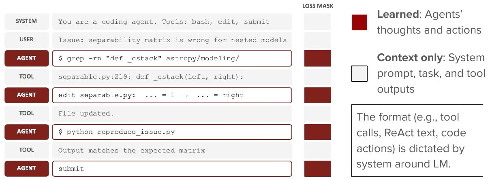

# 第 11 讲｜Agent 需要什么数据

在传统的单轮自然语言处理任务里，“数据”通常就是一张静态的二维表：左边一列放输入文本 $x$，右边一列放标准答案标签 $y$。但当我们构建的是一个会多步调用工具、读写外部状态、并与用户多轮交互的 AI Agent 时，静态的 $(x, y)$ 问答对就远远不够用了。

设想一个常见场景：Agent 在执行“核对上周差旅发票并提交报销单”时失败了。问题究竟出在哪里？是第一步搜错了报销政策文档，是第二步填错了汇率换算参数，还是第三步遇到接口超时后不知道如何重试？想要诊断、优化并客观评测这样一个动态系统，我们必须采集并构建专门面向智能体的数据资产。

本讲作为“智能体数据工程（Data for Agentic Systems）”单元的开篇，将从两个核心维度展开：先系统剖析 Agent 数据的三种核心形态——**运行轨迹（Traces）**、**行为示范（Demonstrations）**与**评价反馈（Feedback）**；再厘清**系统优化（Optimization）**与**基准评测（Evaluation）**之间的数据隔离边界，并进一步探讨如何搭建持续演进的**数据飞轮（Data Flywheels）**、开展高质量的**合成数据生成（Synthetic Data Generation）**，以及从真实人机交互中提炼高价值的隐式信号。

## 学习目标

- 严格区分运行轨迹（Traces）、示范数据（Demonstrations）与评价反馈（Feedback）三类数据形态的结构、信息密度与工程用途。
- 掌握优化数据（Optimization Data）与评测数据（Evaluation Data）的隔离原则，防止多跳轨迹与同源会话造成数据泄漏。
- 掌握构建 AI 工程数据飞轮（Data Flywheel）的闭环流程，理解如何将线上失败轨迹转化为可验证的系统改进。
- 掌握面向 Agent 的合成数据生成策略与质量控制边界，学会从真实人机交互（澄清、拒绝、中途转向与手动修改）中提取隐式监督信号。

## 知识讲解

### 1. 数据的三种形态

开篇我们看到，单靠静态的 $(x, y)$ 问答对无法说清 Agent 为什么会失败。本节要解决的核心问题是：**面对一次完整的多步运行，我们究竟应该把哪些信息存下来，又该如何将它们加工成“能复现问题、能教模型怎么做、能判断做得好不好”的三种核心数据？**

#### Traces

假设一位客服助手告诉用户“退款已经到账”，但用户发现钱并没有到账。要想查清真相，第一步就是打开这次运行的**运行轨迹（Trace）**——你可以把它理解为 Agent 世界的“黑匣子”或结构化程序日志，按时间顺序忠实记下每一步发生了什么。

下面是一段用于教学的简化轨迹（trace）：

| 时点 | 可以核对的事件 |
| --- | --- |
| 09:02:10 | 用户问订单 R8 的退款进度。初始配置只允许读取订单。 |
| 09:02:11 | 助手调用查询工具，参数是订单 R8。工具返回“已发起，到账时间待定”。 |
| 09:02:12 | 助手回复“已经到账”，随后结束。 |

通过这三行记录，同一个事件其实可以衍生出本讲要讨论的全部三种数据形态：

> [!NOTE]
> **同一个退款事件，可以留下哪三种数据？**
> - **运行轨迹（Trace）**：保留实际的工具回执“已发起”和助手原话“已经到账”，让他人能完整重现这次失误。
> - **评价反馈（Feedback）**：把这两句并排核对，指出助手在最后一步把“已发起”说成了“已到账”。
> - **行为示范（Demonstration）**：给出可复用的正确回复，例如“退款已发起，当前还没有到账时间”，并保留支持这句话的原始回执。

在真实的工程环境里，运行记录还可以补充更多排查所需的元信息，例如任务与环境版本、系统可观察到的决策说明、终止原因、调用成本以及响应延迟。

这里有一条很重要的记录边界：**只记录系统实际提供、且任务确实需要的信息**。即便日志里记全了每一次工具调用和返回结果，也不能据此去反推或臆测模型未公开的内部推理过程——Trace 只负责忠实还原外部可观测的事实。

#### Demonstrations

第二种数据形态是**行为示范（Demonstrations）**，它回答的是**“在当前状态下，我们希望 Agent 学会采取怎样的模范动作”**。如果说 Trace 像事故现场录像，Demonstration 就是写进操作手册的标准范例。

在复合系统与 Agent 中，Demonstration 通常表现为两种粒度：
- **阶段级示范**：只示范流程里的某一个关键步骤。例如在 DSPy（一种用编程方式自动优化提示词的框架）模块中，经过评测指标筛选出的少样本示例（Few-shot examples），展示“给定邮件正文 $\to$ 输出标准推理链与结构化日程字段”。
- **完整轨迹示范（Expert Trajectories）**：展示从头到尾的端到端多步操作序列，包括如何拆解问题、挑选工具、根据报错信息调整查询参数，直至最终解决任务。

工程上获取示范数据，通常有三条途径：
1. **领域人类专家亲自操作或编写**：质量最高、最贴近真实业务意图，但人力成本也最高。
2. **强模型生成 + 客观验证器过滤**：让参数量更大、能力更强的教师模型（Teacher LLM）反复尝试解题，再用能自动判定对错的客观验证器（Verifier，例如单元测试或规则校验脚本）筛掉错误答案、只留正确轨迹。这种“多生成、严筛选、留精品”的做法称为**拒绝采样自举（Rejection Sampling）**。
3. **从线上真实运行轨迹清洗沉淀**：先对真实日志做脱敏和清洗，再做**剪枝（Pruning）**——也就是剪掉那些走弯路、反复试错的无效重试步骤，并对有瑕疵的回复进行重写修正。

无论示范数据来自哪条途径，在使用前都必须明确记录它的**生成来源**与**过滤条件**，否则后续很难排查模型学偏的根因。

此外，用完整轨迹训练模型时，还有一个关键机制需要注意：一条多轮轨迹里混杂着系统指令、用户提问、工具回执和 Agent 动作四种角色。在做**监督微调（SFT，即用标准答案示例直接训练模型模仿输出）**时，我们不能让模型把所有行都当作学习目标——否则模型会把精力浪费在“预测用户下一句怎么问”或“假装自己是接口返回数据”上。正确的做法是引入**掩码（Mask）机制**：将系统指令、用户消息和工具回执仅作为已知上下文（不计算误差），只对 Agent 自己发出的动作计算**训练损失（Training Loss，即衡量模型预测与标准答案差距的指标）**。

图注：顺着左列可以依次分辨多轮轨迹中每一步的发言角色。在图示的监督微调（SFT）配置下，系统指令、用户消息与工具回执共同构成当前决策的上下文；只有深色标注的 Agent 行所对应的动作会被计入训练损失，从而确保模型专注学习“在给定上下文下该如何行动”。[斯坦福 CS329Z 第 11 讲原课件，第 14 页](https://web.stanford.edu/class/cs329z/slides/lecture11.pdf#page=14)

#### Feedback

第三种数据形态是**评价反馈（Feedback）**，它对某一条完整轨迹或某一步具体动作的好坏给出价值判断。

对于多步运行的 Agent 而言，不同反馈的核心差异在于**信息密度**与**成本的权衡**：粗粒度反馈（如只看最终成败）便宜且客观，但很难定位长链条中究竟哪一步犯了错；细粒度反馈（如逐步骤批注）能精准指导修改，但获取成本更高。按信息粒度从粗到细，Feedback 可分为四个层次：

| 反馈类型 | 数据形式 | 信息量与定位能力 | 典型应用场景 |
|---|---|---|---|
| **1. 二元成败信号（Binary Outcome）** | 最终通过 / 失败（$0 / 1$，如单元测试是否跑通） | 最客观可靠，但属于**稀疏末端信号**（只在整个任务结束时给出一个总结果），无法直接指出长轨迹中哪一步出了错 | RLVR（可验证强化学习，依赖自动校验器打分训练）、端到端基准评测 |
| **2. 标量评分与多维量表（Scalar / Rubric Scores）** | 按多个评价维度打分（如事实性、合规性、简洁度） | 能拆开诊断问题，区分是“格式错”、“事实错”还是“违反安全策略” | LLM-as-Judge（用大模型充当裁判）自动化评估、MIPROv2（自动搜索优化提示词与示例的算法）优化 |
| **3. 成对偏好比较（Pairwise Preference）** | 同一任务下两条轨迹 $(y_{\text{win}}, y_{\text{lose}})$ 的优劣排序 | 人类或模型直接“二选一”比打绝对分更容易保持标注标准一致 | RLHF / DPO（基于人类或偏好数据对齐模型行为的微调方法）偏好对齐、A/B 策略对比 |
| **4. 自然语言批评与过程纠偏（Natural Language Critique / Step-level Feedback）** | 明确指出“第 3 步调用 `read_doc` 时选错了已作废的旧文档 ID” | **信息密度最高**，直接完成**局部信用分配（Credit Assignment）**——即把整条轨迹成败的功过精准归因到具体的某一步 | Reflexion、TextGrad、GEPA（均属利用自然语言反思自动改进提示词或策略的优化框架）反思式提示演化 |

### 2. 数据用途与循环

上一节我们拆解了 Agent 数据的三种基本形态——Traces、Demonstrations 和 Feedback，知道了“数据长什么样”。本节要解决接下来的工程问题：**这些数据在系统开发与上线后该如何分工隔离、如何形成持续进化的闭环，以及在真实数据不足时如何科学地扩充与采集信号？**

#### Optimization vs evaluation

拿到一条运行轨迹后，它既可以用来帮团队找 Bug、改进系统，也可以留到最后检验系统是否真的变强了。动手处理之前，必须先明确这条数据的用途，再决定谁有权限查看它：

- **优化数据（Optimization Data，Train / Dev）**：面向“改进系统”开放。开发者可以逐条排查失败原因并据此改写提示词，自动优化器可以从中挑选少样本示例，训练程序也可以用其中的训练集（Train）来更新模型参数。
- **留出评测数据（Evaluation Data，Held-out Test）**：面向“最终验收”严格隔离。必须先固定待测系统的所有改动，再放到这批从未参与过调优的独立任务上跑分。一旦团队反复阅读过某组失败案例并针对它们做过调优，这组数据就失去了“盲测”的公正性，应当划归为开发资料（Dev），而不能继续充当最终测试集。

切分数据集之前，先写清楚**“希望系统推广（泛化）到什么新场景”**，再按对应的业务单元整组切分：
- 如果目标是应对**新发生的独立事件**，就把同一事件衍生出的多轮会话、事后复盘以及各种同义改写全部打包进同一组；
- 如果目标是推广到**从未见过的新项目**，就按项目维度整组划分。

如果同一个底层案例的衍生记录被拆散，同时出现在训练集和测试集里，就会发生**关联泄漏（Correlated Leakage）**——相当于考试前已经背过同一道题的改写版，测出来的高分无法代表真实能力。

> [!IMPORTANT]
> **容易混淆**：把一张工单和它的同义改写存进不同文件，只是物理上隔开了文件；在统计独立事件时，两者同源，依然属于同一组，绝不能分别放进训练集和测试集。

#### Data flywheel

**前面提到的“报喜过早”（工具说已发起、助手说已到账）错误，怎样才能变成一次可复查、可沉淀的系统改进？** 答案是搭建**数据飞轮（Data Flywheel）**——把线上运行暴露出的问题结构化地送回开发流程，再通过新的独立运行证据去检验改动是否真正有效，形成“上线 $\to$ 发现问题 $\to$ 修复 $\to$ 验证 $\to$ 再上线”的闭环：

1. **采集和抽样**：在合规允许的采集范围内，保留脱敏后的用户查询、工具状态码与最终回复。筛选出“工具返回待处理、助手却声称已完成”的异常事件，同时也要抽取一部分正常事件作为对照组。
2. **制作开发材料**：对已人工复核的失败案例，写出标准的正确示范（Demonstration），并把原始失败案例沉淀为已知故障的**回归检查（Regression Check）**——也就是每次发版前都重跑一遍，确保修过的老 Bug 不会死灰复燃。修好这个案例，说明该错误可以被稳定重现和修正。
3. **改动并独立验收**：调整状态码说明或回复规则后，冻结新版本，用来自**独立事件、且从未用于调优**的任务进行验证。验收时必须把“待处理”和“已完成”两类真实状态分开统计，防止系统矫枉过正，把所有回执一律改口说成“待确认”。

这里有两个极易踩中的工程陷阱：第一，如果示范样本、回归检查题和最终测试题全部出自同一个订单，三处都通过只能说明系统记住了这一个案例，无法证明它学会了通用规则；第二，不要只看被告警筛选出来的失败样本，还要定期抽查筛选器判定为“正常”的样例，才能揪出被规则漏掉的隐蔽错误。正是这样的循环，把线上日志、失败分析、系统优化与留出评测严密地串联在一起。[数据飞轮原文](https://www.sh-reya.com/blog/ai-engineering-flywheel/)

#### Synthetic data generation

在产品刚起步的冷启动阶段，或者面对罕见但高危的长尾边界场景（例如恶意提示注入、极端格式错误、需要跨越多个文档的复杂多跳推理）时，真实用户数据往往严重匮乏。这时，**合成数据生成（Synthetic Data Generation, Tan et al., 2024）** 就是补齐训练与测试覆盖面的核心手段。

但如果只是简单让大模型自己编题、自己作答，很容易产出千篇一律甚至带错答案的“同质化垃圾数据”。工程上要保证合成数据可靠，必须遵循三步闭环：**种子多样性注入（Seed & Persona Diversity）$\to$ 生成过程受控执行（Grounded Execution）$\to$ 严格验证过滤（Verification & Deduplication）**：

- **锚定真实资料反向合成，避免凭空编造**：不要让大模型空想一套“问题 + 答案”，而是先给它真实的公司文档库或数据库表，**从真实文档中的具体段落反向构造出需要单跳或多跳才能回答的问题**。这样做的好处是，每道题天然自带可核验的金标准答案与准确的引用 ID。
- **注入多样的用户画像与环境扰动**：人为组合不同风格的用户画像（如言简意赅的急躁高管、表述模糊的新员工、试图越权套话的攻击者）以及真实的运行异常（如工具偶尔超时、检索结果里混入表述近似的干扰项），逼迫数据覆盖真实世界的复杂度。
- **确定性校验与语义去重**：强制用确定性代码或独立验证器检查合成出的完整轨迹是否真的在环境里跑通；再对问题文本和操作序列做**语义去重（Semantic Deduplication，筛掉换了说法但本质重复的样本）**，防止数据集中出现大量近义雷同题。

#### Human–agent interaction data

除了显式的点赞、点踩和人工标注，用户在日常使用中顺手做出的修改，同样是极高价值的信号来源。

来看一个具体例子：同事把助手草拟的邮件标题从“明天确认”手动改成了“今天确认”。这次编辑是一个清晰可观测的**隐式信号（Implicit Signal）**，但我们不能盲目把它直接当成“助手写错了”来训练模型，而必须先厘清时间线边界：
- **如果截止时间原本就是今天**：说明助手漏读或误判了已有信息，这次修改可以直接转化为纠错反馈与正确示范；
- **如果截止时间是在生成草稿之后才临时提前的**：助手当时并没有犯错，新版本反映的是外部**需求变化**。

因此，在决定是否把这段修改差异转成示范数据之前，务必先核对**草稿生成那一刻系统可见的全部依据**。

同样的道理也适用于其他自然交互行为：当用户拒绝一个建议、主动发起澄清追问、或在中途打断并转向时，这些动作都在提示“这里存在一个值得回看的关键决策点”。工程上应成对记录**反馈发生前的上下文**与**反馈之后的修正结果**，并核实背后的真实用户意图。同时，处理真实交互数据必须守住隐私与合规底线：严格控制留存范围、对敏感字段做脱敏处理，并支持按需删除。

## 原课程阅读清单与导读

- [Shankar. "Data Flywheels for LLM Applications." (2024).](https://www.sh-reya.com/blog/ai-engineering-flywheel/)
  导读：这篇工程博客系统拆解了如何把零散的线上日志沉淀为结构化的评估与优化闭环。阅读时可以重点关注两个问题：一是低延迟的在线护栏（负责实时拦截明显错误）与离线批量分析（负责深度归因和迭代）在数据飞轮中如何分工；二是团队应如何借助错误分析逐步沉淀自己的评估集。
- **拓展阅读**：[Tan et al. "Large Language Models for Data Annotation and Synthesis: A Survey." EMNLP (2024).](https://aclanthology.org/2024.emnlp-main.54/)
  导读：这篇综述全面梳理了利用大模型开展数据合成、伪标签标注与质量过滤的主流方法论。建议结合本讲的“三步闭环”来读，重点留意论文中关于如何缓解**分布坍塌**（模型反复吃自己生成的数据导致多样性越来越窄）与模型固有偏见的讨论。

## 动手练习

1. **设计结构化 Trace Schema 与三类数据提取**：回到第 05 讲的“邮件提取日程并写入日历”任务，先用 JSON Schema 定义一套字段结构，用来完整保存单次运行的 Trace（建议至少包含输入邮件、时间戳、工具调用参数与返回结果、最终输出及耗时/状态）。接着手工或写一小段脚本构造 3 条成功记录和 3 条典型失败记录（涵盖：漏算“下周三”这类相对日期、误把闲聊邮件写入日历、日历服务连接超时触发重试）。最后说明如何从这 6 条记录中分别提取出：（a）可用于 Few-shot 的 Demonstration；（b）可用于 GEPA 反思的 Feedback；（c）仅供基础设施排查的诊断日志。
2. **防泄漏数据集切分设计**：假设你收集了某企业 10 名员工在过去一个月内使用内部助手产生的 500 条跨会话交互轨迹。请设计一套 `train / dev / test` 切分方案：先结合“关联泄漏”的概念，解释为什么不能把这 500 条轨迹直接随机打乱切分；再分别设计“按用户分组”“按项目主题分组”和“按时间切片”三种具体切分规则，并对比它们各自适合验证哪类泛化能力、又有哪些潜在局限。
