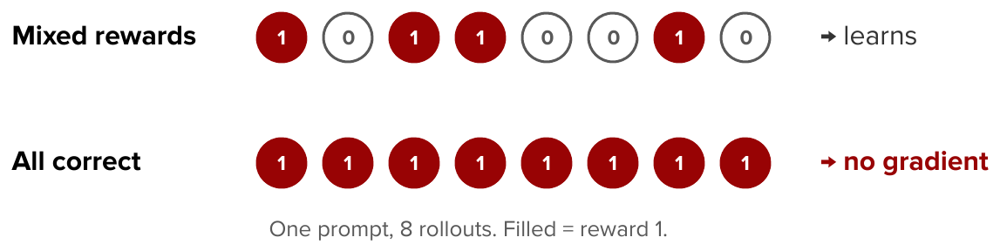
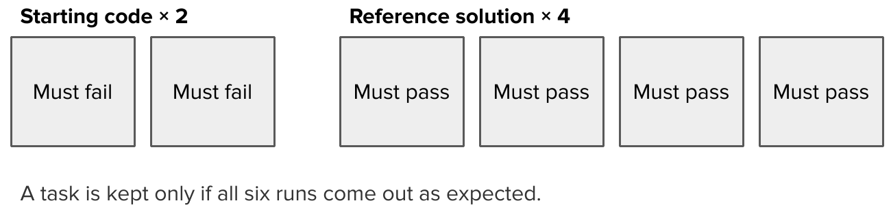

# 第 12 讲｜数据选择与质量

如果手头的预算只够再标十条数据，你会选择十种不同的问法，还是十种不同的失败情形？答案并不固定，它取决于你眼下最想验证什么问题。如果是为了给检索器定位错因，就需要挑选能区分两种猜测的对照样例；如果是为了在上线前估计系统的总体表现，测试集就必须覆盖真实的业务分布。

本讲围绕构建 Agent 数据时的两个核心决定展开：第一，哪些样本值得留下来；第二，怎样确认它们的标签和判分足够可靠。下文将结合 LIMA、tinyBenchmarks 和 SWE-smith 这三类典型实践，说明数据选择如何分别服务于模型训练、快速诊断与独立验收。

## 学习目标

- 理解什么是对系统优化与评测具有最大信息量（Maximally Informative）的数据，掌握基于可验证性、多样性、难度梯度与失败模式的筛选策略。
- 掌握构建“小而精”靶向基准（Tiny-but-targeted Benchmarks）的方法与适用边界，学会让快速开发迭代与全量验收各司其职。
- 掌握高质量数据标注规范（Annotation Practices）与质量评估体系，学会借助一致性指标与分歧对齐流程来校准人类标注者和自动评分器。
- 深入理解如何从原始 Agent 运行轨迹（Traces）与真实代码仓库（如 SWE-smith 管线）出发，构建大规模、经受过执行验证的训练与评测数据集。

## 知识讲解

### 1. 信息量与筛选

开篇我们抛出了“预算只够标十条数据时怎么选”的难题，本节就来解决**如何挑选真正能暴露系统短板、带来最高学习收益的高信息量样本**。我们将从单条样例的因果诊断讲起，一步步过渡到大规模数据的漏斗式过滤，以及如何在有限算力下构造小而精的测试子集。

#### Maximally informative data

**核心原则：让两种可能的解释给出不同的预测。** 这本质上就是做实验时的“控制变量法”。假设你开发了一个馆藏检索助手，它总能搜到标题完全一致的书，但在遇到同义问法或同名版本冲突时却频频出错。为了精准定位到底哪一环出了问题，可以先锁定一本目标图书，固定同一份基线馆藏快照，然后每次只改变一个条件：

| 教学样例 | 这组对照能检查什么？ |
| --- | --- |
| A：用户用正式标题指定新版；库中只有新版。 | 作为基线对照，先确认目标书籍和索引本身都正常工作。 |
| B：保留同一份馆藏，把书名改为读者熟悉的别称。 | 若 A 通过而 B 失败，说明问题大概率出在查询词与索引词的语义匹配上。 |
| C：恢复正式标题，在库中加入同名旧版；用户明确指定新版。 | 若 A 通过而 C 失败，则应优先核对版本元数据解析和结果排序逻辑。 |

如果我们在样例 B 中既把书名换成了别称，又同时往库里塞入了旧版，那么一旦测试失败，你就无法判断到底是“没认出别称”还是“版本排序错了”。由此可见，一条样本的信息量并不是孤立存在的，它取决于你想区分哪几种假设。在实际工程中，简单题依然有价值，可以保留下来做**冒烟测试**（Smoke Test，即每次改完代码后快速确认核心功能没崩的底线检查）；而面对难题时，如果连人工查看题面都缺少作答所需的关键信息，就应该先修正题目本身，再去解释系统的得分，否则得到的只是噪声。

同样的道理也适用于模型训练阶段。在近年来常用的**组内相对奖励**（Group Relative Reward，即让模型对同一道题反复尝试多次，再把这几次结果的得分互相比较，奖励比组内平均分更高的做法）训练策略中，我们还要多问一句：同一道题跑多次，拿到的回报到底能不能拉开差距、区分出好做法和坏做法？下图用各运行八次的例子，直观展示了训练信号从哪里来。

图注：实心圆代表任务成功（得分为 1），空心圆代表失败（得分为 0）。上排既有成功也有失败，模型可以通过组内对比看清哪些动作更有效；下排八次全部成功，回报完全一致，组内相对奖励无法分辨哪次尝试更值得优先学习，也就几乎提供不了有效的优化信号（全失败时同理）。[斯坦福 CS329Z 第 12 讲原课件，第 25 页](https://web.stanford.edu/class/cs329z/slides/lecture12.pdf#page=25)；[Yu 等，DAPO](https://arxiv.org/abs/2503.14476)

#### Filtering and selection

当手里积累了海量原始日志或模型合成的候选数据时，直接全盘拿去训练或评测既费钱又容易引入垃圾噪声。工程上通常会搭建一套像多级漏斗一样的**过滤与精选流水线（Filtering & Selection Pipeline）**，从低成本的粗筛逐层递进到高成本的精筛：

1. **格式与完整性过滤（Syntactic & Structural Filtering）**：先把明显残缺的“坏样本”筛掉，例如输出被截断、JSON 语法损坏、缺少关键环境元数据，或者 Agent 陷入死循环直到超时的轨迹。这一步只需要轻量级规则脚本，成本最低，能先过滤掉大量无效数据。
2. **执行结果与可验证性过滤（Execution & Verifiability Filtering）**：只保留那些在确定性环境或单元测试验证器下真正达成目标的轨迹作为正样本。但光看最终答案对不对还不够，还必须进一步检查**过程合理性**——剔除那些虽然蒙对了最终结果、但中间压根没读取关键证据文档（即证据支撑 Citation Support 缺失）或钻了未授权捷径的“伪成功轨迹”。
3. **语义与轨迹去重（Semantic & Trajectory Deduplication）**：重复样本会让模型死记硬背常见套路，却学不会处理复杂场景。去重需要从两个维度同时入手：
   - **输入层去重**：对用户输入的 Prompt 做 **Embedding 聚类**（把文本转成语义向量，把意思相近的归到一起）或 **MinHash 去重**（一种高效的近似文本查重算法），去掉换汤不换药的重复提问。
   - **动作层均衡**：对 Agent 实际执行的**调用工具组合序列（Tool Call Signatures）**进行分桶统计与均衡采样，避免数据集里 80% 都是“只调一个工具”的简单样本，而真正考验能力的多工具协同轨迹寥寥无几。
4. **难度分层与课程采样（Difficulty Stratification）**：按照任务所需的推理跳数（需要跨多少步才能拼出答案）、涉及的工具数量，或者基准模型在该题上的通过率，把样本清晰地划分为简单、中等、困难三档，再按目标比例均衡抽样，避免训练或评测偏向单一难度。

#### Tiny-but-targeted benchmarks

假设跑完 2,000 道全量测试题需要耗时 4 小时。如果你刚刚修复了一个“相对日期换算”的 Bug，每次改动都等 4 小时显然会拖垮开发节奏；此时先跑一小批题就能很快拿到反馈。不过，**挑哪一小批题，完全取决于你想回答什么问题**。

> [!NOTE]
> **同样只跑一小批题，分数分别能说明什么？**
> - **靶向切片（Targeted Slices）**：专门挑出包含“下周一”、跨月计算等相对日期的题目。在修复前后用同一批切片做对照，能直观看出这类特定错误是否明显减少，但它的分数不能代表系统的整体水平。
> - **代表性子集（如 tinyBenchmarks）**：先观察多个已有模型在全量题上的作答规律，再据此挑选最具区分度的少量题目并分配权重，目标是用极低成本去估算全量基准的总体得分。需要注意它的适用边界：这套权重能否准确迁移到架构或能力分布截然不同的新模型上，仍需定期用全量结果做校验。

简单来说，前者适合日常开发中的高频定向诊断；后者则借助教育测量学中的**项目反应理论（Item Response Theory，IRT）**——通过数学建模同时刻画“题目有多难”和“模型能力有多强”——来大幅降低全量估分的成本。[Maia Polo 等，tinyBenchmarks](https://proceedings.mlr.press/v235/maia-polo24a.html)

> [!TIP]
> **判断依据**：只要团队会根据某份测试集的错题去反复修改系统，这份题集就已经变成了“开发集”，迟早会出现过拟合风险。因此务必另外保留一份从不参与调优的独立测试集，专门用于最终上线前的验收。

### 2. 标注与质量

上一节解决了“选哪些样本”的问题，但即便挑出了信息量最高的题目，如果标签标准含糊不清、自动裁判频繁误判，或者收集到的运行轨迹本身存在漏洞，后续的训练与评测依然会失真。本节聚焦数据质量的把控，依次介绍如何编写清晰的人工标注规范、如何量化评估自动裁判的可靠性，以及如何从真实的 Agent 运行轨迹中构建经受过执行验证的数据集。

#### Annotation practices

无论是构建作为验收准绳的金标准测试集，还是为训练奖励模型和自动评判器准备人类偏好数据，**数据标注质量的上限，往往取决于标注规范（Annotation Guidelines & Rubrics）写得有多清晰**。在组织 Agent 轨迹标注时，建议遵循以下四步工程实践：

1. **将笼统印象拆解为原子判据（Atomic Criteria）**：不要让标注者凭整体感觉给一条很长的运行轨迹打 1–5 分——不同人对“4 分和 3 分的差别”理解千差万别。应该把主观评价拆成一条条客观、可核对的二元判断项（是/否），例如：“回答是否包含了正确的报销上限金额？”、“是否引用了 2026 版现行文档而非 2024 版旧文档？”、“在关键参数缺失时是否主动向用户发起询问？”。
2. **先做小规模试标与分歧复盘（Pilot Annotation & Adjudication）**：在全面铺开标注前，先让多位标注者（强烈建议系统构建者本人也亲自参与）独立标注同一批 20–30 条样本，并计算**标注者间一致性（Inter-Annotator Agreement, IAA）**，常用统计指标包括适用于两位标注者的 Cohen's $\kappa$，以及适用于多位标注者或允许缺失标注的 Krippendorff's $\alpha$（两者都会扣除“纯靠瞎猜碰巧一致”的概率，比单纯算一致率更可靠）。
3. **把分歧视为规格缺陷的信号**：当两位认真的标注者对同一条轨迹给出截然相反的判定时，根源通常不是某一方粗心，而是**题目要求或评分准则留下了未定义的灰色地带**（例如“邮件里只写了下周三，应该按邮件发出时间算，还是按当前查询日期算？”）。正确的做法不是简单少数服从多数，而是把敲定后的边界规则和典型判例补充写回标注指南。
4. **保留“无法判定 / 题目有误”出口**：在标注界面中明确提供异常标记选项，允许标注者指出某道题本身存在环境损坏、信息缺失或逻辑歧义，及时把坏题剔除出数据集，避免强行凑出错误标签。

#### Quality assessment

**当一个自动裁判（例如 LLM-as-Judge）宣称自己有 90% 的准确率时，你能放心直接拿它验收上线吗？** 我们用一组简单的演算数字来看看总体准确率为什么会误导人。假设把“合格回答”定义为正类，下面甲、乙两位裁判评估的是同一批样本：其中 18 条经人工确认为合格，2 条经人工确认为不合格。

| 裁判 | 真正合格的 18 条里放行几条？ | 真正不合格的 2 条里拦住几条？ |
| --- | --- | --- |
| 甲 | 18 | 0 |
| 乙 | 16 | 2 |

单看总体准确率，甲和乙都判对了 18/20，恰好都是 90%。但如果拆开正负两类分别看**真阳性率（True Positive Rate, TPR，即真正合格的样本里有多少被正确放行）**和**真阴性率（True Negative Rate, TNR，即真正不合格的样本里有多少被成功拦住）**，两者的表现天差地别：
- **裁判甲**：真阳性率为 $18/18 = 100\%$，但真阴性率仅为 $0/2 = 0\%$——它实际上是一个“逢题必放行”的橡皮图章，一条坏回答都没拦住。
- **裁判乙**：真阳性率为 $16/18 \approx 88.9\%$，真阴性率为 $2/2 = 100\%$——虽然误拦了 2 条好回答，但把 2 条不合格回答全部拦截了下来。

当你的业务场景最担心“错误答案被放行到用户面前”时，裁判甲看似漂亮的 90% 总体准确率其实完全掩盖了致命缺陷。同时也要注意样本量边界：仅有 2 条负例远远不足以稳定估计下一批数据的表现，工程上需要额外补充独立复核过的负例，并重点排查裁判究竟在哪些具体情形下容易发生误放。

在排查人机分歧时，不要急着直接改提示词。应先让人工复核者写明判定依据，再区分这究竟是**裁判真的判错了**，还是**原本的评判标准写得含混**。每当修订了评判标准，都要把新旧两版裁判放到同一批**未参与标准修订**的独立样本上重新评分，对比它们在误放和误拒上的变化。之所以要这样做，是因为人们往往要看到真实模型输出的千奇百怪的边缘情况后，才会不断细化和调整自己的心理标准——这种现象被称为**评价标准漂移（Criteria Drift）**，而独立复测正是检验标准漂移与裁判对齐效果的关键手段。[Shankar 等，Who Validates the Validators?](https://arxiv.org/abs/2404.12272)

#### 从 Agent traces 建数据集

**在把一条“测试全绿”的 Agent 运行轨迹收进训练集当作修复示范之前，怎样确认这道题本身是可靠可用的？** 必须做双向验证：先确认测试套件在有 Bug 的起始代码版本上确实能报错失败，再确认它在参考修复版本上能够顺利放行。而且每一次运行都必须恢复到完全干净的隔离环境，否则前一次运行残留的临时文件、缓存或依赖状态，很可能会污染下一次的测试结果。

图注：验证流程先看左侧两次，再看右侧四次。只有当六个彼此隔离的干净容器全部跑出预期结果——起始有缺陷代码连续 2 次均失败、参考修复代码连续 4 次均通过——CodeMidas 才会保留这道题。这样做既能排掉一运行就随机波动的不稳定测试（Flaky Tests），也能防止只测参考答案时漏掉“无论代码写什么都能通过”的失效测试。[斯坦福 CS329Z 第 12 讲原课件，第 22 页](https://web.stanford.edu/class/cs329z/slides/lecture12.pdf#page=22)；[Ye 等，CodeMidas](https://arxiv.org/abs/2609.22068)

**那么，像 SWE-smith 这样的自动化管线，具体是怎样从开源代码仓库批量生成修复轨迹的？** SWE-smith（Yang 等，2025）采用了一种巧妙的“反向构造”思路：先为真实的 Python 代码仓库搭建好可执行的容器环境，再利用仓库里原本就能跑通的单元测试，往正常代码里反向注入会触发测试失败的改动（相当于人工造出真实、可验证的 Bug），从而批量生成软件修复任务。随后让 Agent 在这些任务上尝试修复，并在采集轨迹时完整保存仓库快照、问题描述、每一步工具动作、最终生成的补丁以及验收测试结果，确保每一条轨迹事后都能被精确重放与核查。[Yang 等，SWE-smith](https://arxiv.org/abs/2504.21798)

举个具体例子：假设某个日期格式化函数被反向改坏了，系统会先确认同一组测试在原始代码上通过、在改坏的版本上失败，然后才把任务交给 Agent 去修。拿到 Agent 的成功轨迹后，还不能直接入库，必须复核补丁的改动范围（例如确认它没有偷偷删改测试文件来“作弊过关”），确认无误后才能把通过原验收条件的轨迹收录为候选正示范。最后，在划分数据集时有一条至关重要的防泄露边界：如果你的目标是评估模型在**全新代码仓库**上的泛化能力，就必须**按仓库级别**切分开发集与测试集，避免同一份源码或同一个修复模式的细微变体同时出现在训练和测试两边。

## 原课程阅读清单与导读

- [Yang et al. "SWE-smith: Scaling Data for Software Engineering Agents." NeurIPS D&B (2025).](https://arxiv.org/abs/2504.21798)
  导读：重点关注作者如何利用现有单元测试、通过“反向注入破坏性修改”来低成本合成海量可验证的编程任务，以及后续如何通过执行验证过滤 Agent 采样轨迹，将其转化为高质量的微调数据。
- [Shankar et al. "Who Validates the Validators? Aligning LLM-Assisted Evaluation with Human Preferences." UIST (2024).](https://arxiv.org/abs/2404.12272)
  导读：重点理解“评价标准漂移（Criteria Drift）”现象——为什么开发者在真正看到模型输出之前，几乎不可能一次性写全所有评分细则，以及论文提出的人机迭代对齐流程如何让代码断言和 LLM 裁判逐步贴近人类真实判断。
- **拓展阅读**：[Zhou et al. "LIMA: Less Is More for Alignment." NeurIPS (2023).](https://arxiv.org/abs/2305.11206)
  导读：结合本讲的筛选思路去思考：在模型微调与示范选择中，为什么仅仅 1,000 条经过人工精选、风格统一且推理严密的高质量样本，就能在对齐效果上击败数万条未经筛选的嘈杂数据。

## 动手练习

1. **高信息量诊断切片构建**：围绕 HW1 的邮件问答（`email_qa`）与文档检索（`search_docs`）两个任务，设计一个仅含 6 道题的微型靶向诊断集（Micro-benchmark），每道题精准检验一种独立能力或失败模式：（a）单跳精确词匹配、（b）两跳跨邮件人员关联、（c）被新政策废止的旧政策干扰、（d）词面完全无重叠的同义改写查询、（e）文档正文里夹带提示注入指令、（f）问题所问信息在知识库中根本不存在。请为每道题写明入选理由、需要控制的无关变量，以及系统应当给出的期望标准行为。
2. **标注一致性与评分器校准实验**：针对练习 1 设计的 6 道题，先编写一套包含 3 条原子判据（二元是/否核对项）的评分量表（Rubric）；接着人工构造 10 份包含微妙缺陷的候选回答（例如数值计算正确但引用了已作废的旧文档 ID，或者主答案正确却凭空多补了一句无关推测）。分别使用你编写的 LLM-as-Judge 提示词和人工盲评对这 10 份回答逐一打分，计算裁判的真阳性率（TPR）与真阴性率（TNR），再针对人机分歧案例分析错因并迭代修改 Judge 提示词，最后用新提示词重新验证改进效果。
