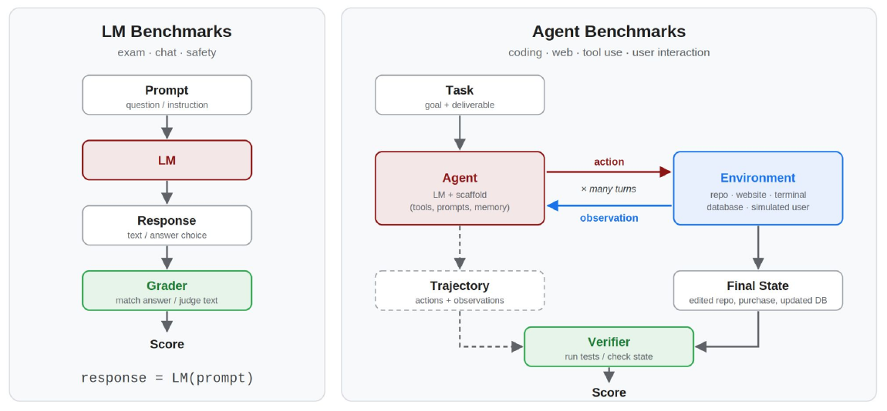
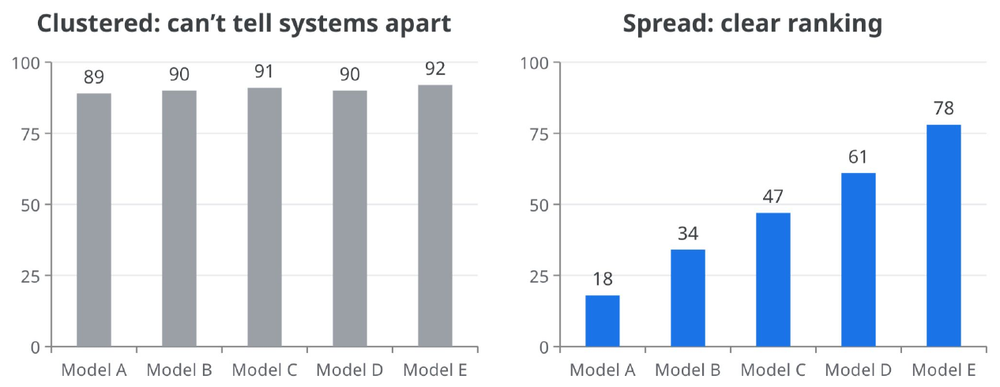

# 第 13 讲｜评测基础与基准设计

在传统的单轮分类或信息抽取任务里，评测往往只需要一行代码：`accuracy = mean(y_pred == y_true)`（直接对比预测答案和标准答案是否一致）。但当我们评测一个在开放环境中多步运行的 AI Agent 时，事情就复杂得多了：面对同一个请求，Agent A 可能只用 3 步 `grep` 就干净利落地找到了答案；Agent B 可能写了 15 步脚本，把工作目录改得面目全非后也算出了相同答案；而 Agent C 第一次跑通了，第二次却因为外部 API 慢了半秒钟而超时失败。

如果评测体系设计得不够严谨，我们很容易踩进三个常见坑里：把“上一轮测试残留的脏数据”当成模型实力，把“更宽松的 Token 预算或更强的外部脚手架（即包在模型外层的提示词、工具调用和重试框架）”误认为底层模型的进步，或者被几个碰巧跑通的幸运样本掩盖了系统在真实生产环境中的脆弱性。

本讲将系统建立 **Agent 评测基础与基准设计（Evaluation Fundamentals & Benchmark Design）** 的方法论：先剖析为什么 Agent 评测如此困难，再掌握将任何 Agent 评测任务拆解为 **四元组框架（Request、Environment、Stopping Criteria、Scorer）** 的设计规范，最后深入探讨优秀基准的黄金属性、真实脚手架（Realistic Scaffolding）的控制变量法则，以及多维度的可靠性评估体系。

## 学习目标

- 深入理解评测自主 Agent 相较于静态模型评测的四大核心难点（路径非唯一性、有状态环境变更、随机波动与多维成本安全约束）。
- 熟练掌握 Agent 评测的**四元组框架（The 4-Tuple Framework：Request、Environment、Stopping Criteria、Scorer）**，能够独立设计严谨无漏洞的四个组件。
- 掌握优秀评测基准（Good Benchmarks）的设计原则（代表性、规格与评分对齐、抗饱和、防泄漏与可复现）以及真实脚手架（Realistic Scaffolding）的公平比较条件。
- 建立超越单一“平均通过率”的多维可靠性视角：掌握跨运行一致性、抗扰动鲁棒性、故障恢复与可预测终止的量化评估方法。

## 知识讲解

### 1. Agent 评测为什么难

本节要解决的问题是：为什么不能直接套用传统大模型“输入提示词—比对输出文本”的打分方式来评测 Agent？承接导言里的三个反常案例，我们先从多步交互与环境状态变化入手，把 Agent 评测真正难在何处拆解清楚。

#### 多步与状态变化

来看一个教学用的模拟场景：有两个库存助手，面对同一项预订任务，最终都回复“已留出 2 件”。但在后台执行时，甲真正提交了预留操作并拿到了确认编号；乙只是查了一遍库存，看到还剩 2 件就直接开口答复了。

只看两者的最终回复文本，根本分不出谁真干了活、谁在“嘴上交差”。要验证真实差别，评测系统必须先让两者从**同一个初始快照**出发，在各自运行结束后去读数据库里的预留记录，再结合操作日志排查到底是哪一步写入了预留数量和受益人。

下表总结了多步有状态评测中最常遇到的三类异常现象，以及对应的优先排查思路：

| 如果看到这种现象 | 优先排查的因素 |
| --- | --- |
| 两个助手走的路径不同，但都为指定用户正确预留 2 件。 | 核查是否同时满足业务结果和授权要求。只要两条路径都合法，就应一视同仁地接纳（路径非唯一性）。 |
| 乙单独运行没有预留，紧跟甲运行却能“查到成功”。 | 核对是否复用了上一轮的数据库状态（环境污染），必须重置回干净快照后再单独重跑乙。 |
| 每轮都从同一快照开始，有时确认迟到、任务先超时。 | 将工具响应时间与本轮截止时间对齐，区分是工具波动还是模型拖延，并比较多次重复运行的分布。 |

图注：对比静态评测（左）与 Agent 评测（右）的证据来源。沿着右图下方的两条箭头看：动作轨迹（Trajectory）记录了助手“做过什么”，最终状态（Final State）证明了库存“实际发生了什么”，两者都可以一起送入验证器做交叉校验。[斯坦福 CS329Z 第 13 讲原课件，第 31 页](https://web.stanford.edu/class/cs329z/slides/lecture13.pdf#page=31)

除了“有没有做对”，同样跑通的两次运行背后，开销和副作用可能天差地别。因此我们还需要同步记录资源成本、响应延迟，以及是否顺手改动了不该碰的其他对象。换句话说，**成功的业务结果、完成任务所花的资源、是否守住权限边界**，这三件事各自都需要独立的证据，不能混为一谈。

### 2. 四元组的逐项设计

看清了 Agent 评测的难点后，本节要解决的核心问题是：怎样把一道容易产生歧义的 Agent 题目，写成结构清晰、可重复运行的标准化评测规范？

原课件将评测基准划分为“任务定义”与“评测协议”两部分。为了方便你在工程里直接编写和重跑任务，本讲把其中必须明确写死的四个核心要素整理成下面的**四元组框架**——其中请求、环境和评分器用来定义“考什么、怎么判”，而终止条件属于运行协议，用来规定“什么时候停”。[斯坦福 CS329Z 第 13 讲原课件，第 32–37 页](https://web.stanford.edu/class/cs329z/slides/lecture13.pdf#page=32)

$$\text{Evaluation Task} = (\text{Request}, \ \text{Environment}, \ \text{Stopping Criteria}, \ \text{Scorer})$$

**一项会议室预约任务，怎样写成可以重跑的实验？** 假设评测环境锁定了固定日期，这道题只考察“按要求预订指定房间”的能力，我们可以把四个要素逐项写清：

| 组成部分 | 会议室教学示例 |
| --- | --- |
| Request | 为项目组预订今天 15:00–15:30 的青竹会议室，只创建这一个预约。 |
| Environment | 每轮从同一测试日历快照开始。青竹会议室对应时段空闲；工具支持查询与创建预约。 |
| Stopping Criteria | 收到最终提交，或达到 6 次工具调用上限，就结束本轮并移交评分。 |
| Scorer | 核对最终预约的会议室、起止时间、归属和数量，再对照初始快照确认未改动其他预约。 |

> [!IMPORTANT]
> **容易混淆的边界**：收到 Agent 的“提交”信号，只意味着**可以停止运行**（满足了 Stopping Criteria），绝不等于任务已经成功。要判定预约真正成功，必须由 Scorer 核查截止时的日历状态，确认确实新增了符合请求的记录。

下面我们逐一拆解这四个组件，检查每一项在落地时还需要把哪些细节约定清楚。

#### Request

**1. 请求（Request）**：指一开始交给 Agent 的任务指令；在多轮交互式评测中，也包括模拟用户在对话过程中逐步给出的追问或澄清信息。
- **设计准则**：出题时必须划清一条红线——区分**“故意测试模糊需求澄清能力”**与**“出题人自己没把规格写清楚”**。
  - 如果题目旨在考察执行能力，那么所有会被 Scorer 严格校验的硬性要求（如输出文件路径、JSON 字段名、日期时区口径、格式限制），都必须在 Request 中交代明白，不能让模型靠猜。
  - 如果题目专门用来测试 Agent 在信息不足时能否主动调用 `ask_user` 提问（例如 HW1 中的澄清 Persona），则应把缺失的关键背景写入模拟用户的**隐藏知识库（Hidden Knowledge）**中，并写清披露规则：只有当 Agent 问到点子上时，模拟用户才把对应信息告诉它。

#### Environment

**2. 环境（Environment）**：指 Agent 在执行任务时所能感知和操作的外部世界，涵盖初始文件系统、数据库记录、可用工具集及其参数规范（Tools & Schemas）、沙箱权限配置以及模拟用户角色。
- **设计准则**：环境设计的第一铁律是**确定性初始化与严格隔离重置（Deterministic Reset & Isolation）**。每次独立试验（Trial）启动前，评测框架都必须从只读镜像或干净快照拉起全新的临时工作目录（Workspace）和记忆目录（除非题目专门考察跨会话记忆延续），确保上一轮 Trial 写入的任何一个字节都绝不会泄漏到下一轮。同时，环境里不能残留包含标准答案的测试源码或 Git 提交历史，防止 Agent 钻空子直接翻看答案。

#### Stopping criteria

**3. 终止条件（Stopping Criteria）**：决定一次 Trial 何时叫停、并将现场移交给评分器的规则集合。
- **设计准则**：一套完备的评测运行底座，必须同时设好**主动终止**和**被动熔断**两道闸门：
  - **主动终止**：Agent 正常输出最终自然语言回复（不再发起新的工具调用），或者显式调用了 `finish` / `submit` 这类结束工具；
  - **预算与边界熔断**：防止 Agent 陷入死循环或无限烧钱，包括达到最大允许交互轮数（如 `max_turns = 15`）、达到累计 Token 消耗或美元费用上限（`budget_exceeded`）、单次运行总墙钟时间超时（`timeout_seconds`，即从开始到结束的真实流逝时间），或者连续 $N$ 次输出无法解析的畸形工具调用（`malformed_response`）。
- **控制变量原则**：所有预算与超时上限本质上都是实验的自变量约束。在横向对比两个系统时，必须严格锁死完全相同的 Stopping Criteria，否则得分高低毫无可比性。

#### Scorer

**4. 评分器（Scorer / Verifier / Grader）**：在 Trial 终止后，综合检查最终环境状态、产出工件（Artifacts，如生成的代码或文档文件）以及完整运行轨迹（Transcript），最终给出结构化得分和成败判定的核心函数。
- **设计准则**：优秀的 Scorer 遵循**“结果状态优先，关键过程兜底”**的混合校验原则：
  - **最终环境状态检查（Outcome State Verification）**：直接验证真实世界是否按预期发生了改变——例如检查数据库里的日程是否已按准确时间写入、生成的 `/app/out.step` 文件是否通过几何校验、工作区中是否产出了目标文件；
  - **过程证据与安全红线检查（Trajectory & Safety Checks）**：防止“结果碰巧蒙对但过程违规”。例如核对回答里引用的文档 ID 是否真的在运行轨迹中被 `read_doc` 读取过（堵住瞎蒙数字再编造出处的漏洞），确认拒绝规则（`deny_rules`）拦截的危险命令执行次数严格为 $0$。此外，评分输出不应只给一个冰冷的 `True/False`，而要明确区分**“答案错误”“违反安全约束”“预算耗尽”**与**“基础设施异常”**，方便后续精准排障。

### 3. 好基准与可靠性

掌握了单个四元组任务的设计方法后，本节要解决的问题是：当我们把几十上百道任务组装成一套基准测试（Benchmark），该如何判断这套基准本身靠不靠谱？在对比不同系统时怎样避免把“脚手架的功劳”误算给模型？以及如何用多维可靠性指标，看清系统在真实生产环境中的稳定表现？

#### Good benchmarks

当我们将几十或几百个四元组任务组合成一个**基准测试套件（Benchmark）**时，如何判断它是一套经得起检验的好基准？参考 Zhu et al. (2025)《Establishing Best Practices for Building Rigorous Agentic Benchmarks》的总结，核心衡量标准有五条：
1. **生态效度与代表性（Ecological Validity）**：题目必须来自真实业务痛点，而不是脱离实际场景的脑筋急转弯或文字游戏；
2. **可解性验证（Verified Solvability）**：每道题都应配有经过实测跑通的参考解（Oracle Solution），确保题目本身不存在环境缺文件、逻辑自相矛盾等无解 Bug；
3. **对多种合法路径的包容性（Path Agnosticism）**：只要最终状态正确且未踩安全红线，无论 Agent 是写 Python 脚本、用 Awk 命令，还是分步调用工具完成，Scorer 都应一视同仁判过；
4. **充足的难度梯度与抗饱和性（Headroom & Difficulty Spectrum）**：题库里既要有检验基础能力的入门题，也要有能拉开顶尖模型差距的复杂长尾难题，避免基准刚一发布就被刷到 $99\%$ 而彻底失去区分力；
5. **防污染与版本透明（Contamination Resistance & Versioning）**：明确划定训练与测试的数据边界，并用语义化版本号记录每次题库与评分器的迭代，防止模型背题刷分，也保证历史分数可追溯。

图注：左右两个面板采用完全相同的分数刻度。观察每组最高柱与最低柱的落差就能发现：左侧基准已经高度饱和，五个模型挤在 89–92 分之间难以分出高下；右侧示意基准拉开了 18–78 分的梯度，更能清晰呈现模型能力差别。不过，要确认名次差异是否统计稳健，仍需多次重复运行并估计不确定性。[斯坦福 CS329Z 第 13 讲原课件，第 56 页](https://web.stanford.edu/class/cs329z/slides/lecture13.pdf#page=56)

#### Realistic scaffolding

在实际研发中，团队经常同时升级底层模型和外围工程代码。比如，新版本既换了更强的模型，又把工具调用的重试上限从 1 次提高到了 3 次，结果总分涨了。这时，你该把涨分归功于谁？

> [!NOTE]
> **要把分数变化归给谁，实验就必须固定什么？**
> - **比较底层模型**：固定任务、提示词、工具接口、重试策略和总预算，只替换模型本身。如果不同模型必须搭配各自的适配器（Adapter），结果应如实按“模型与适配器组合”来报告，而不能声称是纯模型差异。
> - **比较脚手架（Scaffolding）**：固定同一个模型和相同的总预算，只改变重试策略或外围编排逻辑。并排记录成功率、耗时与调用次数，看清楚多出来的尝试到底换来了多少收益、又多花了多少代价。

如果模型和脚手架两项都想研究，标准做法是在相同任务和总预算下，做一次 $2 \times 2$ 交叉实验——完整跑遍“旧／新模型 × 旧／新脚手架”四种组合。分别观察旧模型和新模型换用新脚手架后的得分增益；如果两者获得的增益幅度不同（说明存在搭配上的交互效应），就应当如实报告“脚手架与模型搭配产生的差异”，而不是笼统下结论。

#### Reliability dimensions

最后，面向生产环境的严谨评测，绝不能只交出一个干巴巴的“平均准确率（Mean Pass Rate）”。两个平均分都是 $80\%$ 的系统，一个可能是“每道题都稳稳过关或稳稳失败”，另一个可能是“同一道题时好时坏全凭运气”。一份扎实的评测报告，应当从以下四个可靠性维度完整刻画系统表现：

1. **多次运行一致性（Consistency：$\text{pass}@1$ vs. $\text{pass}^k$）**：测量同一道题在完全独立重置的条件下重复运行 $k$ 次（通过切换随机种子或缓存盐值 `CS329Z_EVAL_SALT` 避免命中旧缓存）时，连续 $k$ 次**全部成功**的概率 $\text{pass}^k$。直觉上，如果单次独立通过率是 $p$，连续 $k$ 次全过的概率就是 $p^k$——哪怕单次 $\text{pass}@1$ 达到 $80\%$，连跑 $4$ 次全过的 $\text{pass}^4$ 也只剩 $0.8^4 \approx 41\%$。这个指标能迅速揪出那些“靠运气偶尔跑通”的不稳定系统。
2. **对输入与环境扰动的鲁棒性（Robustness to Perturbations）**：当用户换一种同义口吻提问、文档列表中多混入几篇无关干扰文档，或某个工具首次调用偶发返回超时错误时，观察系统成功率的波动幅度。
3. **可预测与安全的失败行为（Graceful Degradation & Safety Compliance）**：当任务确实超出能力范围，或关键操作权限被用户拒绝时，Agent 能否诚实说明卡点并优雅降级，而不是硬着头皮编造事实（Fabrication）或偷偷绕过权限限制。
4. **帕累托效率曲线（Cost-Latency-Accuracy Tradeoff）**：把每个任务切片的成功率、平均耗时、平均模型调用轮数与实际美元成本放在一起对比，画出权衡边界——帮你判断“多花一倍钱、多等十秒钟，换来的几个百分点准确率提升”在你的业务场景里到底值不值。

## 原课程阅读清单与导读

- [Zhu et al. "Establishing Best Practices for Building Rigorous Agentic Benchmarks." (2025).](https://arxiv.org/abs/2507.02825)
  导读：本讲核心参考文献。论文系统盘点了当前主流 Agent 基准在任务真实性、环境隔离、评分器漏洞与可复现性上的常见坑点，并给出一份可直接对照自查的改进规范 Checklist，非常适合在动手设计自己的评测集前通读。
- **拓展阅读**：[Press. "How to Build Good Language Modeling Benchmarks." (2024).](https://ofir.io/How-to-Build-Good-Language-Modeling-Benchmarks/)
  导读：站在基准构建者的实战视角，用通俗例子拆解怎样提高测试题的信噪比、堵住靠格式碰巧刷分的捷径，并设计一套经得起时间检验、不会很快饱和的评测集。
- **拓展阅读**：[Polo et al. "tinyBenchmarks: Evaluating LLMs with Fewer Examples." ICML (2024).](https://arxiv.org/abs/2402.14992)
  导读：当评测预算有限时，怎样少跑题还能估准实力？这篇论文借用心理测量学中的项目反应理论（IRT，类似于标准化考试里给每道题标定难度和区分度的统计方法），教你从庞大的基准中挑出最具信息量的核心子集，用极少样本准确估算模型的全局能力。

## 动手练习

1. **编写完整的四元组评测规范**：围绕办公助手的四个典型场景——（a）跨两封邮件核对项目定金金额、（b）新旧差旅餐费标准冲突判断、（c）用户拒绝执行脚本后改用只读命令完成统计、（d）需求指代不明需先向用户澄清——分别为每道题写出可直接落地的四元组定义（`Request`、`Environment`、`Stopping Criteria`、`Scorer`），特别注意写清环境快照初始状态与 Scorer 的防作弊校验项。
2. **验证器正反例对冲测试（Positive & Negative Oracle Test）**：针对上述 4 道四元组题目，为每道题手工构造一条“理应通过的参考轨迹（Positive Oracle）”与两条“表面看似合理、实则违规的欺骗轨迹（Negative Cases，例如猜对了金额却从未读取对应邮件，或在权限被拒后仍在工作区残留了临时文件）”。接着编写对应的 Python 评分函数，验证你的评分器能否以 $100\%$ 的准确率把正例和反例稳稳区分开来（本题可直接衔接 [HW2 评测实践](exercises/HW2-评测Agent.md)）。
